# nano_j2me

**English** | [简体中文](README.zh-CN.md)

[](https://github.com/lucinhu/nano_j2me/releases/latest)
[](LICENSE)
[](docs/VERIFICATION.md)
[](tools/run_sanitized_tests.sh)
[](#design-commitments)

<p align="center">
  
</p>

A J2ME (CLDC 1.1 / MIDP 2.0) runtime written in portable C99. It runs the `.jar`
games written for feature phones on a PC, a phone, a microcontroller, or a web
browser — the same runtime everywhere, with one small `nj_port` per platform.

- **The whole phone, not a subset.** CLDC 1.1 bytecodes including `long`,
  `double`, exceptions, `synchronized` and `jsr`/`ret`; MIDP 2.0 LCDUI and game
  APIs; RMS, JSR 75 files, JSR 135 media, JSR 184 M3G, Mascot Capsule Micro3D,
  JSR 82 Bluetooth discovery and JSR 256 sensors.
- **No dependencies.** `cc` and CMake are enough. No C++, no JVM, no libc
  requirement for freestanding builds, no zlib/libpng/libjpeg — DEFLATE, PNG,
  JPEG, GIF, WAV, AMR-NB, MP3, MIDI, H.263 and MPEG-4 Part 2 are in-tree.
- **Small and embeddable.** Everything OS-specific is one `nj_port` implementation
  (about ten callbacks). The runtime keeps zero mutable global state; several VMs
  can coexist in one process, and `nj_vm_destroy()` returns the bytes it released.
- **Verifiable.** 190 registered tests pass under `ctest`; 398 of the 400 real-game
  corpus titles run; every claim below is checked by a test, a gate or a
  recorded playback.

## Screenshots

**Desktop (SDL2)** — the game plus the twelve-key phone pad the port draws itself.

<p>
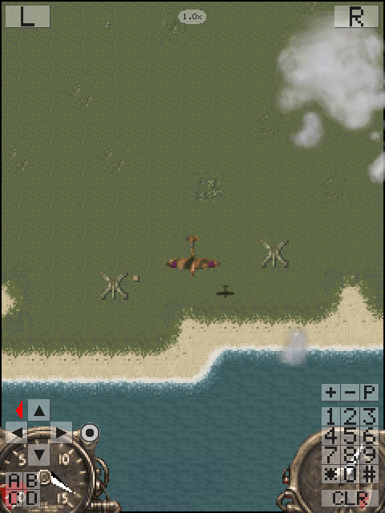
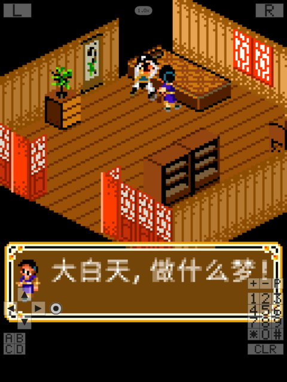
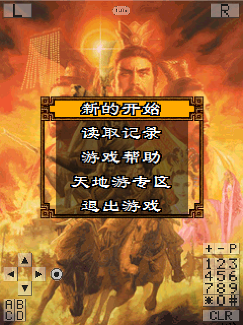
</p>

**Desktop client** — with no JAR argument the SDL2 build opens a library of the
games in your games directory: icons and names come from the MIDlet itself,
search, recents, favourites, key rebinding and a settings page included.

<p>
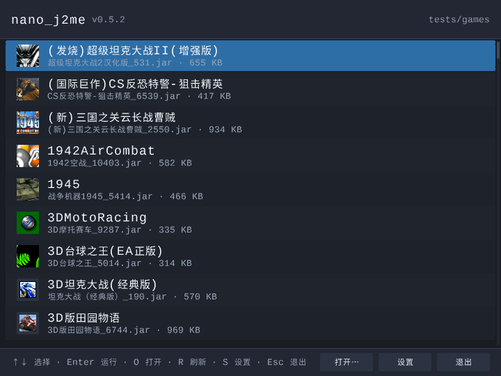
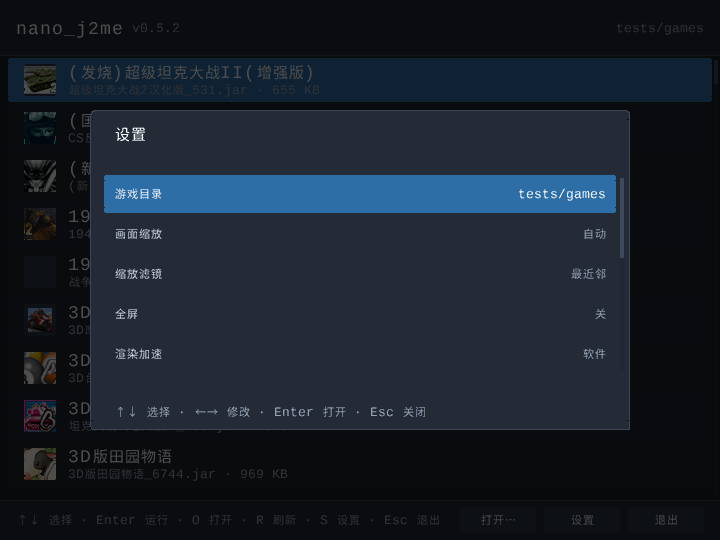
</p>

**Browser (WebAssembly)** — the same runtime as an Emscripten module with a
dependency-free shell: drag in `.jar` files, play with keyboard or on-screen
keypad, sound, three save states per game, all stored locally in IndexedDB.

<p>
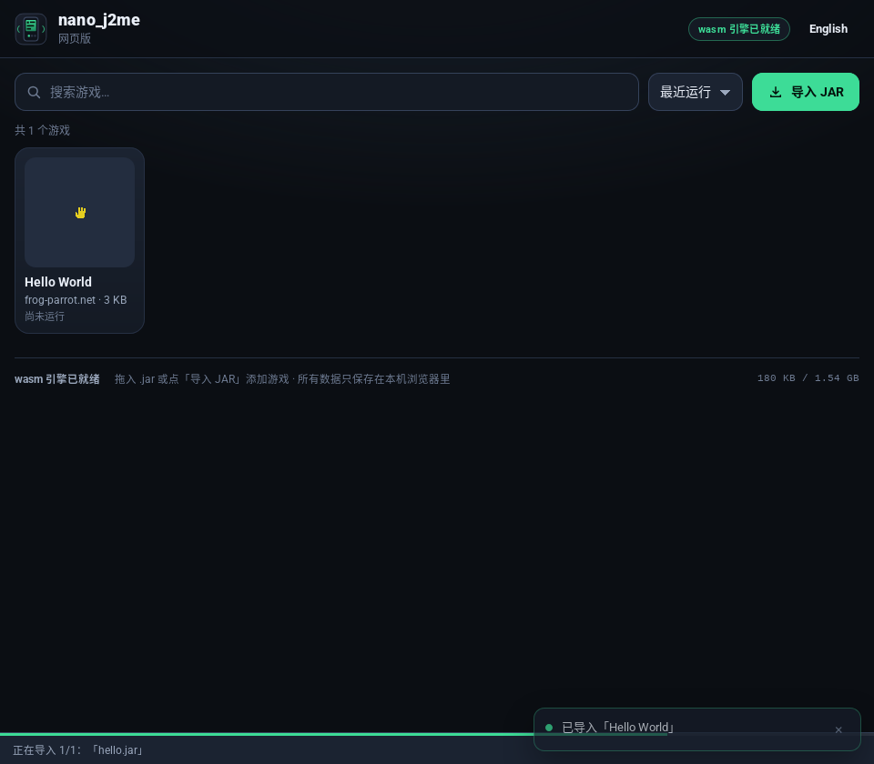
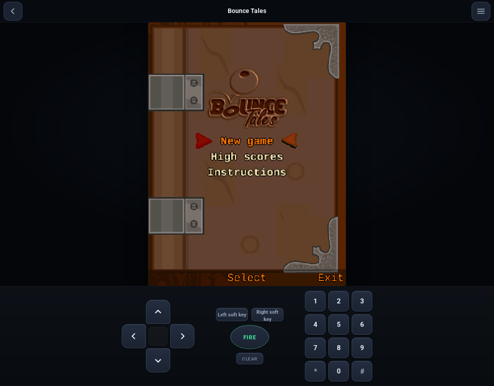
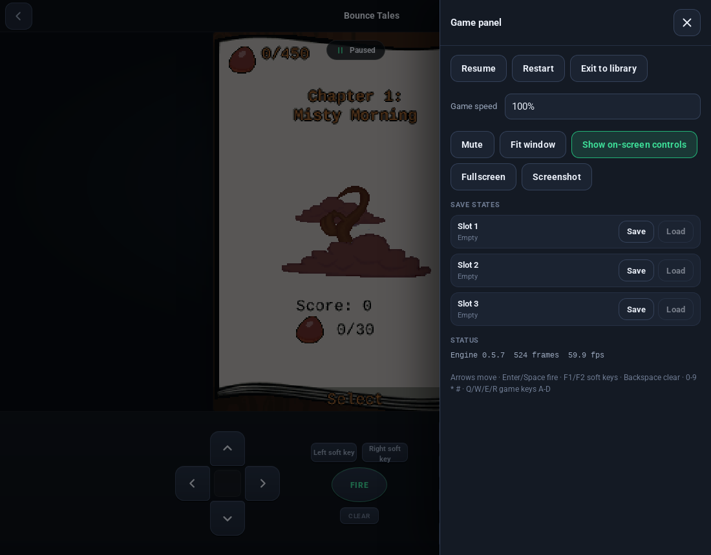
</p>

**Android, RetroArch and ESP32-S3** — the same core on a phone launcher, as a
libretro core, and on a real 240 MHz Xtensa part.

<p>
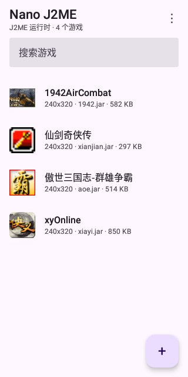
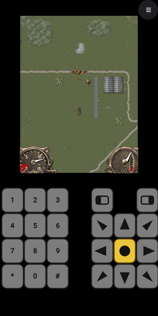
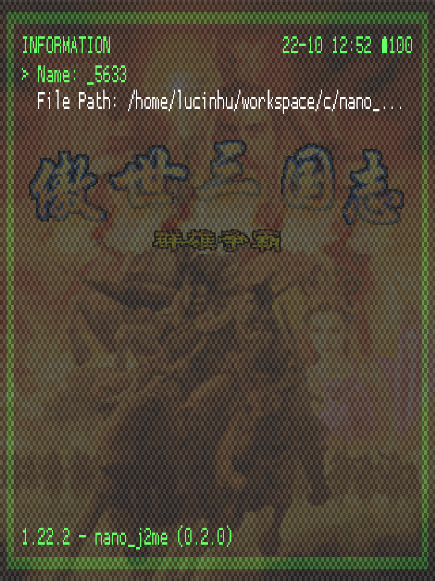
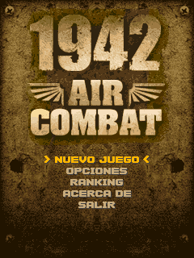
</p>

**3D and video** — JSR 184 M3G (Minecraft PE), Mascot Capsule Micro3D, and an
MPEG-4 intro movie with its own AMR-NB track.

<p>
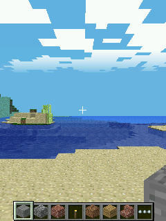

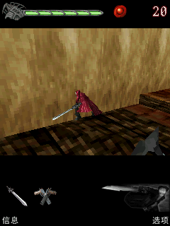
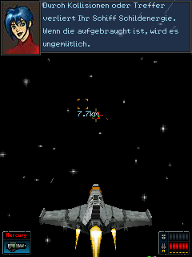
</p>

## Platforms

| Target | What you get |
|---|---|
| **Linux** x86_64 / aarch64 | CLI runner and the SDL2 desktop client; builds for glibc 2.17+ |
| **Windows** x86_64 | `nj2me.exe` (mingw-w64): console runner plus the same library client, UTF-8 paths, verified under Wine |
| **Android 5.0+** | one APK for arm64-v8a / armeabi-v7a / x86 / x86_64: launcher, floating keypads, AAudio/OpenSL ES sound |
| **Android 2.x legacy** | ARMv5 `armeabi` edition with a lightweight launcher — see [docs/ANDROID_LEGACY.md](docs/ANDROID_LEGACY.md) |
| **Web browsers** | Emscripten module plus a dependency-free ES-module shell — see [docs/WEB.md](docs/WEB.md) |
| **RetroArch / libretro** | native cores for Linux (x86_64, aarch64, armv7) and Android (arm64, armv7, x86_64) |
| **ESP32-S3 / ESP32-C3** | full runtime and MIDlet on an ESP-IDF board (PSRAM required for the VM) |
| **headless** | the reference port used by the test suite, for embedding and CI |

On Arch Linux the AUR packages install the desktop client, the static library and
headers, the libretro core and a desktop entry:

```sh
yay -S nano-j2me        # releases; nano-j2me-git tracks master
```

## Building

```sh
cmake -S . -B build -G Ninja
cmake --build build          # a few seconds, no dependencies
```

`build/nj2me` is the SDL2 desktop client when SDL2 is installed, the console
runner otherwise. The libretro core is built by default as
`build/libretro/nano_j2me_libretro.so`; `-DNJ_BUILD_LIBRETRO=OFF` turns it off.

To run the test suite, generate its fixtures once (a JDK and Pillow are needed;
the fixtures are ~1 MB of regenerable data):

```sh
cmake --build build --target nj_fixtures
ctest --test-dir build --output-on-failure     # 190 tests
```

The fixture step is separate on purpose: a plain `cmake --build` stays a compile
with no network and no Java. `-DNJ_GENERATE_FIXTURES=ON` makes it automatic.

## Running a game

```sh
build/nj2me game.jar                    # SDL2 client, or the console runner
build/nj2me                             # library window (no JAR argument)
build/nj2me --port headless --dump-frames out/ game.jar
```

Keyboard: arrows are the D-pad, `Enter`/`Space` fire, `F1`/`F2` the soft keys,
`Backspace` clear, digits and `*`/`#` the phone pad, `F12`/`Tab` the on-screen
keypad, `F11` fullscreen, `F10` back to the library. A gamepad works as a
first-class controller. Text can be drawn with a TrueType file instead of the
built-in bitmap faces (`--font <ttf>`); a malformed file is a warning, not a
failure.

Some titles check which handset they are on. A built-in profile answers as a
real phone, identity properties included:

```sh
build/nj2me --list-devices
build/nj2me --device nokia6230 game.jar
build/nj2me --prop microedition.platform=Nokia6230/05.50 game.jar
```

## Web version (WebAssembly)

The same runtime compiles to WebAssembly with Emscripten. There is no
server-side emulation and no pthreads: the interpreter is driven one frame per
`requestAnimationFrame` through a virtual clock, so any static file host is
enough, and imported games never leave the browser.

```sh
tools/emsdk_setup.sh                    # once: installs the SDK into .local-tools/
tools/build_web.sh                      # -> build/web/ (shell + nj2me.js + nj2me.wasm)
python3 -m http.server -d build/web 8000
```

Open `http://localhost:8000/`, drop a `.jar` in, play. The shell keeps the game
library, save files and up to three save states per game in IndexedDB. The
JavaScript⇄C API, persistence layout and limits are in
[docs/WEB.md](docs/WEB.md); the harness (`tools/check_web.sh --all`) runs the
Node API tests, a 41-title corpus and a real-Firefox page test.

## Other builds

```sh
tools/build_android.sh                  # Android APK (standard edition)
tools/build_android_legacy.sh           # Android 2.x legacy APK
tools/build_windows.sh                  # Windows x86_64 zip (downloads SDL2 mingw)
tools/build_libretro_cores.sh --list    # cross-built libretro cores
```

Load the libretro core in RetroArch as **Mobile - J2ME (nano_j2me)** and pick a
`.jar`; controls, core options and save locations are in
[docs/LIBRETRO.md](docs/LIBRETRO.md). For the ESP32-S3 see
[docs/PORTING.md](docs/PORTING.md) and `tests/embedded/idf/`; the port is
exercised under Espressif's `esp-emu` with `tools/run_esp_emulator.sh`.

Optional accelerators stay off by default: a port-side GLES2 2D backend and
M3G/ Micro3D fragment path (`NJ_BUILD_GLES2_ACCEL=ON`, see
[docs/GLES2_BACKEND.md](docs/GLES2_BACKEND.md) and
[docs/GLES2_3D.md](docs/GLES2_3D.md)), and JIT backends for RV32/ARM64
(`NJ_ENABLE_JIT=1`, see [docs/JIT.md](docs/JIT.md)).

## Status

The runtime implements the parts old games actually use, and the gates keep it
that way:

| Area | State |
|---|---|
| CLDC 1.1 VM: class-file parser/linker, interpreter, arena heap + mark & sweep GC, green threads and monitors, exceptions | complete |
| `java.lang`, `java.util`, `java.io`, RMS, JSR 75 `FileConnection` | complete |
| MIDP 2.0 LCDUI and `lcdui.game` (Canvas, GameCanvas, TextBox, forms, lists, alerts, sprites, tiled layers) | complete |
| JSR 135 media: tones, MIDI, WAV, AMR-NB, MP3, H.263 and MPEG-4 Part 2 video players | complete |
| JSR 184 M3G: scene graph, `.m3g` parser, animation, skinned meshes, camera/light/fog, software rasterizer | complete |
| Mascot Capsule Micro3D v3: figures, command lists, affine/parallel/perspective projections | complete |
| Networking: `http(s)://` and `socket://` via portable port hooks; Bluetooth discovery and JSR 256 sensors | complete where a port supplies the radio |
| Software rasterizer, bitmap fonts, image decoders, DEFLATE/ZIP | complete |
| Execution engines | interpreter, plus opt-in RV32/ARM64 JITs |

Compatibility is measured, not claimed: of the 400-title corpus in
[docs/CORPUS.md](docs/CORPUS.md), **398 run**; the two failures are the titles'
own (a truncated JAR and a licence check). Per-platform results, the
test ledger and known limits are in
[docs/PLATFORM_SUPPORT.md](docs/PLATFORM_SUPPORT.md) and
[docs/VERIFICATION.md](docs/VERIFICATION.md).

## Design commitments

- **Pure C99, zero dependencies.** No C++, no libc requirement
  (`-DNJ_USE_LIBC=0`), no external decoder libraries.
- **Zero mutable global state.** All state belongs to an `nj_vm`.
  `tools/check_no_statics.sh` fails the build if any object file defines a
  writable symbol.
- **One file to port.** `include/nj2me/nj_port.h` is the entire OS surface; a
  new platform is a new `nj_port`, nothing else.
- **Correct first, then small.** The interpreter handles the instructions small
  JVMs skip on purpose — `long`, `double`, `synchronized`, `jsr`/`ret` — because
  old games use them.

## Repository layout

```
include/nj2me/      public headers; nj_port.h is the porting contract
src/core/           VM: heap, class loader, interpreter, threads, app, save states
src/midp/           class library: LCDUI, game, RMS, media, M3G, Micro3D, io, util
src/gfx/            software rasterizer, fonts, PNG/JPEG/GIF codecs
src/zip/            DEFLATE and the ZIP/JAR reader
src/port/           headless, SDL2, Android, libretro, ESP32, web, GLES2
src/runner/         the runner that ties a port to a MIDlet
web/                the bundled browser shell (HTML/CSS/ES modules)
tests/              assertion-based test programs and fixtures
tools/              build, verification and porting tools
docs/               architecture, porting, compatibility, performance
```

## Documentation

| Document | Contents |
|---|---|
| [docs/ARCHITECTURE.md](docs/ARCHITECTURE.md) | how the VM, class library and rasterizer fit together |
| [docs/PORTING.md](docs/PORTING.md) | bringing the runtime up on a new board or frontend |
| [docs/WEB.md](docs/WEB.md) | the WebAssembly port: API, persistence, verification |
| [docs/LIBRETRO.md](docs/LIBRETRO.md) | building and using the RetroArch core |
| [docs/COMPATIBILITY.md](docs/COMPATIBILITY.md) | what is implemented, what is not, and how titles fail |
| [docs/CORPUS.md](docs/CORPUS.md) | the 400-title compatibility corpus and its results |
| [docs/PERFORMANCE.md](docs/PERFORMANCE.md) | measured performance, per platform |
| [docs/VERIFICATION.md](docs/VERIFICATION.md) | the test ledger: what was run, on which build |

## Licence

Runtime code is [MIT licensed](LICENSE), with attributed third-party MIT code
covered by the [notice bundle](docs/licenses/third-party-code-MIT.txt). The AMR
fallback uses [Apache-2.0 licensed numeric data](docs/AMR_DATA_LICENSES.md), and
the bundled Liberation Mono / Source Han glyph data keeps its
[SIL OFL 1.1 notices](docs/FONT_LICENSES.md). Codec provenance, source pins and
implementation notes are recorded in
[docs/CODEC_PROVENANCE.md](docs/CODEC_PROVENANCE.md). Game JARs used for testing
are third-party and are not redistributed here.
