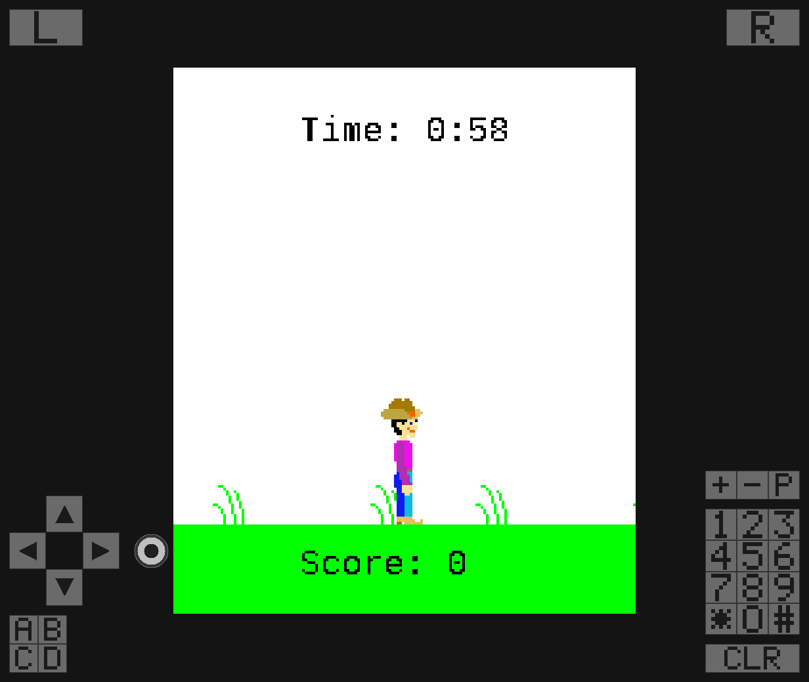

# nano_j2me

[English](README.md) | **简体中文**

用纯 **C99** 写的 J2ME（CLDC 1.1 / MIDP 2.0）运行时，为嵌入式而生。

它能在任何有帧缓冲、有几百 KB 内存的东西上跑 MIDlet 套件——那些给功能机写的 `.jar` 游戏：Linux、Android、ESP32-S3，或者你手上正拿着的任何板子。

```
                    ┌──────────────────────────────────────────┐
   game.jar  ──────►│  nj_app      ZIP 读取、清单解析、        │
                    │              类与资源来源                │
                    └───────────────┬──────────────────────────┘
                                    │ .class 字节 
                    ┌───────────────▼──────────────────────────┐
                    │  nj_class    解析、链接、常量池缓存      │
                    │              （内联缓存）                │
                    └───────────────┬──────────────────────────┘
                                    │
   ┌────────────────┐   ┌───────────▼───────────┐   ┌──────────────────┐
   │  nj_heap       │◄──┤  nj_interp            ├──►│  nj_thread       │
   │  区域堆 +      │   │  CLDC 1.1 字节码      │   │  绿色线程、      │
   │  标记清除式 GC │   │  异常、方法调用       │   │  调度器          │
   └────────────────┘   └───────────┬───────────┘   └──────────────────┘
                                    │ 原生   
                    ┌───────────────▼──────────────────────────┐
                    │  类库，全部用 C 写                       │
                    │  java.lang · java.util · java.io ·       │
                    │  javax.microedition.lcdui · .game · .rms │
                    └───────────────┬──────────────────────────┘
                                    │ nj_gfx（软件光栅化器）      
                    ┌───────────────▼──────────────────────────┐
                    │  nj_port   ← 唯一面向操作系统的接口      │
                    │  headless · SDL2 · Android · ESP32-S3    │
                    └──────────────────────────────────────────┘
```

## 设计上的硬约束

这些不是愿望，每一条都有测试或门禁守着。

**纯 C99，零依赖。** 不用 C++，不要求 libc（`NJ_USE_LIBC=0` 可以完全脱离），不用 zlib、libpng、libjpeg。DEFLATE、PNG 和光栅化器都是自己实现的，因为单片机上不会有这些库。

**零可写全局状态。** 运行时的每一个字节都属于某个 `nj_vm`。`nj_vm_destroy()` 会把它占的内存全部释放，并且**返回释放了多少字节**，调用方可以据此断言。所以在一个永不断电的设备上，MIDlet 可以反复启动、停止、再启动；同一个进程里也能同时存在多个虚拟机。`tools/check_no_statics.sh` 会把整个运行时编译一遍，只要有任何一个目标文件在可写段里定义了符号就报错。

**移植只需要一个文件。** `include/nj2me/nj_port.h` 就是全部的操作系统接口：大约十个回调。支持一个新平台 = 写一份新的 `nj_port` 实现，别的都不用动。见 [docs/PORTING.md](docs/PORTING.md)。

**先正确，再谈体积。** 解释器实现了完整的 CLDC 1.1 指令集，包括 `long`、`double`、异常、`synchronized`、`multianewarray` 以及老式的 `jsr`/`ret`。这些正是小型 JVM 通常会跳过的部分，而它们恰恰是老游戏最常用的部分。

## 现状

| 组件 | 状态 |
|---|---|
| ZIP/JAR 读取、DEFLATE 解压 | **完成** —— 经过模糊测试，ASan/UBSan 干净 |
| class 文件解析与链接 | **完成** |
| 字节码解释器（CLDC 1.1） | **完成** |
| 对象模型、区域堆、标记清除式 GC | **完成** |
| 协作式线程与调度器 | **完成** |
| 异常、C 到 Java 的桥 | **完成** |
| `java.lang` 核心、`Math`、`Thread`、包装类 | **完成** |
| `javax.microedition.lcdui` | **完成** |
| `javax.microedition.lcdui.game` | **完成** |
| `java.util`、`java.io`、RMS | **完成** |
| 软件光栅化器 | **完成** |
| PNG 与基线 JPEG 解码、点阵字体 | **完成**，走可插拔的编解码注册表 |
| 移植：headless（参考实现） | **完成** |
| 移植：SDL2 | **完成** |
| 移植：Android（NDK + JNI） | **完成** —— 一个 APK 支持 Android 5.0（API 21）及以上、四种 ABI；启动器会显示每个游戏自己的名字和图标，也能从文件管理器直接打开 `.jar`；三套可配置的悬浮按键布局；AAudio 或 OpenSL ES 出声，MIDI 交给手机自带的合成器；多点触控；自动识别游戏分辨率。四种 ABI 合计 1.57 MiB，在 API 21 模拟器、API 36 模拟器和真机上都跑过 |
| 移植：ESP32-S3（ESP-IDF，Xtensa） | **完成** —— 真实的 IDF 构建，能在 QEMU 里跑起一个 MIDlet |
| 移植：ESP32-C3（ESP-IDF，RISC-V） | 能编译、链接、启动；跑虚拟机需要 PSRAM |
| 测试套件 | **53/53 通过**（`ctest`） |
| Sanitizer 套件 | **11/11 通过**（ASan + UBSan + LSan，`tools/run_sanitized_tests.sh`） |

端到端验证过的：**Tumbleweed**（`net.frog_parrot.jump.Jump`，Apress 2004）在 headless 移植上以 176x208 跑起来——滚动的地面、会动的精灵、实时分数和倒计时。详见 [docs/COMPATIBILITY.md](docs/COMPATIBILITY.md)。

## 构建

```sh
cmake -S . -B build -G Ninja
cmake --build build                    # 编译。两秒。没有别的步骤。
```

要跑测试，先生成一次测试数据：

```sh
cmake --build build --target nj_fixtures   # 需要 JDK；PNG/JPEG 需要 Pillow
ctest --test-dir build --output-on-failure
```

**生成测试数据这一步是故意分开的。** 它会跑 PNG/JPEG/zip 的生成器、用 `javac` 编译十几个 MIDlet JAR，而且——只在你明确要求时——从 GitHub 下载两个第三方游戏。把这件事变成每次构建的依赖，会让 `cmake --build` 变成一个跟编译毫无关系的、要好几秒、而且没网就失败的步骤。现在它是：

* **默认关闭** —— `cmake --build build` 就是编译，仅此而已；
* **显式触发** —— 需要时用 `--target nj_fixtures`；
* **默认不联网** —— 只有 `-DNJ_FIXTURES_FETCH_GAMES=ON` 才允许那两个下载，因为构建不应该依赖 GitHub 可达；
* **有提示** —— 缺数据时 `ctest` 会告诉你该跑哪条命令，而不是一个接一个地失败 25 个测试、每个都报 "cannot open tests/fixtures/..."。

配置时加 `-DNJ_GENERATE_FIXTURES=ON` 可以恢复旧行为。

headless 移植始终可用，测试套件用的就是它。装了 `libsdl2-dev`（或等价物）时，SDL2 移植会自动构建。

## 屏幕按键

SDL2 窗口把 **J2ME 的每一个键**都画出来了，因为只有方向键的话，除了平台跳跃游戏什么都玩不了：



* **左软键 / 右软键** 在上方两角，和当年手机上一样
* **方向键** 在左下，下面一排是 **A / B / C / D**
* **开火键** 在方向键和游戏之间那条区域里
* **十二键数字键盘** 在右边，下面是**清除键**，上面是**音量 / 电源**

点击或触摸即可。落在按键上的按下只算一次按键，**不会**再算一次指针按下——所以同时有指针界面和键盘的游戏，不会因为一次点击收到两个事件。

```sh
F12 或 Tab          运行时显示 / 隐藏
NJ_SDL2_KEYS=0      启动时就隐藏
```

它们是半透明的，并且位于画面留白（letterbox）的区域里，所以在窗口默认打开的那些缩放下，游戏画面始终完整可见。这个留白是移植层自己算的，没有用 `SDL_RenderSetLogicalSize`，就是为了让这层按键能按窗口像素来画，而不是画在游戏自己那块 176x208 里面。

## 运行游戏

```sh
build/nj2me --port sdl2 game.jar
build/nj2me --port headless --dump-frames out/ game.jar
```

文字来自六套内置点阵字体。想改用 TrueType 文件，把它指出来即可——每套字体的 em 尺寸会贴合原来点阵字体占的格子，所以基线不会移动：

```sh
build/nj2me --port sdl2 --font /usr/share/fonts/liberation/LiberationMono-Regular.ttf game.jar
```

文件读不了或者格式不对都不致命：内置字体会留在原位，只打一条警告。加 `-DNJ_ENABLE_TTF=0` 可以把 TrueType 光栅化器整个编译掉，只留点阵字体。嵌入相关的细节见 `docs/PORTING.md`。

## 告诉游戏它跑在哪台手机上

J2ME 游戏会问 `System.getProperty("microedition.platform")` 来判断自己在哪台手机上，其中一些遇到不认识的答案就直接不启动——`1945空战英雄_6105` 要求平台串以 `"Nokia"` 开头。指定一个内置机型档案，运行时就会以那台手机的身份作答，包括它的识别号和厂商私有键：

```sh
build/nj2me --list-devices                              # 有哪些内置档案
build/nj2me --device nokia6230 game.jar                 # 以 Nokia 6230 运行
build/nj2me --prop microedition.platform=Nokia6230/05.50 game.jar
```

`--prop key=value` 可以重复给出，并覆盖档案里的值；默认档案是 `generic`，只用移植层自己的身份作答。档案里的 IMEI/IMSI 是**合成的**：形状合法，但不是任何人的号码。每个档案具体答什么、为什么要这么答，见 [docs/COMPATIBILITY.md 的设备一节](docs/COMPATIBILITY.md#the-device-a-title-believes-it-is-on)。

## 验证内存契约

```sh
# 运行时里没有任何可写全局状态
tools/check_no_statics.sh

# 创建 -> 运行 -> 销毁，三次，收尾完全一致，零残留
build/test_vm tests/fixtures/hello.jar HelloWorld "hello from j2me"

# 同样的流程，加上进程级泄漏检查
gcc -std=c99 -g -O1 -fsanitize=address,undefined -Iinclude \
    -o /tmp/t tests/test_vm.c src/core/*.c src/zip/*.c src/midp/*.c \
    src/port/posix/nj_port_headless.c -lm
ASAN_OPTIONS=detect_leaks=1 /tmp/t tests/fixtures/hello.jar HelloWorld
```

## 目录结构

```
include/nj2me/     公开头文件；nj_port.h 就是移植契约
src/core/          虚拟机：堆、类加载、解释器、线程、字符串、应用
src/midp/          类库（LCDUI、game、RMS、util、io、MIDlet）
src/gfx/           软件光栅化器、点阵字体、PNG 解码
src/zip/           DEFLATE 解压与 ZIP/JAR 读取
src/port/posix/    headless 与 SDL2 移植
src/port/android/  NDK 移植
src/port/esp32/    ESP-IDF 组件
src/runner/        把移植层和 MIDlet 接起来的运行器
tests/             基于断言的测试程序
tools/             测试数据生成器与 no-statics 门禁
docs/              架构、移植、兼容性
```

## 文档

> 文档目前是英文的。

- [docs/ARCHITECTURE.md](docs/ARCHITECTURE.md) —— 虚拟机怎么工作、为什么这么设计
- [docs/PORTING.md](docs/PORTING.md) —— 把它带到一块新板子上
- [docs/COMPATIBILITY.md](docs/COMPATIBILITY.md) —— 实现了什么、没实现什么，以及每种失败会怎么报错

## 许可

MIT —— 见 [LICENSE](LICENSE)。`tests/` 下的测试数据由本仓库自己的工具生成，采用同一许可；`tools/fetch_test_games.sh` 下载的游戏 JAR 属于第三方，没有随本仓库分发。
