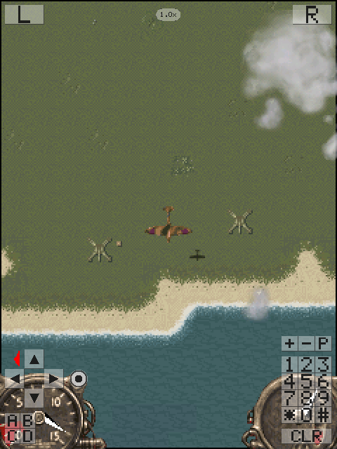
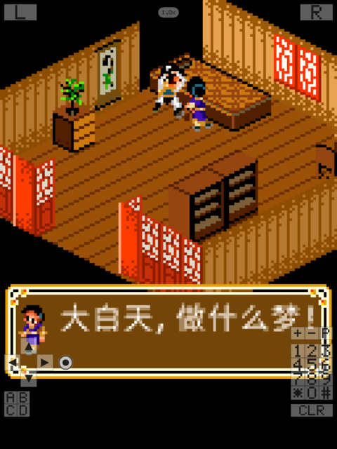
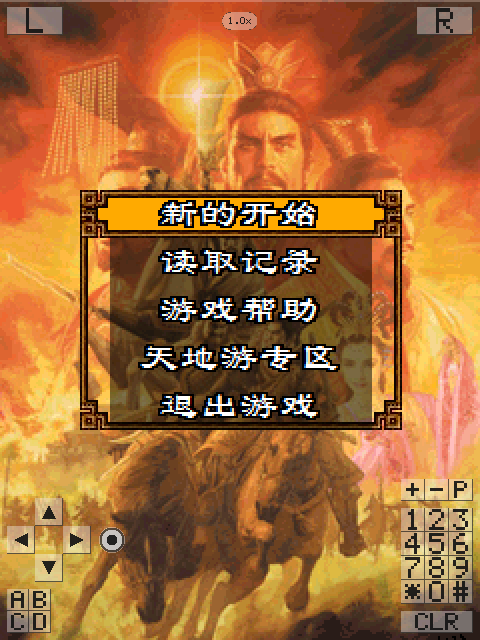
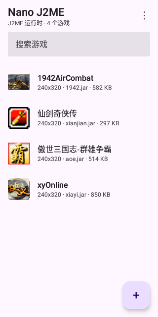
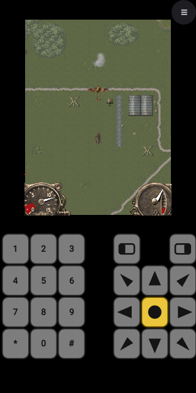
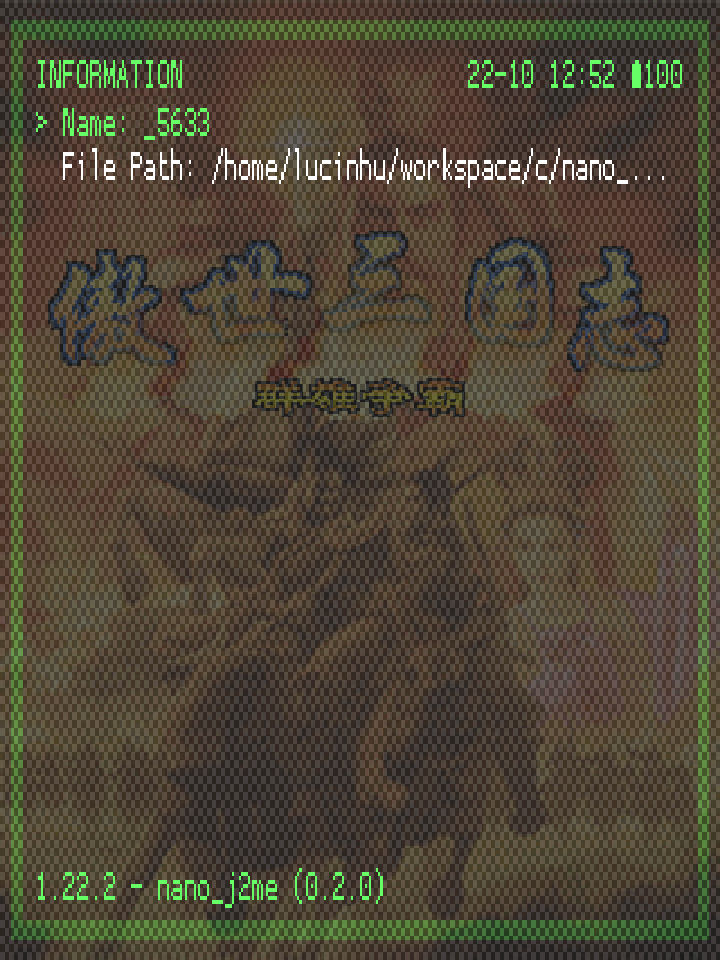
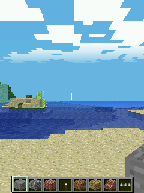
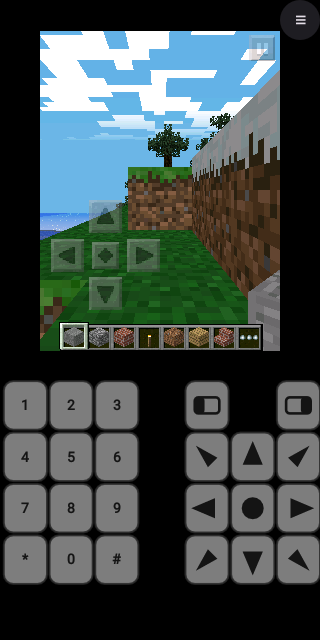

# nano_j2me

[English](README.md) | **简体中文**

[](https://github.com/lucinhu/nano_j2me/releases/latest)
[](LICENSE)
[](docs/VERIFICATION.md)
[](tools/run_sanitized_tests.sh)
[](#设计上的硬约束)

用纯 **C99** 写的 J2ME（CLDC 1.1 / MIDP 2.0）运行时，为嵌入式而生。

它能在任何有帧缓冲、有几百 KB 内存的东西上跑 MIDlet 套件——那些给功能机写的 `.jar` 游戏：Linux、Android、ESP32-S3，或者你手上正拿着的任何板子。

```
                    ┌──────────────────────────────────────────┐
   game.jar  ──────►│  nj_app      ZIP 读取、清单解析、        │
                    │              类与资源来源                │
                    └───────────────┬──────────────────────────┘
                                    │ .class 字节 
                    ┌───────────────▼──────────────────────────┐
                    │  nj_class    解析、链接、常量池缓存      │
                    │              （内联缓存）                │
                    └───────────────┬──────────────────────────┘
                                    │
   ┌────────────────┐   ┌───────────▼───────────┐   ┌──────────────────┐
   │  nj_heap       │◄──┤  nj_interp            ├──►│  nj_thread       │
   │  区域堆 +      │   │  CLDC 1.1 字节码      │   │  绿色线程、      │
   │  标记清除式 GC │   │  异常、方法调用       │   │  调度器          │
   └────────────────┘   └───────────┬───────────┘   └──────────────────┘
                                    │ 原生   
                    ┌───────────────▼──────────────────────────┐
                    │  类库，全部用 C 写                       │
                    │  java.lang · java.util · java.io ·       │
                    │  javax.microedition.lcdui · .game · .rms │
                    └───────────────┬──────────────────────────┘
                                    │ nj_gfx（软件光栅化器）      
                    ┌───────────────▼──────────────────────────┐
                    │  nj_port   ← 唯一面向操作系统的接口      │
                    │  headless · SDL2 · Android · ESP32-S3    │
                    └──────────────────────────────────────────┘
```

## 0.4.1 的新内容

**0.4.1 把帧率上限交给玩家，而让这件事浮出水面的正是端口自己的计数器。** Android 版从存在起就把手机限在 30 帧。现在 `adb shell setprop debug.nj2me.stats 1` 会让端口每五秒打出真正上屏的帧数——MIDlet 自己报不了这个数：一个 30 Hz 的标题无论手机画不画得动，都会靠 sleep 睡到每秒 30 帧——而 API 26 x86_64 模拟器载入一个已保存的 Minecraft PE 世界、放开上限后打出的是 `59.4 fps`。于是上限成了玩家设置：库的「显示设置」和游戏面板里多了一行「帧率上限」——30（默认）、60、不限制，对正在运行的游戏在下一帧生效。运行时为此新增了 `nj_vm_set_frame_cap()`：`nj_run()` 会把调用者的 `nj_port` 拷进自己的帧循环，UI 线程直接改端口那个结构体，VM 永远读不到。`debug.nj2me.fps <n>` 保留为启动时的覆盖开关，用来做测量。

完整更新日志：[v0.4.1 发布说明](https://github.com/lucinhu/nano_j2me/releases/tag/v0.4.1)。

## 0.4.0 的新内容（上一版）

**0.4.0 是能跑 Minecraft PE 的一版，也是让三类「画面不对」无处藏身的一版。** 0.3.0 之后，运行时补上了 UDP 数据报连接、Android 上自动决定 Java 堆大小，以及语料里真正会点名的那几块 JSR-75 / JSR-135。这一版的大部分工作，是一个要求很高的标题暴露出来的问题——以及现在守住这些问题的门禁。

* **Minecraft PE 0.6.1。** 能进世界、生成地形、正常出画，局域网联机走新的 UDP `DatagramConnection`。画面本身要修 JSR-184 采样器的三处：纹理坐标按 API 的 texel 中心约定（第 *i* 个 texel 覆盖 `[i/W,(i+1)/W)`），落在图集瓦片边界上的 UV 不会再采到上一条瓦片；`Texture2D.setFiltering()` 的 level filter 真正生效，`FILTER_BASE_LEVEL`（类默认值，也是所有标题要的）取第 0 级，而不是把相邻瓦片平均掉的 mip；JSR 184 的调色板 `Image2D` 构造会把索引表展开，`environment/clouds.png` 才画成云，而不是一片调色板索引。水面干净了，云回来了。
* **帧率控制不再饿死标题自己的线程。** 限帧时旧的 pacer 用 `sleep` 等，整台虚拟机一起停摆：在自己线程里生成和渲染世界的游戏，30fps 下每帧 33ms 只拿到 8ms。现在等待时间花在调度器上（加载期每呈现一帧，应用自身工作量是原来的 85 倍），而且限帧改成绝对微秒截止时间，`--fps 60` 不会再跑成 62.5，`--fps 30` 就落在 30（Minecraft 27.4 → 29.5fps）。
* **语料点名的 JSR-75 与厂商类。** `HttpsConnection` / `SecurityInfo` / `SecureConnection` / `Certificate`，并且 `http://` 连接刻意**不是** `HttpsConnection`；PIM 联系人列表能打开、内容是空的（这是一台新手机的回答）；三星 `SM`/`SMS` 抛 `IOException` 而不是假装成功；JSR-135 的 `TempoControl`/`RateControl` 真的能重新给 MIDI 曲定速。
* **移植。** ESP32-S3 镜像重新能链接了——手写的 IDF 源清单早已过期，`check_port_sources` 现在拿它和桌面清单双向比对——而且格式化数据报地址不再依赖解析器。Android 按标题自动决定 Java 堆大小。
* **门禁。** 八套裁剪配置在 `-Werror` 下零警告构建（这一遍抓到了真实的 `AffineTrans.setRotation` 缺陷：60° 旋转把模型缩小了一半）；400 标题快速门禁给每个标题独立存档目录，结果 fatal 0 / known 4；异常逃出帧循环时会打印每个线程当时在哪一帧。
* **数字。** `ctest` 131 项测试，Sanitizer 套件 131/131 全绿；真实游戏语料 399 个里 **397 个正常跑**，2 个失败都是标题自身原因（JAR 被截断、授权过期）。

完整更新日志：[v0.4.0 发布说明](https://github.com/lucinhu/nano_j2me/releases/tag/v0.4.0)。

## 截图

**桌面，SDL2 移植。** 完整的十二键手机键盘由移植层画出来——因为只有方向键的话，除了平台跳跃游戏什么都玩不了。

<p>



</p>

**Android。** 启动器显示每个游戏自己的名字和图标；游戏里可以换用不同的悬浮按键布局。

<p>


</p>

**RetroArch。** 同一个运行时以 libretro core 形式载入 RetroArch。

<p>

</p>

**ESP32-S3。** 真实的 MIDlet 跑在 Espressif 的 `esp-emu` 里：内置 RAM 的板级配置，帧数据经 UART 流出并解码成这张 PNG。

<p>

</p>

**Minecraft PE 0.6.1，0.4.0 新增。** 游戏自己生成的世界：云层来自展开后的调色板 `Image2D`，水面干净，标题自己的限帧也跟得上。

<p>


</p>

**视频，0.3.0 新增。** 1942 空战的 MPEG-4 片头：一帧一帧解码，以 direct-video 叠加画在 Canvas 上；影片自带的 AMR-NB 音轨同步播放。

<p>

</p>

**真实标题上的 Micro3D，0.3.0 新增。** 鬼泣3D 的任务一战斗与浴火银河的飞行场景，由 Mascot Capsule Micro3D 的命令表与 Figure 绘制。

<p>


</p>

## 设计上的硬约束

这些不是愿望，每一条都有测试或门禁守着。

**纯 C99，零依赖。** 不用 C++，不要求 libc（`NJ_USE_LIBC=0` 可以完全脱离），不用 zlib、libpng、libjpeg。DEFLATE、PNG 和光栅化器都是自己实现的，因为单片机上不会有这些库。

**零可写全局状态。** 运行时的每一个字节都属于某个 `nj_vm`。`nj_vm_destroy()` 会把它占的内存全部释放，并且**返回释放了多少字节**，调用方可以据此断言。所以在一个永不断电的设备上，MIDlet 可以反复启动、停止、再启动；同一个进程里也能同时存在多个虚拟机。`tools/check_no_statics.sh` 会把整个运行时编译一遍，只要有任何一个目标文件在可写段里定义了符号就报错。

**移植只需要一个文件。** `include/nj2me/nj_port.h` 就是全部的操作系统接口：大约十个回调。支持一个新平台 = 写一份新的 `nj_port` 实现，别的都不用动。见 [docs/PORTING.md](docs/PORTING.md)。

**先正确，再谈体积。** 解释器实现了完整的 CLDC 1.1 指令集，包括 `long`、`double`、异常、`synchronized`、`multianewarray` 以及老式的 `jsr`/`ret`。这些正是小型 JVM 通常会跳过的部分，而它们恰恰是老游戏最常用的部分。

## 现状

| 组件 | 状态 |
|---|---|
| ZIP/JAR 读取、DEFLATE 解压 | **完成** —— 经过模糊测试，ASan/UBSan 干净 |
| class 文件解析与链接 | **完成** |
| 字节码解释器（CLDC 1.1） | **完成** |
| 对象模型、区域堆、标记清除式 GC | **完成** |
| 协作式线程与调度器 | **完成** |
| 异常、C 到 Java 的桥 | **完成** |
| `java.lang` 核心、`Math`、`Thread`、包装类 | **完成** |
| `javax.microedition.lcdui` | **完成** |
| `javax.microedition.lcdui.game` | **完成** |
| `java.util`、`java.io`、RMS | **完成** |
| `javax.microedition.io` | **完成** —— `file://`、`http(s)://`（走一个可选的 `http_request` 钩子，安卓移植里包的是 `HttpURLConnection`）以及 `socket://`（四个可选的 `socket_*` 钩子，走 TCP）；其他协议按名字明确拒绝 |
| `javax.bluetooth`（JSR 82）| **发现部分完成** —— `LocalDevice`、`DiscoveryAgent`、`UUID`、`DeviceClass`、`DataElement`、`ServiceRecord`、`RemoteDevice`，走九个可选的 `bt_*` 钩子；RFCOMM/L2CAP 服务端由移植提供，没有无线电的移植得到的是 `BluetoothStateException` |
| `javax.microedition.sensor`（JSR 256）| **完成** —— `findSensors`、连接、通道、量程和数据监听器都在，传感器本身由移植提供；Condition 是明确拒绝而不是假装支持 |
| 软件光栅化器 | **完成** |
| `javax.microedition.m3g`（JSR 184）| **完成** —— 场景图、`.m3g` 解析器、关键帧轨道（位移/旋转/缩放/颜色）、蒙皮网格、相机/光照/雾，以及带深度缓冲、透视校正纹理、mipmap、两面光照和纹理变换的软件光栅化器；语料审计的缺口已全部关闭 |
| `javax.microedition.media`（JSR 135）| **完成** —— 音调、MIDI、WAV、AMR-NB、MP3，以及 H.263 / MPEG-4 Part 2 视频 Player 与 `VideoControl`；播放按影片真实时钟节流，影片自带的 AMR-NB 音轨同步播放 |
| Mascot Capsule Micro3D v3 | **完成** —— Figure、仿射/平行/透视投影、命令表（逐命令/逐面颜色）、MTRA/MBAC；真实标题可出画 |
| 执行引擎 | 解释器，加上可选的 RV32 / ARM64 基线 JIT（`NJ_ENABLE_JIT=1`），共享按 VM 有界的热块缓存；见 [docs/JIT.md](docs/JIT.md) |
| 解码器：PNG、JPEG、GIF、DEFLATE、WAV、AMR、MP3、MIDI、H.263、MPEG-4 Part 2、点阵字体 | **完成**，每个都有自己的开关（`NJ_ENABLE_*`），并且都走可插拔注册表，所以移植可以裁掉一个、也可以换成平台自己的实现 |
| 移植：headless（参考实现） | **完成** |
| 移植：SDL2 | **完成** |
| 移植：libretro / RetroArch | **完成** —— 一个 RetroArch 当作 core 加载的原生共享库：RGB565 画面、重采样音频、手柄/键盘/触摸输入、用于机型档案/旋转/堆大小/按键绑定的 core options，以及按游戏分开的 RecordStore/FileConnection 存档。没有 JVM，没有子进程。见 [docs/LIBRETRO.md](docs/LIBRETRO.md) |
| 移植：Android（NDK + JNI） | **完成** —— 一个 APK 支持 Android 5.0（API 21）及以上、四种 ABI；启动器会显示每个游戏自己的名字和图标，也能从文件管理器直接打开 `.jar`；三套可配置的悬浮按键布局；AAudio 或 OpenSL ES 出声，MIDI 交给手机自带的合成器；多点触控；自动识别游戏分辨率。四种 ABI 合计 2.79 MiB（仅 arm64 的包 858 KiB），在 API 21 模拟器和 API 36 模拟器上都跑过 |
| 移植：ESP32-S3（ESP-IDF，Xtensa） | **完成** —— 真实的 IDF 构建；在 16 MB flash / 8 MB PSRAM 的板级配置下，通过 Espressif 的 `esp-emu` 跑起 ROM、完整类库和一个 MIDlet（`tools/run_esp_emulator.sh`：`BENCH sum=-136042548`，105,717,067 条字节码——桌面版的总数），内置 RAM 配置在 QEMU 下也能跑。`tools/run_esp_emulator_ui.sh` 还在同一个模拟器里演示了显示、输入和存储路径（240x320 帧解码成 PNG，按键经 UART 注入，JAR 从挂载的存储卡读取）。见 [docs/PERFORMANCE.md](docs/PERFORMANCE.md#esp32-s3-measured-on-the-real-architecture) 和 [docs/FOOTPRINT.md](docs/FOOTPRINT.md#what-esp-emu-does-and-does-not-model-the-ui-demo) |
| 移植：ESP32-C3（ESP-IDF，RISC-V） | 能编译、链接、启动；跑虚拟机需要 PSRAM |
| 测试套件 | **131 项测试**（`ctest`） |
| Sanitizer 套件 | **131/131 通过**（ASan + UBSan + LSan，`tools/run_sanitized_tests.sh`） |

端到端验证过的：**Tumbleweed**（`net.frog_parrot.jump.Jump`，Apress 2004）在 headless 移植上以 176x208 跑起来——滚动的地面、会动的精灵、实时分数和倒计时。详见 [docs/COMPATIBILITY.md](docs/COMPATIBILITY.md)。收集到的真实游戏语料共 399 个，其中 **397 个正常跑**，2 个失败都是标题自身原因（JAR 被截断、授权过期）；见 [docs/CORPUS.md](docs/CORPUS.md)。

## 构建

```sh
cmake -S . -B build -G Ninja
cmake --build build                    # 编译。两秒。没有别的步骤。
```

要跑测试，先生成一次测试数据：

```sh
cmake --build build --target nj_fixtures   # 需要 JDK；PNG/JPEG 需要 Pillow
ctest --test-dir build --output-on-failure
```

**生成测试数据这一步是故意分开的。** 它会跑 PNG/JPEG/zip 的生成器、用 `javac` 编译十几个 MIDlet JAR，而且——只在你明确要求时——从 GitHub 下载两个第三方游戏。把这件事变成每次构建的依赖，会让 `cmake --build` 变成一个跟编译毫无关系的、要好几秒、而且没网就失败的步骤。现在它是：

* **默认关闭** —— `cmake --build build` 就是编译，仅此而已；
* **显式触发** —— 需要时用 `--target nj_fixtures`；
* **默认不联网** —— 只有 `-DNJ_FIXTURES_FETCH_GAMES=ON` 才允许那两个下载，因为构建不应该依赖 GitHub 可达；
* **有提示** —— 缺数据时 `ctest` 会告诉你该跑哪条命令，而不是一个接一个地失败 25 个测试、每个都报 "cannot open tests/fixtures/..."。

配置时加 `-DNJ_GENERATE_FIXTURES=ON` 可以恢复旧行为。

headless 移植始终可用，测试套件用的就是它。装了 `libsdl2-dev`（或等价物）时，SDL2 移植会自动构建。

libretro core 默认会构建成 `build/libretro/nano_j2me_libretro.so`（`-DNJ_BUILD_LIBRETRO=OFF` 可以关掉）。把它和它的 `.info` 文件一起复制进 RetroArch 的 `cores/` 目录，然后加载 `.jar`；操作、core options、存档位置和限制见 [docs/LIBRETRO.md](docs/LIBRETRO.md)。core 是分架构的，所以 `tools/build_libretro_cores.sh` 也能交叉构建 Android（arm64-v8a、armeabi-v7a、x86_64）和 ARM Linux（ARM64/ARMv7）上可直接安装的 core——用 `--list` 看目标列表。

## 在 RetroArch 里运行

每次发布都会带上六个 core，打包为 `nano_j2me-0.4.0-libretro-cores.tar.gz`，所以想试不需要交叉编译器。要构建本机的 core：

```sh
cmake -S . -B build -G Ninja
cmake --build build --target nano_j2me_libretro -j
```

把 `nano_j2me_libretro.so` 和 `nano_j2me_libretro.info`（两者必须放在一起）复制进 RetroArch 的 `cores/` 目录，在 *Load Core* 里选 **Mobile - J2ME (nano_j2me)**，然后加载游戏的 `.jar`。core options 里可以设置机型档案、旋转、堆大小、声音和按键绑定；存档落在 `<RetroArch 存档目录>/nano_j2me/<游戏目录>/`。命令行直接跑就是：

```sh
retroarch -L ~/.config/retroarch/cores/nano_j2me_libretro.so game.jar
```


## 屏幕按键

SDL2 窗口把 **J2ME 的每一个键**都画出来了，因为只有方向键的话，除了平台跳跃游戏什么都玩不了：


* **左软键 / 右软键** 在上方两角，和当年手机上一样
* **方向键** 在左下，下面一排是 **A / B / C / D**
* **开火键** 在方向键和游戏之间那条区域里
* **十二键数字键盘** 在右边，下面是**清除键**，上面是**音量 / 电源**

点击或触摸即可。落在按键上的按下只算一次按键，**不会**再算一次指针按下——所以同时有指针界面和键盘的游戏，不会因为一次点击收到两个事件。

```sh
F12 或 Tab          运行时显示 / 隐藏
NJ_SDL2_KEYS=0      启动时就隐藏
```

它们是半透明的，并且位于画面留白（letterbox）的区域里，所以在窗口默认打开的那些缩放下，游戏画面始终完整可见。这个留白是移植层自己算的，没有用 `SDL_RenderSetLogicalSize`，就是为了让这层按键能按窗口像素来画，而不是画在游戏自己那块 176x208 里面。

## 运行游戏

```sh
build/nj2me --port sdl2 game.jar
build/nj2me --port headless --dump-frames out/ game.jar
```

文字来自六套内置点阵字体。想改用 TrueType 文件，把它指出来即可——每套字体的 em 尺寸会贴合原来点阵字体占的格子，所以基线不会移动：

```sh
build/nj2me --port sdl2 --font /usr/share/fonts/liberation/LiberationMono-Regular.ttf game.jar
```

文件读不了或者格式不对都不致命：内置字体会留在原位，只打一条警告。加 `-DNJ_ENABLE_TTF=0` 可以把 TrueType 光栅化器整个编译掉，只留点阵字体。嵌入相关的细节见 `docs/PORTING.md`。

## 告诉游戏它跑在哪台手机上

J2ME 游戏会问 `System.getProperty("microedition.platform")` 来判断自己在哪台手机上，其中一些遇到不认识的答案就直接不启动——`1945空战英雄_6105` 要求平台串以 `"Nokia"` 开头。指定一个内置机型档案，运行时就会以那台手机的身份作答，包括它的识别号和厂商私有键：

```sh
build/nj2me --list-devices                              # 有哪些内置档案
build/nj2me --device nokia6230 game.jar                 # 以 Nokia 6230 运行
build/nj2me --prop microedition.platform=Nokia6230/05.50 game.jar
```

`--prop key=value` 可以重复给出，并覆盖档案里的值；默认档案是 `generic`，只用移植层自己的身份作答。档案里的 IMEI/IMSI 是**合成的**：形状合法，但不是任何人的号码。每个档案具体答什么、为什么要这么答，见 [docs/COMPATIBILITY.md 的设备一节](docs/COMPATIBILITY.md#the-device-a-title-believes-it-is-on)。

## 验证内存契约

```sh
# 运行时里没有任何可写全局状态
tools/check_no_statics.sh

# 创建 -> 运行 -> 销毁，三次，收尾完全一致，零残留
build/test_vm tests/fixtures/hello.jar HelloWorld "hello from j2me"

# 同样的流程，加上进程级泄漏检查
gcc -std=c99 -g -O1 -fsanitize=address,undefined -Iinclude \
    -o /tmp/t tests/test_vm.c src/core/*.c src/zip/*.c src/midp/*.c \
    src/port/posix/nj_port_headless.c -lm
ASAN_OPTIONS=detect_leaks=1 /tmp/t tests/fixtures/hello.jar HelloWorld
```

## 目录结构

```
include/nj2me/     公开头文件；nj_port.h 就是移植契约
src/core/          虚拟机：堆、类加载、解释器、线程、字符串、应用
src/midp/          类库（LCDUI、game、RMS、util、io、MIDlet）
src/gfx/           软件光栅化器、点阵字体、PNG 解码
src/zip/           DEFLATE 解压与 ZIP/JAR 读取
src/port/posix/    headless 与 SDL2 移植
src/port/android/  NDK 移植
src/port/esp32/    ESP-IDF 组件
src/port/libretro/ libretro core（RetroArch）
src/runner/        把移植层和 MIDlet 接起来的运行器
tests/             基于断言的测试程序
tools/             测试数据生成器、跨平台构建脚本与门禁
docs/              架构、移植、兼容性
```

## 文档

> 文档目前是英文的。

- [docs/ARCHITECTURE.md](docs/ARCHITECTURE.md) —— 虚拟机怎么工作、为什么这么设计
- [docs/PORTING.md](docs/PORTING.md) —— 把它带到一块新板子上
- [docs/LIBRETRO.md](docs/LIBRETRO.md) —— 在 RetroArch 里跑这个 core
- [docs/COMPATIBILITY.md](docs/COMPATIBILITY.md) —— 实现了什么、没实现什么，以及每种失败会怎么报错

## 许可

MIT —— 见 [LICENSE](LICENSE)。`tests/` 下的测试数据由本仓库自己的工具生成，采用同一许可；`tools/fetch_test_games.sh` 下载的游戏 JAR 属于第三方，没有随本仓库分发。
