# nano_j2me

[English](README.md) | **简体中文**

[](https://github.com/lucinhu/nano_j2me/releases/latest)
[](LICENSE)
[](docs/VERIFICATION.md)
[](tools/run_sanitized_tests.sh)
[](#设计上的硬约束)

用纯 **C99** 写的 J2ME（CLDC 1.1 / MIDP 2.0）运行时，为嵌入式而生。

它能在任何有帧缓冲、有几百 KB 内存的东西上跑 MIDlet 套件——那些给功能机写的 `.jar` 游戏：Linux、Windows、Android、ESP32-S3，或者你手上正拿着的任何板子。

```
                    ┌──────────────────────────────────────────┐
   game.jar  ──────►│  nj_app      ZIP 读取、清单解析、        │
                    │              类与资源来源                │
                    └───────────────┬──────────────────────────┘
                                    │ .class 字节 
                    ┌───────────────▼──────────────────────────┐
                    │  nj_class    解析、链接、常量池缓存      │
                    │              （内联缓存）                │
                    └───────────────┬──────────────────────────┘
                                    │
   ┌────────────────┐   ┌───────────▼───────────┐   ┌──────────────────┐
   │  nj_heap       │◄──┤  nj_interp            ├──►│  nj_thread       │
   │  区域堆 +      │   │  CLDC 1.1 字节码      │   │  绿色线程、      │
   │  标记清除式 GC │   │  异常、方法调用       │   │  调度器          │
   └────────────────┘   └───────────┬───────────┘   └──────────────────┘
                                    │ 原生   
                    ┌───────────────▼──────────────────────────┐
                    │  类库，全部用 C 写                       │
                    │  java.lang · java.util · java.io ·       │
                    │  javax.microedition.lcdui · .game · .rms │
                    └───────────────┬──────────────────────────┘
                                    │ nj_gfx（软件光栅化器）      
                    ┌───────────────▼──────────────────────────┐
                    │  nj_port   ← 唯一面向操作系统的接口      │
                    │  headless · SDL2 · Android · ESP32-S3    │
                    └──────────────────────────────────────────┘
```

## 0.5.5 的新内容

Minecraft 兼容性修复包括：深度缓冲跨宿主帧保留、网格与云层 alpha、World 默认背景
清除、LEQUAL 深度比较、平行和通用相机的投影深度、深度范围与多边形偏移。
Linux 桌面界面还支持自动 DPI 适配和保存 UI 缩放设置。

Release 构建采用正常的解释器优化等级。在固定工作量的 Minecraft 世界生成基准中，
三个种子比此前强制 `-O2` 的构建减少了 19–20% CPU 时间，世界数据完全一致。
变换后的二维绘制与 String.getChars 也有实测优化，并修复了流、集合、RMS、
StringBuffer、图片解码、Nokia DirectGraphics 和声音回调问题。这些基准不代表整款
游戏的 FPS 提升。

**快速快照兼容性：** 含 Graphics3D 实例的旧版快速快照无法在新深度编码下恢复；
请重新启动游戏，再读取游戏自身的存档。游戏 JAR、世界文件和 RMS 存档不受影响。
新快照需要新版运行时。详见[发布说明与验证记录](docs/RELEASE_0.5.5.md)。

## 0.5.4 的新内容

**软件光栅器每个像素少做一点，画面不变。** 对存档世界里的 Minecraft PE 做阶段
剖析，一帧 40% 的时间花在平面纹理路径上；这里做了三处改动，1200 帧世界内运行的
用户 CPU 降了约 **18%**——从 2.760/2.766/2.773 秒降到 2.261/2.274/2.252 秒，
约合 81 到 99 帧/秒的 CPU 时间：

- 带纹理的三角形现在每像素只做一次 `1/w` 除法（原来是两次纹理坐标加一次雾，
  共三次），雾直接用深度求值；
- 三个顶点都比雾的近平面更近的三角形没有雾，三个顶点都比远平面更远的三角形
  整片就是雾色，这两种都跳过逐像素的雾计算；
- 源 alpha 为 1/255 的片元（云纹理 80% 的像素）在写完深度之后直接跳过，因为把
  它们混合进去对目标的影响不超过 1。

融合倒数不是逐位精确的，`tests/test_m3g.c` 的包裹测试证明了这点：在
`WRAP_REPEAT` 的贴图边界上，一个 ulp 的差别会取到隔壁那一格，所以 repeat 包裹
的纹理保留除法（Minecraft 的云是 repeat，地形是 clamp）。`test_m3g` 933 项检查
0 失败，完整 ctest 140/140，语料门禁 `fatal 0 / 400, known 4`，同一快照的截帧
只在云带（标题按墙钟时间做动画）有差异。详见
`docs/notes/2026-10-31-raster-fast-paths.md`。

**复制的解释器现在是默认，Android APK 也用它构建。** 计算跳转（computed goto）
的解释器在桌面上本来就更快（地形生成 -6%，Minecraft 22 MB 初始存档 -20%）；
而手机版用 clang `-Os` 交叉编译，可移植 switch 差得多：在 x86_64 API-21 模拟器
上新建一个 Minecraft PE 世界，switch 需要 73.7 秒地形生成，复制解释器只要
43.9 秒，从点 Start 到进入世界从约 1 分 50 秒降到 1 分 08 秒（生成 -40%、
存档 -35%、回读准备 -39%）。`tools/build_android.sh` 现在默认传
`-DNJ_THREADED_DISPATCH=1`（`NJ_ANDROID_THREADED=0` 可切回 switch 做对照）；
`tools/check_threaded_dispatch.sh` 在 ctest 里保证两份实现逐字节码等价。详见
`docs/notes/2026-11-01-minecraft-android-costs.md`。

**修复五个 M3G 缺陷，每个都有回归检查。** `VertexArray.get` 的
`firstVertex` 为负时会读到数组之前；`VertexArray.set` 的
`numVertices*numComponents` 用 32 位相乘（先分配 0 大小再越界写——真实的
ASan SEGV 与 UBSan 有符号溢出）；`TriangleStripArray` 构造函数接受超出索引
数组的 strip 长度；`Image2D(fmt,w,h,byte[])` 接受过短甚至空的像素数组；
`Group.addChild` 接受自环/祖先边，会让渲染遍历递归到栈溢出。`test_m3g` 现在
ASan 与 UBSan 下 933 项检查 0 失败，同一存档世界的截帧在云带之外没有变化。

**解释器把世界生成最耗时的循环折叠成一条指令，M3G 渲染器每个 pass 只解析一次
帧状态。** 世界生成 >99% 的时间花在解释器派发上，而它的字节码组合里此前完全
没有浮点折叠，所以现在有五个整型/浮点家族合并为一次派发：
`iload`+隐式常量+整数运算（占生成派发点的 7.7%）、常量+`if_icmp` 分支（3.7%）、
串联的 `fadd/fmul/fsub` 加 `fstore`/`freturn` 尾巴、`fload`+`fload`/`fconst`+浮点
运算，以及 store+load。手机 APK 每 1000 个世界方块的生成快 8.6%、首次保存快
5.6%；桌面新建世界的整个阶段快 8.4%（固定吞吐负载 0.216 s → 0.195 s，字节码
70.5 M → 62.5 M）。渲染器里一次 `render(World)` pass 通过同一个 `Graphics3D`
画约 46 次，之前每次都要重新解析 target、相机、矩阵和灯光列表；现在
Graphics3D 那一半每个 pass 只解析一次并存进调用栈局部变量，再用一个小 key
校验，in-world 用户态 CPU 再降 2.35%（12/12 轮更快，截帧与未改动版本逐像素
一致）。详见 `docs/notes/2026-11-01-interpreter-superinstructions.md` 与
`docs/notes/2026-10-31-per-pass-frame-state.md`。

**JSR 75 `FileConnection` 现在像一个文件系统，而它原来的一个缺陷会删掉文件。**
已关闭的连接不会再操作那个文件——以前在已关闭连接上调用 `delete()` 会真的删掉
文件；JSR 75 的模式规则也遵守了：`READ` 连接拒绝 `create()`、`mkdir()` 和
`delete()`，只 `WRITE` 的连接拒绝元数据查询和 `openInputStream()`。元数据回答
与手机一致：`getName()` 对目录保留结尾的 `/`，不存在的文件 `fileSize()` 为 -1、
目录则抛 `IOException`，文件不存在时 `lastModified()` 为 0，`availableSize()`
返回卷的空闲空间而不是文件自身长度。`tests/test_fs.c` 从旧行为下的 66 项检查/
24 失败变成 **132 项检查 / 0 失败**，完整 ctest 140/140。曾尝试增加的
`isOpen()` 被撤掉：内置类的方法数是存档 ABI 哈希的一部分，加上它会让所有已有
的 `world.state` 拒绝恢复，这一点已写进提交说明。详见
`docs/notes/2026-11-01-jsr75-file-connection.md`。

**挖方块不再穿过解释器重扫场景图，同时补上三个 M3G 索引缺陷。** Minecraft PE
在方块被破坏时重建区块网格，每加一个重建好的部分都会走
`Group.addChild()` 的重复检查——`java.util.Vector.indexOf(child)` 对每个元素
都经解释器派发 `Object.equals`，每元素约 167 ns；而子节点向量里有 678–695 个
场景图节点，每帧 13 次扫描约 1.5 ms。现在扫描先解析一次接收者的 `equals`，
当它就是 `java.lang.Object.equals` 时直接比较引用；覆写了 `equals` 的类仍走
原路径，而且这个捷径是精确的——`Object.equals(o, e)` 就是 `o == e`。挖掘爆发
中负责渲染的那一帧从 5.75 ms 降到 3.49 ms（-39%），启动后 p99 从 6.10 ms
降到 3.77 ms（-38%）；另外两帧仍是游戏自己的 Java 网格重建，没有变化。本轮
加入的种子化 fuzz 驱动又发现三个 M3G 缺陷：`setLight(INT_MAX)` 的
`(index+1)*16` 在 32 位下溢出（UBSan，随后 OOME），现在超出 16 盏灯的表就抛
`IndexOutOfBoundsException`；`Mesh.setAppearance()` 会把子网格向量撑到调用者
给的索引（单子网格网格上 `setAppearance(1)` 会悄悄造出第二个子网格），现在
超出子网格数量就被拒绝；`getLight()` 原先会从数组余量或 `resetLights()` 之后
的陈旧槽位取回答，现在以活动灯光数为界。`test_m3g` 在 ASan 与 UBSan 下
933 项检查 0 失败，确定性驱动已提交在 `tests/fuzzdemo/`。详见
`docs/notes/2026-11-02-dig-burst-runtime.md` 与
`docs/notes/2026-11-02-m3g-fuzz.md`。

**三个测量说“不要改”，还有一个说“手机上不要改”。** 用 `-O2`、`-O3`、
`-O2 -flto` 构建的 Android APK 分别比发布的 `-Os` 库大 18%、25%、58%，在
API-21 x86_64 镜像上做确定性世界回读，CPU 分别是 +2.1%、+0.6%（在噪声内）、
+1.0%，所以 Android 默认仍是 `-Os`。性能分析里的 `m3g_tsa_getStripLengths`
热点其实是 gprof 假象——这个函数在 in-world 路径上根本不会被调用——剩余
per-draw setup 只有 1.1%；两个逐位精确的候选改写（strip 指针环、直线化顶点
路径）测出来更慢或持平，因此只保留了分析笔记
（`docs/notes/2026-11-02-per-draw-residuals.md`）。还有载入路径——22 MB 世界
的 read+prepare 共 3.08 G 次解释器派发——两个新的逐位精确折叠在桌面 gcc
`-O3` 下快 10%，但在 APK 实际使用的 clang `-Os` 下反而慢 1.5%，所以没有
合并；表格在 `docs/PERFORMANCE.md`。

**窗口尺寸变化现在真的会传到画面，而不只是合成器拉伸。** Activity 一直用
Surface 创建时的尺寸：`surfaceChanged()` 是空回调，锁定缓冲保持着初始尺寸，
所以旋转手机或改窗口大小（多窗口、`adb shell wm size`）时，320x640 的缓冲
会被拉伸到 480x800。现在 `surfaceChanged()` 调用 `nativeSetWindowSize()`，
重新套用 `ANativeWindow_setBuffersGeometry()` 并更新缓存尺寸，
`display_present()` 采用锁定缓冲自己的尺寸。在 API-21 镜像上做两次
320x640 <-> 480x800 往返，日志显示 `window buffer 320x640` ->
`480x800 stride 480` 再回到原尺寸，状态浮层报告新尺寸，按缩放后的坐标点击
仍能命中 HUD 暂停图标和菜单项；桌面端口把同一入口编译成桩。提交 `0f4cf05`。

**第二轮模糊测试又发现三个 M3G 缺陷，其中一个错在类表。**
`AnimationTrack` 被登记成继承 `java/lang/Object` 而不是 `Object3D`，导致
`duplicate()`、`animate()`、`setUserID()` 和强制转换抛
`NoSuchMethodError`；类表改回 `Object3D`（7 项检查）。这让实例从 64 字节
长到 96 字节，而快照 ABI 校验会比较每个类的字段/方法/数组数量和实例
大小，于是所有旧版本写出的状态都会被拒绝。为了避免这种断裂，
`src/core/nj_save.c` 现在接受“声明完全相同、只有实例大小增长”的变更：
用旧大小、把非静态字段偏移回移增长量重算旧 ABI 哈希，再遍历对象表，如果
状态里真的持有被迁移类的实例就明确拒绝。原来的 `world.state` 可以恢复
（`class .../AnimationTrack: migrating legacy shape (saved inst=64, have
inst=96)`），真正含该实例的旧状态会被拒绝而不是半加载；
`tools/m3g_fuzz2_state_evidence.sh` 可重跑这三种情况。同一轮还修了两个
UBSan 溢出：`Background.clear()` 用 INT_MAX 裁剪时
（`2147483647 + 1073741823`）改为 double 采样、64 位回绕；装载器构造的
隐式 strip 在 `firstIndex` 为 INT_MAX 时不再让 `jr_strip`/`jr_draw`
溢出。模糊驱动从 33 个操作族、5 个种子扩到 41 个族、8 个种子（动画、
蒙皮/形变网格、mipmap、合成的 `.m3g` 容器、立即模式），3552 次操作的一轮
零 ASan/UBSan/LSan 报告，`test_m3g` 从 865 增至 878 项检查。提交 `8883341`。

**为 APK 编译器专门化的光栅循环拿到一个小胜利。** 之前所有光栅优化都在
gcc `-O3` 上测，而手机 APK 用 clang `-Os`；在 `-Os` 下，主导的
`flat_texargb` span 循环占 in-world CPU 的 20%。它获得两个逐位精确的专门化
（clamp 采样器变体提升不变量；主导 flag 组合删掉可证明死掉的逐像素分支）：
在 clang `-Os` 下 8 轮 ABBA，第一个 -0.95%，两个一起 -2.27%（每次 8/8
更快），gcc `-O3` 侧 -0.34%，截帧完全一致。提交 `3971629`。

**存档路径的折叠是第四个“不要合并”。** 给 `chunks.dat` 末尾追加两个字节，
首次 22 MB 存档就会走原地 `saveChunks0` 路径，它的 4.44 亿次解释器派发
主要花在字节打包循环上。分析找到六个占约 20% 的热点族；实现的两个折叠在
桌面 gcc `-O3` 下让整个存档快 11.3%，clang `-Os` 下 3.1%，但在实际的
x86_64 `-Os` APK 上只有 1.0%（在 ±3% 的跑动波动内），所以没有合并；
基准配方和所有表格在 `docs/notes/2026-11-02-save-path.md`（提交
`d012e2e`）。原地快速存档是 289 ms，而首次完整存档是 5,328 ms；API-21
镜像上的回读是 6,971 + 7,863 ms。

**给宿主机补了一个 JIT，结论是解释器仍然更快。** `src/core/nj_jit.c` 的契约只有在手机后端上才可测，于是我们加了 System V x86_64 后端（`src/core/nj_jit_x86_64.c`，1,507 行，`tests/test_jit_x86_64.c` 里 4,416 条断言），用 `NJ_ENABLE_JIT=1` 打开，在真正可测的机器上量出上限。它把 32% 的执行字节码编译成平均 10.5 条字节码的原生块，然后更慢：Minecraft 桌面地形生成在 gcc `-O3` 下 13.1 -> 20.8 秒（墙钟 +34%），clang `-Os` 下 14.2 -> 23.6 秒；`bench.sh` 0.177 -> 0.279 秒（+57%）。原因是结构性的：5-10 条字节码的块在 15-20 ns 的 C 到 JIT 边界之前就结束了，而且开 JIT 的构建还会关掉解释器的超级指令。基础设施保留（默认关闭，打开时 ctest 141/141），笔记里排了真正有前途的方向——编译折叠后的序列、块链接、保留折叠——但这份数据不足以支撑补完 ARM64 后端（`docs/notes/2026-11-02-jit_x86_64.md`，提交 `3ba080f`）。

**更重的 in-world 场景里，一次投影提升在 `-Os` 下值 2.8%；字段查找缓存又撞上“不要合并”的墙。** 保存的水面场景只有约 1,400 三角形/帧，所以第七轮基准先瞄准岸线再存档，得到确定性的 2.3 倍视角（3,283 三角形/帧，600 帧共 2,005,022 个三角形）。clang `-Os` 的帧内分析是 `jr_emit` 43.7%、`jr_project` 17.0%（4,410 万次调用）、`jr_fetch` 8.1%、`sw_fog` 2.0%，而 5.3% 的 `nj_crc_update` 其实是 34 MB 快照载入，不是帧工作。`jr_project` 每个顶点先乘一次倒数，然后在四个调用点各乘一次半视口值；把 `0.5f*vw`/`0.5f*vh` 提到 `m3g_jr` 里是逐位精确的（w < 2^24 时 0.5f*w 精确），8 轮干净的 ABBA 平均 -2.84% 用户 CPU（8/8 更快），gcc `-O3` 侧 -3.12%，截帧与原始构建一致（`docs/notes/2026-11-02-heavy-scene-os.md`，提交 `6bb74c2`）。同一份设备侧归因里的另一个候选——按指针三元组跳过三次 `strcmp` 校验的字段/类解析 memo——在 gcc `-O3` in-world 下 -2.7%，但 clang `-Os` 下 +0.2%、`bench.sh` +1.2%、APK 上 -1.8% 且正负号混杂、落在 ±2% 波动内，所以只保留分析笔记（`docs/notes/2026-11-03-field-lookup.md`，提交 `21989cd`）。

**第三轮 M3G 模糊测试、Background 裁剪重置和窄纹理。** 种子化 API 模糊驱动长到 46 个操作族，掉出三个真实缺陷，每个都有先失败后通过的测试：从 `.m3g` 载入的环形 Group 图让 `Node.animate()` 无界递归（装载器链接子引用时没做祖先检查），现在和渲染遍历一样有深度 32 上限；每个对象都被引用时 `Loader.load()` 返回全 null 数组（roots 回退路径数了对象，但填充循环仍跳过被引用标记的），违反 JSR 184 的 no-nulls 保证；畸形 `.m3g` 可以把 Material 指成 Mesh 的顶点缓冲，让 `jr_setup` 从异物里读 VertexBuffer 偏移——现在类检查后直接不画。另外，`Background.setImage()` 按规范把裁剪重置为整幅图（毁灭战士3 绑了两张背景图却从不调 `setCrop`，旧的 0x0 裁剪让整次 blit 被跳过）；ALPHA/LUMINANCE/LUMINANCE_ALPHA 纹理现在每张图一次性扩成 RGBA，缓存在图像原本没用的 `_nj_mips` 字段里（加新字段会让所有旧存档无法载入，因为快照载入器会比较每个类的字段数）；34 个已声明但未赋值的 JSR 184 常量（Material 标志、Fog 模式、KeyframeSequence/AnimationTrack 枚举）也补上了。API 审计显示表面已经完整——30/30 规范类、没有缺失成员、只剩一个需要只追加存档迁移的 41 常量缺口（`docs/notes/2026-11-02-m3g-fuzz3.md`、`2026-11-03-background-coverage.md`、`2026-11-03-m3g-api-gaps.md`，提交 `8e3ae85`、`dbddc20`、`0149f16`）。对 27 个 M3G 语料标题携带的 975 个 `.m3g` 资产做变异模糊测试（10,000 个变异体分别过 `Loader`、`duplicate()`、主要 getter 和光栅路径，全程 ASan+UBSan+LSan）没有发现内存安全或泄漏缺陷：846 个资产能独立载入，129 个需要外部 PNG 的按规范抛 `IOException`；harness 已提交为 `tests/m3gmutdemo/` 与 `tools/m3g_mutation_fuzz.py`（`docs/notes/2026-11-03-m3g-mutation-fuzz.md`）。

**Android：音频焦点、BACK 语义、手柄，以及一个诚实的测量基线。** 移植层以前从不申请音频焦点，所以来电时 MIDI 还在响；现在 `onResume` 申请、`onPause` 放弃，焦点变化时暂停/恢复 `MidiPlayer`（模拟器上打过 GSM 电话验证）。暂停和打开面板时释放按住的手柄/硬件键。BACK 在抬起时决定：短按只给 MIDlet 一次完整的右软键按下/抬起，按住 550 ms 只打开移植层面板，二者绝不叠加。之前被丢弃的手柄 KEYCODE_BUTTON_A/B/X/Y 现在映射到开火、软键和游戏 A/B/C/D。API-36 镜像跑同一套创建/回读/缩放/音频矩阵，只发现 BLUETOOTH_CONNECT 运行时权限缺口（仅报告，API 31+）。余量审计改变了以后的测量方式：在这个 AVD 上游戏被模拟器 vsync 钉在 60.0 fps，只用了 16.7 ms 预算的约 21%（3.48 ms/帧 guest CPU），SurfaceFlinger 一帧没丢，所以 fps 和 p99 无法验证 guest 侧改动——`perf` 归因和 guest CPU 毫秒/帧可以（`docs/notes/2026-11-03-android-headroom.md`、`2026-11-02-android-input.md`、`2026-11-03-input.md`，提交 `404f4fc`、`cac808f`）。

## 0.5.3 的新内容（上一版）

**按名字的字段查找有了缓存，3D 渲染器不再每帧重复解析同样的字段。**
Minecraft PE 的场景遍历对每个节点、每次绘制都要同一批 M3G 字段：一局 1200 帧
的存档世界跑下来，每帧有 22,400 次 `nj_class_lookup()` 和 14,000 次
`nj_field_lookup()`，每次都要先探类表、再走继承来的字段链。现在两个查找都在
VM 里带一份缓存（按调用方传入的指针定位槽位），但命中之前会重新比对类名、
字段名和描述符文本——所以同一个缓冲区换名字复用时不会拿到上一个名字的答案；
`desc == NULL` 的按名匹配照旧绕开缓存。同一个存档世界、1200 帧 240x320 的
headless 运行，用户 CPU 从 2.705/2.713/2.725 秒降到 2.433/2.447/2.474 秒，
**-9.2% 到 -10.1%**；同一状态的截帧除了云（标题按墙钟时间做动画）之外逐像素
相同。`--stats` 会报 `findcache=命中/未命中`，`tests/test_lookup_cache.c`
（15 项检查）守住了正确性这边：复用缓冲区、静态请求对实例字段、按名匹配
（`desc == NULL`）都有检查。两份表在 64 位构建的默认值下每个 VM 多 9,232 字节
（本仓库 Release 构建 JIT 关闭时 `nj_vm_sizeof()` 从 7,040 涨到 16,272；32 位
构建约 4,624 字节），内存紧张的目标可以用 `-DNJ_FIELD_CACHE_SLOTS` /
`-DNJ_CLASS_CACHE_SLOTS` 把 RAM 换回去。完整 ctest 140/140，语料门禁
`fatal 0 / 400, known 4`。详见 `docs/notes/2026-10-31-lookup-memo.md`。

## 0.5.2 的新内容（上一版）

**SDL2 构建现在也是一个桌面客户端。** 不带 `.jar` 运行 `build/nj2me` 会打开
游戏列表窗口：游戏目录里每个可运行的包都有一行，显示 MIDlet 自己声明的图标
和名字。`O` 选择文件，`S` 打开设置，`R` 重新扫描，`Enter` 或点击运行，
`Esc`/`Q` 退出；两个方向都支持拖放——把 `.jar` 拖到窗口上直接运行，把目录
拖上去就换成新的游戏库。关闭游戏窗口或按 `F10` 回到列表，而不是退出。
启动器由模拟器自己的光栅器和内置点阵字体绘制，不依赖任何界面工具包，中文
游戏名也能正常显示；`--games`/`NJ2ME_GAMES` 指定游戏目录，
`--print-library` 显示列表看到了什么，`nj2me game.jar` 仍和以前一样直接
运行单个游戏。细节见[桌面客户端](#桌面客户端)一节和
`docs/notes/2026-10-31-desktop-client.md`。

**游戏按键可以自己映射了，设置页也覆盖了整个移植层。** 客户端的「按键映射」
页把十二个游戏键（方向、开火、软键、清除键、A-D）逐个改成你按下的键，并以
键名存进 `client.conf`（`map_up = W`）。数字键和 `*`/`#` 仍是手机键盘，移植层
自己的 `F3`/`F5`/`F10`/`F11`/`F12`/`Tab` 不能占用。同一页还能改缩放滤镜、
全屏、软件/加速渲染、堆大小、静音和网络开关；游戏中 `F11` 切换全屏，直接
`nj2me game.jar` 运行也会读取同一份文件里的堆和显示设置。细节见
`docs/notes/2026-10-31-key-mapping-and-settings.md`。

**桌面 SDL2 与安卓端口默认不再限制帧率。** 标题一画完就上交，是延迟最低的
做法，实际看到的画面由显示端决定：SDL2 渲染器主动要 vsync，SurfaceView 也
只在面板刷新时取帧。本机实测：同一份 Minecraft PE 存档，600 帧在 60 上限下
要 10.45 秒（57.4 fps），现在只要 4.90 秒（122.5 fps，240Hz 笔记本）；同样
的世界在 headless 端口能画到 314 fps。安卓的「帧率上限」设置现在是
不限制（默认）/ 60 / 30，仍然不改重启就作用到正在运行的 VM；命令行用
`--fps <n>` 限帧，`debug.nj2me.fps` 仍可覆盖启动时的上限。libretro 保持 60
（显示节奏归前端管），ESP32 保持 30——那里省电是实打实的。

**雾的修复也补了回归测试**：一个顶点越过 `fog_far`、近边贴着 `fog_near` 的
三角形，在深处必须是纯雾色；按顶点算雾会把材质颜色混进去，正是 Minecraft
天空原来的问题。m3gdemo 现在有 148 个检查。

**而且这是第一个带 Windows 构建的版本。** 桌面客户端不再只停留在编译它的
平台上：`nj2me.exe` 用 mingw-w64 交叉编译，和它链接的 `SDL2.dll`、双语
`README.txt` 和示例一起打成 zip 发布。Windows 的路径是 UTF-16，所以游戏列表
照样能列出、显示并运行中文名的 jar（语料上 `--print-library` 在 wine 下输出
"400 games, 399 runnable"），拖放和 `F10`/`F11` 行为一致，设置放在
`%APPDATA%\nano_j2me\client.conf`。可移植性改动都关在 `#if defined(_WIN32)`
里：宽字符文件 API、`FindFirstFileW` 列目录、JIT 代码页改用
`VirtualAlloc`/`VirtualProtect`、命令行参数经 `CommandLineToArgvW` 转成 UTF-8，
POSIX 构建逐字节不变。初版限制见
`docs/notes/2026-10-31-windows-build.md`：没有 libcurl 网络端口、没有 libretro
core、仅 x86_64、可执行文件未签名。

## 0.5.1 的新内容（上一版）

**0.5.1 修的是雾。** Minecraft PE 的天空以前是整片雾色：光栅器按顶点算雾
因子，而游戏天空平面的每一个顶点都在 `fog_far` 之外，于是整片天空都取了雾
色；参考实现画的是从顶部 `(58,116,202)` 到地平线 `(105,183,228)` 的渐变。
现在雾是逐片元量，在每个光栅循环里用插值出的 `1/w` 计算，这正是 GL ES 的
定义；同一存档对 FreeJ2ME-Plus 的逐像素平均绝对差从 41.4 降到 13.8，天空
每个通道只差个位数。代价是光栅器的 3~5%。加上前几轮修的云和水，Minecraft
PE 现在画出来的就是参考帧的样子。（准星是故意没有的：游戏检测到 Nokia 多
点触控时会把准星藏起来、换成触控布局——这是游戏自己的触屏行为，不是渲染
缺陷。）

**0.5.1 还把默认帧率上限从 30 提到 60**（SDL2 与安卓端口）：手机端的计数器
早就显示，放开上限时模拟器能把一个已存世界画到 59.4 fps，也就是说 30 上限
白白藏掉了一半的动态。

完整更新日志：[v0.5.2 发布说明](https://github.com/lucinhu/nano_j2me/releases/tag/v0.5.2)。

## 0.5.0 的新内容

**0.5.0 给 `synchronized` 补上了真正的语义。** 运行时以前没有语义：
`monitorenter` 只记下哪个栈帧持有监视器，`monitorexit` 就忘掉，任何线程都
不会因此阻塞——理由是「协作调度的线程在临界区里不会被抢占」。量子边界说
不是这样：一个双线程 fixture 在旧运行时上打出 `overlap=true`。现在实现了
Java 监视器：有竞争的 `monitorenter` 会停到持有者离开为止，`Object.wait()`
在等待期间释放监视器、`wait()` 返回前重新持有，`notify()`/`notifyAll()` 检
查所有权、不持有就抛 `IllegalMonitorStateException`；同步方法从第一条字
节码之前就持有监视器，直到返回、抛异常或栈帧展开。对象头里没有锁字——
所有权靠扫描很小的线程表——所以对象布局、堆占用和 GC 看对象的方式都没
变。`tests/lockdemo` 守着这条线：它报告 `overlap=false`，整个语料照旧能跑。
快照格式升到 v3 以保存监视器所有权和 `Object.wait` 状态；v2 快照会被拒
绝，而不是被误读。

完整更新日志：[v0.5.0 发布说明](https://github.com/lucinhu/nano_j2me/releases/tag/v0.5.0)。

## 0.4.1 的新内容（上一版）

**0.4.1 把帧率上限交给玩家，而让这件事浮出水面的正是端口自己的计数器。** Android 版从存在起就把手机限在 30 帧。现在 `adb shell setprop debug.nj2me.stats 1` 会让端口每五秒打出真正上屏的帧数——MIDlet 自己报不了这个数：一个 30 Hz 的标题无论手机画不画得动，都会靠 sleep 睡到每秒 30 帧——而 API 26 x86_64 模拟器载入一个已保存的 Minecraft PE 世界、放开上限后打出的是 `59.4 fps`。于是上限成了玩家设置：库的「显示设置」和游戏面板里多了一行「帧率上限」——30（默认）、60、不限制，对正在运行的游戏在下一帧生效。运行时为此新增了 `nj_vm_set_frame_cap()`：`nj_run()` 会把调用者的 `nj_port` 拷进自己的帧循环，UI 线程直接改端口那个结构体，VM 永远读不到。`debug.nj2me.fps <n>` 保留为启动时的覆盖开关，用来做测量。

完整更新日志：[v0.4.1 发布说明](https://github.com/lucinhu/nano_j2me/releases/tag/v0.4.1)。

## 0.4.0 的新内容（上一版）

**0.4.0 是能跑 Minecraft PE 的一版，也是让三类「画面不对」无处藏身的一版。** 0.3.0 之后，运行时补上了 UDP 数据报连接、Android 上自动决定 Java 堆大小，以及语料里真正会点名的那几块 JSR-75 / JSR-135。这一版的大部分工作，是一个要求很高的标题暴露出来的问题——以及现在守住这些问题的门禁。

* **Minecraft PE 0.6.1。** 能进世界、生成地形、正常出画，局域网联机走新的 UDP `DatagramConnection`。画面本身要修 JSR-184 采样器的三处：纹理坐标按 API 的 texel 中心约定（第 *i* 个 texel 覆盖 `[i/W,(i+1)/W)`），落在图集瓦片边界上的 UV 不会再采到上一条瓦片；`Texture2D.setFiltering()` 的 level filter 真正生效，`FILTER_BASE_LEVEL`（类默认值，也是所有标题要的）取第 0 级，而不是把相邻瓦片平均掉的 mip；JSR 184 的调色板 `Image2D` 构造会把索引表展开，`environment/clouds.png` 才画成云，而不是一片调色板索引。水面干净了，云回来了。
* **帧率控制不再饿死标题自己的线程。** 限帧时旧的 pacer 用 `sleep` 等，整台虚拟机一起停摆：在自己线程里生成和渲染世界的游戏，30fps 下每帧 33ms 只拿到 8ms。现在等待时间花在调度器上（加载期每呈现一帧，应用自身工作量是原来的 85 倍），而且限帧改成绝对微秒截止时间，`--fps 60` 不会再跑成 62.5，`--fps 30` 就落在 30（Minecraft 27.4 → 29.5fps）。
* **语料点名的 JSR-75 与厂商类。** `HttpsConnection` / `SecurityInfo` / `SecureConnection` / `Certificate`，并且 `http://` 连接刻意**不是** `HttpsConnection`；PIM 联系人列表能打开、内容是空的（这是一台新手机的回答）；三星 `SM`/`SMS` 抛 `IOException` 而不是假装成功；JSR-135 的 `TempoControl`/`RateControl` 真的能重新给 MIDI 曲定速。
* **移植。** ESP32-S3 镜像重新能链接了——手写的 IDF 源清单早已过期，`check_port_sources` 现在拿它和桌面清单双向比对——而且格式化数据报地址不再依赖解析器。Android 按标题自动决定 Java 堆大小。
* **门禁。** 八套裁剪配置在 `-Werror` 下零警告构建（这一遍抓到了真实的 `AffineTrans.setRotation` 缺陷：60° 旋转把模型缩小了一半）；400 标题快速门禁给每个标题独立存档目录，结果 fatal 0 / known 4；异常逃出帧循环时会打印每个线程当时在哪一帧。
* **数字。** `ctest` 131 项测试，Sanitizer 套件 131/131 全绿；真实游戏语料 399 个里 **397 个正常跑**，2 个失败都是标题自身原因（JAR 被截断、授权过期）。

完整更新日志：[v0.4.0 发布说明](https://github.com/lucinhu/nano_j2me/releases/tag/v0.4.0)。

## 截图

**桌面，SDL2 移植。** 完整的十二键手机键盘由移植层画出来——因为只有方向键的话，除了平台跳跃游戏什么都玩不了。

<p>
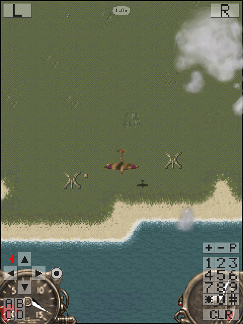
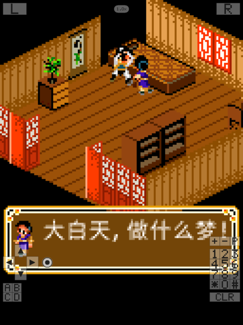
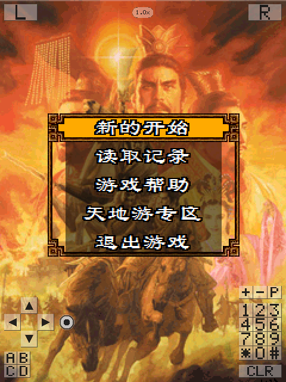
</p>

**桌面客户端，0.5.2 新增。** 游戏列表窗口：图标和名字来自 MIDlet 自己，
坏掉的包留在列表里标成 `bad`，底部的提示同时也是可点的按钮。

<p>
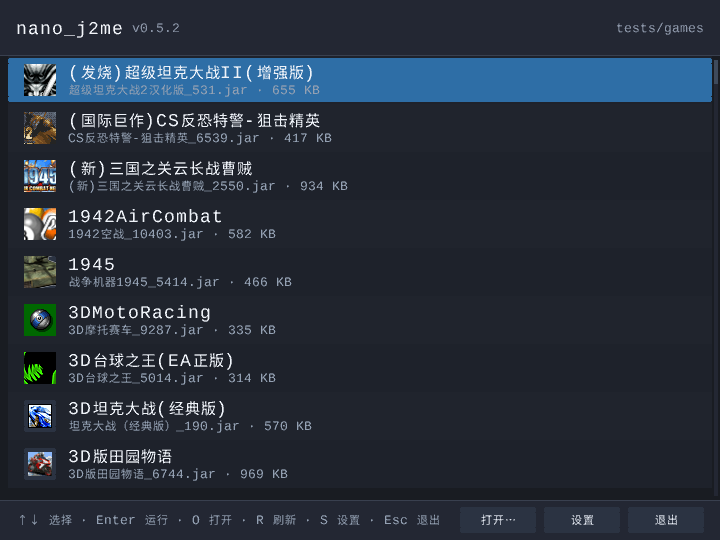
</p>

**设置与按键映射，0.5.2 新增。** 设置页管显示、堆大小和网络；「按键映射」页
可以把十二个游戏键改成任意键，右下角的提示确认新绑定。

<p>
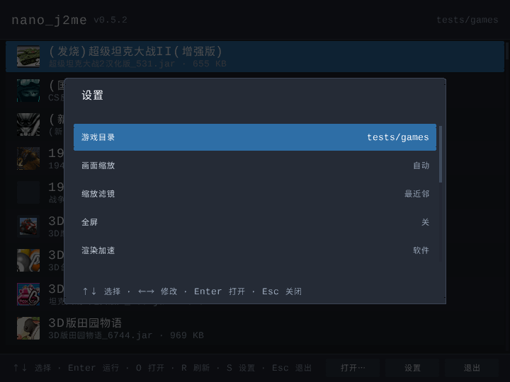
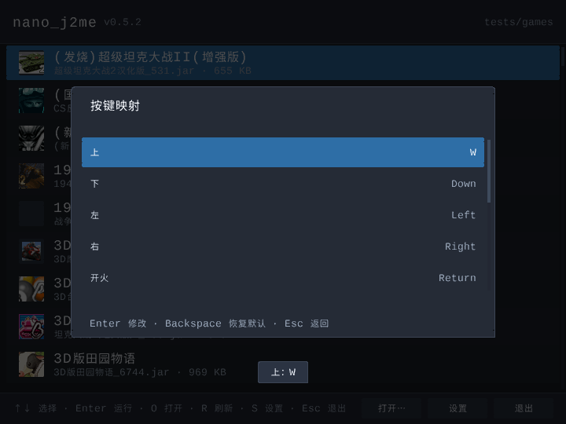
</p>

**搜索与快捷键表。** 直接输入即可按名字、文件名或 MIDlet 类名过滤列表；
按 `F1` 会列出客户端接受的全部按键以及设置文件的位置。

<p>
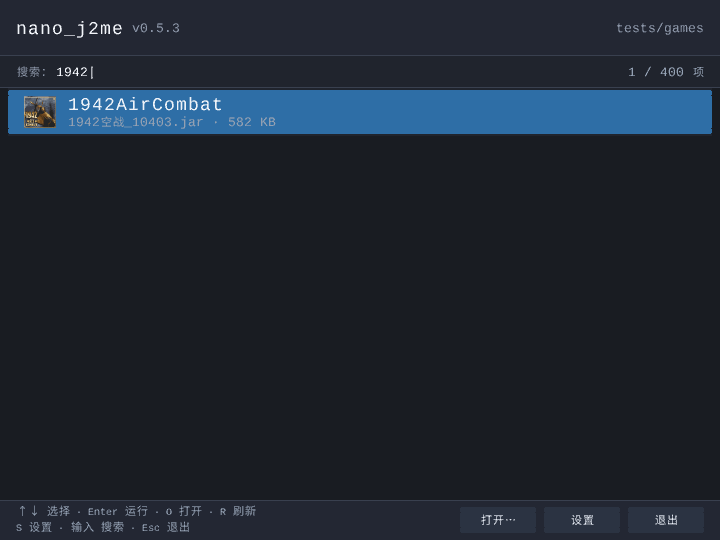
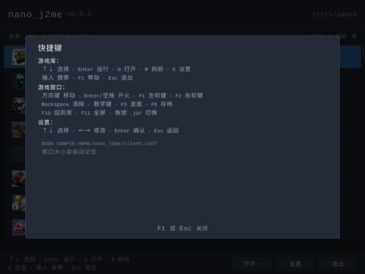
</p>

**最近玩过与收藏。** 列表顶部是最近运行的十个游戏，`F2` 给行加星；
重启后星标还在，设置页的“恢复默认”也不会把它们清掉。

<p>
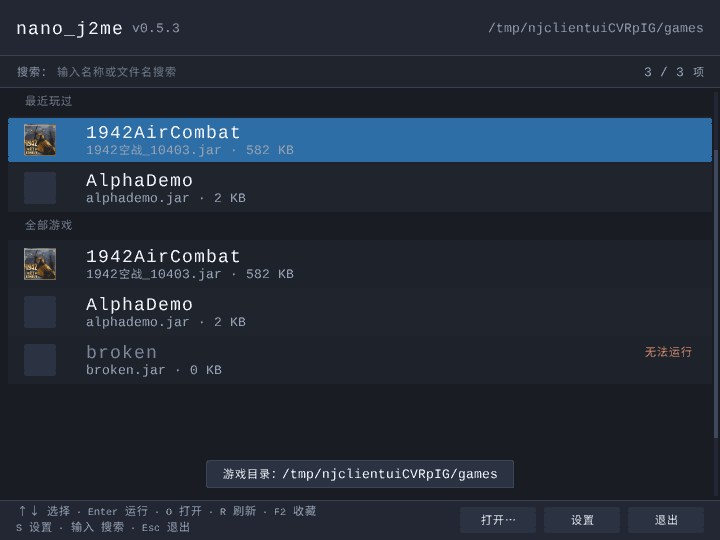
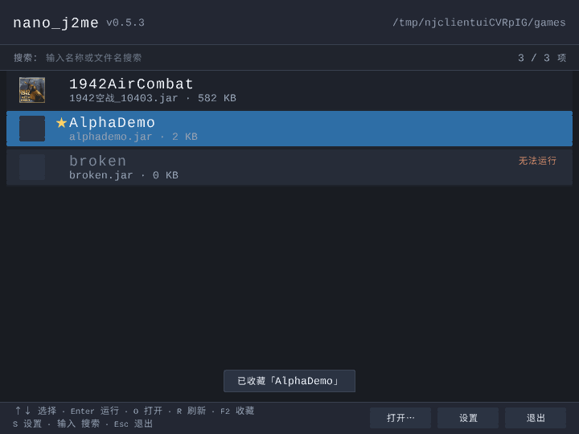
</p>

**Windows，0.5.2 新增。** 同一个客户端编成 `nj2me.exe`，这是在 wine 下截的图：
UTF-16 路径处理让宽字符目录扫描和中文游戏名与 Linux 上完全一致。

<p>
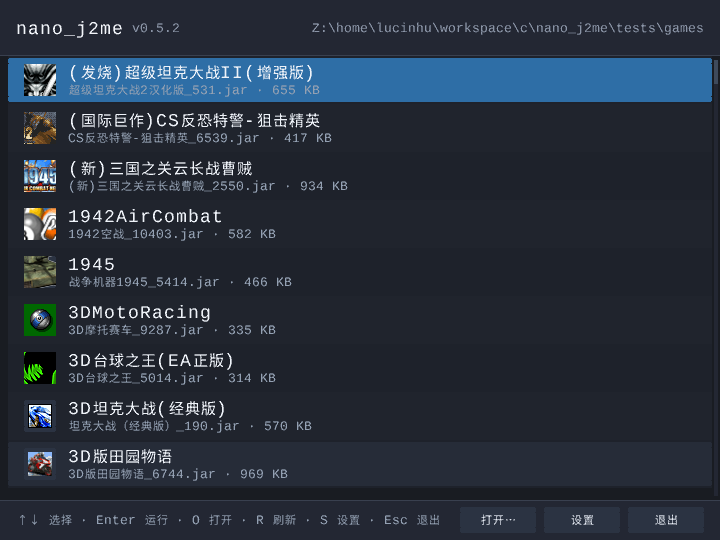
</p>

**Android。** 启动器显示每个游戏自己的名字和图标；游戏里可以换用不同的悬浮按键布局。

<p>
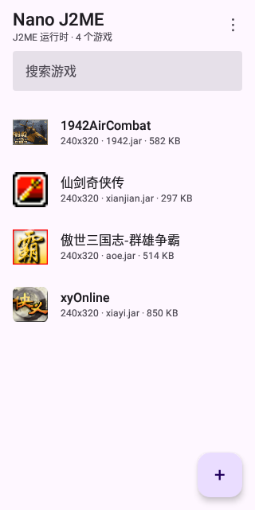
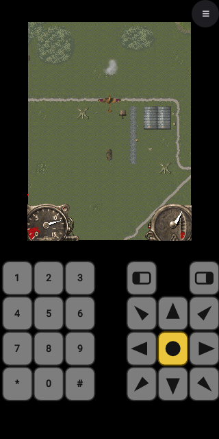
</p>

**RetroArch。** 同一个运行时以 libretro core 形式载入 RetroArch。

<p>
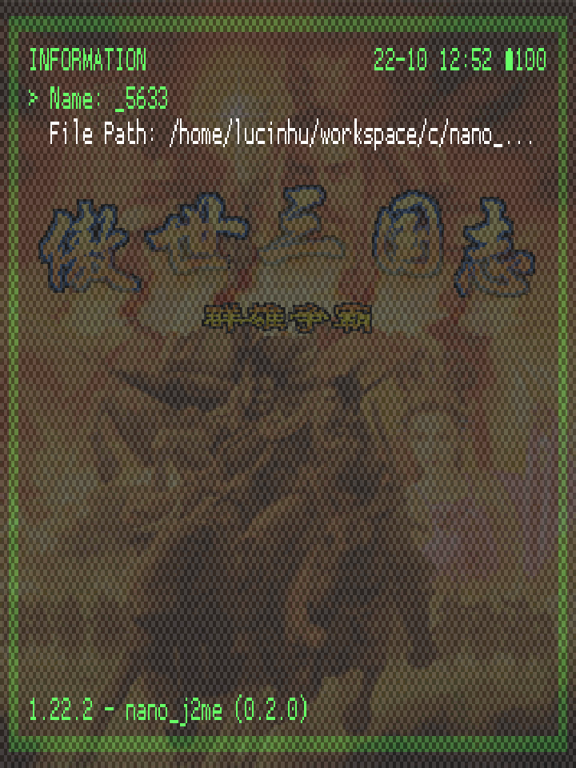
</p>

**ESP32-S3。** 真实的 MIDlet 跑在 Espressif 的 `esp-emu` 里：内置 RAM 的板级配置，帧数据经 UART 流出并解码成这张 PNG。

<p>

</p>

**Minecraft PE 0.6.1，0.4.0 新增。** 游戏自己生成的世界：云层来自展开后的调色板 `Image2D`，水面干净，标题自己的限帧也跟得上。

<p>
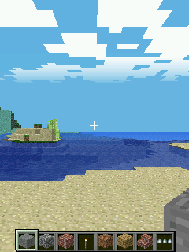
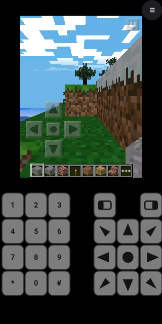
</p>

**视频，0.3.0 新增。** 1942 空战的 MPEG-4 片头：一帧一帧解码，以 direct-video 叠加画在 Canvas 上；影片自带的 AMR-NB 音轨同步播放。

<p>

</p>

**真实标题上的 Micro3D，0.3.0 新增。** 鬼泣3D 的任务一战斗与浴火银河的飞行场景，由 Mascot Capsule Micro3D 的命令表与 Figure 绘制。

<p>
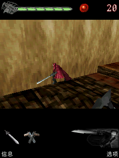
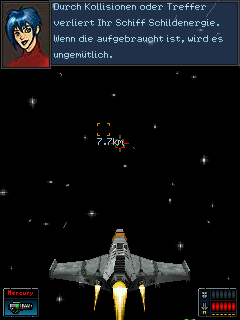
</p>

## 设计上的硬约束

这些不是愿望，每一条都有测试或门禁守着。

**纯 C99，零依赖。** 不用 C++，不要求 libc（`NJ_USE_LIBC=0` 可以完全脱离），不用 zlib、libpng、libjpeg。DEFLATE、PNG 和光栅化器都是自己实现的，因为单片机上不会有这些库。

**零可写全局状态。** 运行时的每一个字节都属于某个 `nj_vm`。`nj_vm_destroy()` 会把它占的内存全部释放，并且**返回释放了多少字节**，调用方可以据此断言。所以在一个永不断电的设备上，MIDlet 可以反复启动、停止、再启动；同一个进程里也能同时存在多个虚拟机。`tools/check_no_statics.sh` 会把整个运行时编译一遍，只要有任何一个目标文件在可写段里定义了符号就报错。

**移植只需要一个文件。** `include/nj2me/nj_port.h` 就是全部的操作系统接口：大约十个回调。支持一个新平台 = 写一份新的 `nj_port` 实现，别的都不用动。见 [docs/PORTING.md](docs/PORTING.md)。

**先正确，再谈体积。** 解释器实现了完整的 CLDC 1.1 指令集，包括 `long`、`double`、异常、`synchronized`、`multianewarray` 以及老式的 `jsr`/`ret`。这些正是小型 JVM 通常会跳过的部分，而它们恰恰是老游戏最常用的部分。

## 现状

| 组件 | 状态 |
|---|---|
| ZIP/JAR 读取、DEFLATE 解压 | **完成** —— 经过模糊测试，ASan/UBSan 干净 |
| class 文件解析与链接 | **完成** |
| 字节码解释器（CLDC 1.1） | **完成** |
| 对象模型、区域堆、标记清除式 GC | **完成** |
| 协作式线程与调度器 | **完成** |
| 异常、C 到 Java 的桥 | **完成** |
| `java.lang` 核心、`Math`、`Thread`、包装类 | **完成** |
| `javax.microedition.lcdui` | **完成** |
| `javax.microedition.lcdui.game` | **完成** |
| `java.util`、`java.io`、RMS | **完成** |
| `javax.microedition.io` | **完成** —— `file://`、`http(s)://`（走一个可选的 `http_request` 钩子，安卓移植里包的是 `HttpURLConnection`）以及 `socket://`（四个可选的 `socket_*` 钩子，走 TCP）；其他协议按名字明确拒绝 |
| `javax.bluetooth`（JSR 82）| **发现部分完成** —— `LocalDevice`、`DiscoveryAgent`、`UUID`、`DeviceClass`、`DataElement`、`ServiceRecord`、`RemoteDevice`，走九个可选的 `bt_*` 钩子；RFCOMM/L2CAP 服务端由移植提供，没有无线电的移植得到的是 `BluetoothStateException` |
| `javax.microedition.sensor`（JSR 256）| **完成** —— `findSensors`、连接、通道、量程和数据监听器都在，传感器本身由移植提供；Condition 是明确拒绝而不是假装支持 |
| 软件光栅化器 | **完成** |
| `javax.microedition.m3g`（JSR 184）| **完成** —— 场景图、`.m3g` 解析器、关键帧轨道（位移/旋转/缩放/颜色）、蒙皮网格、相机/光照/雾，以及带深度缓冲、透视校正纹理、mipmap、两面光照和纹理变换的软件光栅化器；语料审计的缺口已全部关闭 |
| `javax.microedition.media`（JSR 135）| **完成** —— 音调、MIDI、WAV、AMR-NB、MP3，以及 H.263 / MPEG-4 Part 2 视频 Player 与 `VideoControl`；播放按影片真实时钟节流，影片自带的 AMR-NB 音轨同步播放 |
| Mascot Capsule Micro3D v3 | **完成** —— Figure、仿射/平行/透视投影、命令表（逐命令/逐面颜色）、MTRA/MBAC；真实标题可出画 |
| 执行引擎 | 解释器，加上可选的 RV32 / ARM64 基线 JIT（`NJ_ENABLE_JIT=1`），共享按 VM 有界的热块缓存；见 [docs/JIT.md](docs/JIT.md) |
| 解码器：PNG、JPEG、GIF、DEFLATE、WAV、AMR、MP3、MIDI、H.263、MPEG-4 Part 2、点阵字体 | **完成**，每个都有自己的开关（`NJ_ENABLE_*`），并且都走可插拔注册表，所以移植可以裁掉一个、也可以换成平台自己的实现 |
| 移植：headless（参考实现） | **完成** |
| 移植：SDL2 | **完成** —— 桌面客户端：带拖放的游戏库、可重映射按键和十二行设置页（见[桌面客户端](#桌面客户端)） |
| 移植：Windows x86_64（mingw-w64）| **完成** —— 同一个 `nj2me.exe` 交叉编译而来：命令行运行器加游戏库窗口，UTF-8 路径走宽字符 Win32 API，设置和存档在 `%APPDATA%\nano_j2me`；暂不支持 libretro core 与 libcurl 网络，仅 x86_64。见 [docs/notes/2026-10-31-windows-build.md](docs/notes/2026-10-31-windows-build.md) |
| 移植：libretro / RetroArch | **完成** —— 一个 RetroArch 当作 core 加载的原生共享库：RGB565 画面、重采样音频、手柄/键盘/触摸输入、用于机型档案/旋转/堆大小/按键绑定的 core options，以及按游戏分开的 RecordStore/FileConnection 存档。没有 JVM，没有子进程。见 [docs/LIBRETRO.md](docs/LIBRETRO.md) |
| 移植：Android（NDK + JNI） | **完成** —— 一个 APK 支持 Android 5.0（API 21）及以上、四种 ABI；启动器会显示每个游戏自己的名字和图标，也能从文件管理器直接打开 `.jar`；三套可配置的悬浮按键布局；AAudio 或 OpenSL ES 出声，MIDI 交给手机自带的合成器；多点触控；自动识别游戏分辨率。四种 ABI 合计 2.79 MiB（仅 arm64 的包 858 KiB），在 API 21 模拟器和 API 36 模拟器上都跑过 |
| 移植：ESP32-S3（ESP-IDF，Xtensa） | **完成** —— 真实的 IDF 构建；在 16 MB flash / 8 MB PSRAM 的板级配置下，通过 Espressif 的 `esp-emu` 跑起 ROM、完整类库和一个 MIDlet（`tools/run_esp_emulator.sh`：`BENCH sum=-136042548`，105,717,067 条字节码——桌面版的总数），内置 RAM 配置在 QEMU 下也能跑。`tools/run_esp_emulator_ui.sh` 还在同一个模拟器里演示了显示、输入和存储路径（240x320 帧解码成 PNG，按键经 UART 注入，JAR 从挂载的存储卡读取）。见 [docs/PERFORMANCE.md](docs/PERFORMANCE.md#esp32-s3-measured-on-the-real-architecture) 和 [docs/FOOTPRINT.md](docs/FOOTPRINT.md#what-esp-emu-does-and-does-not-model-the-ui-demo) |
| 移植：ESP32-C3（ESP-IDF，RISC-V） | 能编译、链接、启动；跑虚拟机需要 PSRAM |
| 测试套件 | **140 项测试**（`ctest`） |
| Sanitizer 套件 | **140/140 通过**（ASan + UBSan + LSan，`tools/run_sanitized_tests.sh`） |

端到端验证过的：**Tumbleweed**（`net.frog_parrot.jump.Jump`，Apress 2004）在 headless 移植上以 176x208 跑起来——滚动的地面、会动的精灵、实时分数和倒计时。详见 [docs/COMPATIBILITY.md](docs/COMPATIBILITY.md)。收集到的真实游戏语料共 400 个，其中 **398 个正常跑**，2 个失败都是标题自身原因（JAR 被截断、授权过期）；见 [docs/CORPUS.md](docs/CORPUS.md)。

## 构建

Arch Linux 上已经打进 AUR：[`nano-j2me`](https://aur.archlinux.org/packages/nano-j2me)
跟最新发布，[`nano-j2me-git`](https://aur.archlinux.org/packages/nano-j2me-git)
跟 master。两个包都装桌面客户端、静态库和头文件、libretro core 以及桌面入口——
`yay -S nano-j2me`，或者把 `yay` 换成 `paru`。其他平台：

```sh
cmake -S . -B build -G Ninja
cmake --build build                    # 编译。两秒。没有别的步骤。
```

要跑测试，先生成一次测试数据：

```sh
cmake --build build --target nj_fixtures   # 需要 JDK；PNG/JPEG 需要 Pillow
ctest --test-dir build --output-on-failure
```

**生成测试数据这一步是故意分开的。** 它会跑 PNG/JPEG/zip 的生成器、用 `javac` 编译十几个 MIDlet JAR，而且——只在你明确要求时——从 GitHub 下载两个第三方游戏。把这件事变成每次构建的依赖，会让 `cmake --build` 变成一个跟编译毫无关系的、要好几秒、而且没网就失败的步骤。现在它是：

* **默认关闭** —— `cmake --build build` 就是编译，仅此而已；
* **显式触发** —— 需要时用 `--target nj_fixtures`；
* **默认不联网** —— 只有 `-DNJ_FIXTURES_FETCH_GAMES=ON` 才允许那两个下载，因为构建不应该依赖 GitHub 可达；
* **有提示** —— 缺数据时 `ctest` 会告诉你该跑哪条命令，而不是一个接一个地失败 25 个测试、每个都报 "cannot open tests/fixtures/..."。

配置时加 `-DNJ_GENERATE_FIXTURES=ON` 可以恢复旧行为。

headless 移植始终可用，测试套件用的就是它。装了 `libsdl2-dev`（或等价物）时，SDL2 移植会自动构建。

**在 Linux 上构建 Windows 包**需要 mingw-w64 和 SDL2 的 mingw 开发包；第一次
运行 `tools/build_windows.sh` 会把该包下载到被 git 忽略的 `.local-tools/`，
再用 `tools/toolchain-mingw-w64.cmake` 交叉编译，产出
`build/nj2me-0.5.2-windows-x86_64.zip`（exe、配套 `SDL2.dll`、示例和
README）。同一个 toolchain 文件也可以手动使用：

```sh
cmake -S . -B build-windows -DCMAKE_TOOLCHAIN_FILE=tools/toolchain-mingw-w64.cmake \
      -DSDL2_INCLUDE_DIRS="$PWD/.local-tools/sdl2-mingw/SDL2-2.32.10/x86_64-w64-mingw32/include" \
      -DSDL2_LIBRARIES="$PWD/.local-tools/sdl2-mingw/SDL2-2.32.10/x86_64-w64-mingw32/lib/libSDL2.dll.a" \
      -DNJ_BUILD_TESTS=OFF -DNJ_BUILD_LIBRETRO=OFF
cmake --build build-windows --target nj2me-cli
```

`wine` 被设成交叉运行器，所以 `ctest` 可以直接跑交叉编译出来的 Windows
二进制。可移植性说明和限制见
[docs/notes/2026-10-31-windows-build.md](docs/notes/2026-10-31-windows-build.md)。

libretro core 默认会构建成 `build/libretro/nano_j2me_libretro.so`（`-DNJ_BUILD_LIBRETRO=OFF` 可以关掉）。把它和它的 `.info` 文件一起复制进 RetroArch 的 `cores/` 目录，然后加载 `.jar`；操作、core options、存档位置和限制见 [docs/LIBRETRO.md](docs/LIBRETRO.md)。core 是分架构的，所以 `tools/build_libretro_cores.sh` 也能交叉构建 Android（arm64-v8a、armeabi-v7a、x86_64）和 ARM Linux（ARM64/ARMv7）上可直接安装的 core——用 `--list` 看目标列表。

## 在 RetroArch 里运行

每次发布都会带上六个 core，打包为 `nano_j2me-0.4.0-libretro-cores.tar.gz`，所以想试不需要交叉编译器。要构建本机的 core：

```sh
cmake -S . -B build -G Ninja
cmake --build build --target nano_j2me_libretro -j
```

把 `nano_j2me_libretro.so` 和 `nano_j2me_libretro.info`（两者必须放在一起）复制进 RetroArch 的 `cores/` 目录，在 *Load Core* 里选 **Mobile - J2ME (nano_j2me)**，然后加载游戏的 `.jar`。core options 里可以设置机型档案、旋转、堆大小、声音和按键绑定；存档落在 `<RetroArch 存档目录>/nano_j2me/<游戏目录>/`。命令行直接跑就是：

```sh
retroarch -L ~/.config/retroarch/cores/nano_j2me_libretro.so game.jar
```


## 屏幕按键

SDL2 窗口把 **J2ME 的每一个键**都画出来了，因为只有方向键的话，除了平台跳跃游戏什么都玩不了：

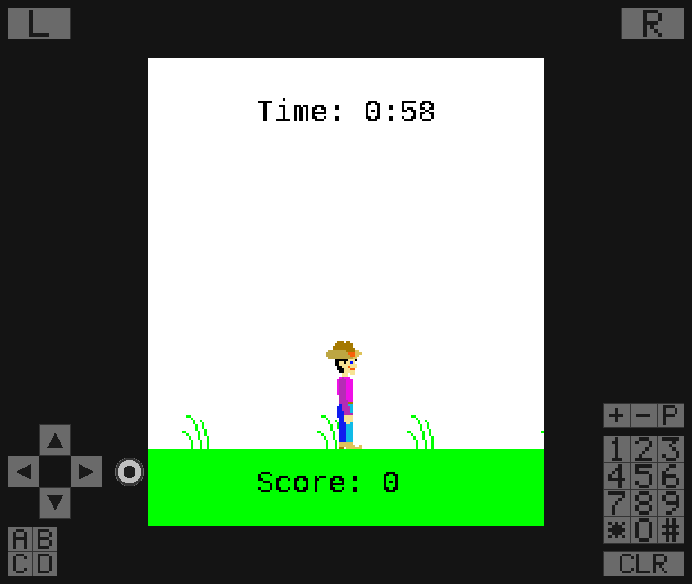

* **左软键 / 右软键** 在上方两角，和当年手机上一样
* **方向键** 在左下，下面一排是 **A / B / C / D**
* **开火键** 在方向键和游戏之间那条区域里
* **十二键数字键盘** 在右边，下面是**清除键**，上面是**音量 / 电源**

点击或触摸即可。落在按键上的按下只算一次按键，**不会**再算一次指针按下——所以同时有指针界面和键盘的游戏，不会因为一次点击收到两个事件。

```sh
F12 或 Tab          运行时显示 / 隐藏
NJ_SDL2_KEYS=0      启动时就隐藏
```

它们是半透明的，并且位于画面留白（letterbox）的区域里，所以在窗口默认打开的那些缩放下，游戏画面始终完整可见。这个留白是移植层自己算的，没有用 `SDL_RenderSetLogicalSize`，就是为了让这层按键能按窗口像素来画，而不是画在游戏自己那块 176x208 里面。

## 运行游戏

```sh
build/nj2me --port sdl2 game.jar
build/nj2me --port headless --dump-frames out/ game.jar
```

文字来自六套内置点阵字体。想改用 TrueType 文件，把它指出来即可——每套字体的 em 尺寸会贴合原来点阵字体占的格子，所以基线不会移动：

```sh
build/nj2me --port sdl2 --font /usr/share/fonts/liberation/LiberationMono-Regular.ttf game.jar
```

文件读不了或者格式不对都不致命：内置字体会留在原位，只打一条警告。加 `-DNJ_ENABLE_TTF=0` 可以把 TrueType 光栅化器整个编译掉，只留点阵字体。嵌入相关的细节见 `docs/PORTING.md`。

## 桌面客户端

SDL2 构建既是移植层，也是一个客户端。不带 `.jar` 启动就是游戏列表窗口：
游戏目录里每个包占一行，显示 MIDlet 自己声明的图标和名字、文件名和大小；
坏掉的包也会留在列表里，标成 `bad` 并写出原因。`Enter` 或点击运行选中的
游戏，`O` 选择 jar 文件，`R` 重新扫描，`S` 修改游戏目录、缩放、缩放滤镜、
全屏、渲染方式、手柄、屏幕键盘、帧率上限、按键映射、堆大小、静音和网络
开关，`Esc`/`Q` 退出。直接输入可以按名字、文件名或 MIDlet 类名过滤列表，
`F1` 显示客户端和游戏窗口全部按键的说明，`F2` 给选中的游戏加星。运行过的
游戏会排在列表上方的“最近玩过”里（最新的在前），常玩的那一个永远只差一行。
`F10`（或关闭游戏窗口）回到列表。

Linux 高分屏默认自动跟随桌面缩放，游戏窗口的按钮、状态浮层和指针坐标也会一起适配。
设置页的「界面缩放」可选自动、100%、125%、150%、175%、200%、250%、300%，
修改后立即保存；它与游戏画面的整数缩放分开。也可以用
`NJ2ME_UI_SCALE=1.5 build/nj2me` 临时指定 150%，这个环境变量优先于设置页。
配置文件中 `ui_scale = 0` 表示自动，`ui_scale = 150` 表示 150%。
在 Wayland/Retina 已提供高分辨率渲染缓冲区时，会扣除窗口与缓冲区的比例，避免重复放大。

把 `.jar` 拖到列表窗口或正在运行的游戏窗口上就会运行它——正在进行的游戏
先正常结束；把目录拖到列表窗口上，它就成为游戏库。不可运行的文件会被拒绝
并弹出提示，绝不会打断正在玩的游戏。扫描是增量的，所以 400 个游戏的目录
在扫描过程中就能用。

手柄和键盘一样可以直接玩：`A` 开火，`B`/`X`/`Y` 是游戏键，`LB`/`RB` 是软键，
`Back`/`Start` 是清除键和游戏键 D，方向键或左摇杆移动。运行中插拔手柄都能
识别，按住只产生一次按键而不是连发；设置页的“手柄”一行（`gamepad = 0`）或
`NJ_SDL2_GAMEPAD=0` 可以整体关闭。

```sh
build/nj2me                          # 打开列表窗口
build/nj2me --games /path/to/jars    # 换一个游戏库
build/nj2me --client game.jar        # 先运行，结束后回到列表
build/nj2me --print-library          # 看看列表看到了什么
```

设置存在 `$XDG_CONFIG_HOME/nano_j2me/client.conf`（默认
`~/.config/nano_j2me/client.conf`）；默认游戏目录是
`~/.local/share/nano_j2me/games`，不存在时自动创建。按键映射也是这个文件里
的行——`map_up = W`、`map_fire = J` 之类，值就是 `SDL_GetKeyName()` 打印的
键名，留空表示默认键。直接 `nj2me game.jar` 运行会读取同一份文件里的堆、
滤镜、全屏、渲染、静音和网络设置，命令行上的 `--scale`、`--fps`、`--keys`
和 `--heap` 仍然优先。启动器由运行时自己的光栅器和内置字体绘制，所以不依赖
任何界面工具包也能显示中文游戏名。窗口会记住上次拖动到的尺寸
（`window = 900x700`），运行中的游戏窗口标题带游戏名；同一份文件里的
`recent =`、`favorite =` 行保存最近玩过的游戏和加了星的行，设置页的“恢复默认”
只恢复开关和按键，不动这两份记录。忘了按键时按 `F1`，里面列出了列表、游戏窗口
和设置页的全部按键以及设置文件的路径。细节见
`docs/notes/2026-10-31-desktop-client.md`、
`docs/notes/2026-10-31-key-mapping-and-settings.md`、
`docs/notes/2026-10-31-client-polish.md` 和
`docs/notes/2026-10-31-recent-and-favorites.md`。

## 告诉游戏它跑在哪台手机上

J2ME 游戏会问 `System.getProperty("microedition.platform")` 来判断自己在哪台手机上，其中一些遇到不认识的答案就直接不启动——`1945空战英雄_6105` 要求平台串以 `"Nokia"` 开头。指定一个内置机型档案，运行时就会以那台手机的身份作答，包括它的识别号和厂商私有键：

```sh
build/nj2me --list-devices                              # 有哪些内置档案
build/nj2me --device nokia6230 game.jar                 # 以 Nokia 6230 运行
build/nj2me --prop microedition.platform=Nokia6230/05.50 game.jar
```

`--prop key=value` 可以重复给出，并覆盖档案里的值；默认档案是 `generic`，只用移植层自己的身份作答。档案里的 IMEI/IMSI 是**合成的**：形状合法，但不是任何人的号码。每个档案具体答什么、为什么要这么答，见 [docs/COMPATIBILITY.md 的设备一节](docs/COMPATIBILITY.md#the-device-a-title-believes-it-is-on)。

## 验证内存契约

```sh
# 运行时里没有任何可写全局状态
tools/check_no_statics.sh

# 创建 -> 运行 -> 销毁，三次，收尾完全一致，零残留
build/test_vm tests/fixtures/hello.jar HelloWorld "hello from j2me"

# 同样的流程，加上进程级泄漏检查
gcc -std=c99 -g -O1 -fsanitize=address,undefined -Iinclude \
    -o /tmp/t tests/test_vm.c src/core/*.c src/zip/*.c src/midp/*.c \
    src/port/posix/nj_port_headless.c -lm
ASAN_OPTIONS=detect_leaks=1 /tmp/t tests/fixtures/hello.jar HelloWorld
```

## 目录结构

```
include/nj2me/     公开头文件；nj_port.h 就是移植契约
src/core/          虚拟机：堆、类加载、解释器、线程、字符串、应用
src/midp/          类库（LCDUI、game、RMS、util、io、MIDlet）
src/gfx/           软件光栅化器、点阵字体、PNG 解码
src/zip/           DEFLATE 解压与 ZIP/JAR 读取
src/port/posix/    headless 与 SDL2 移植
src/port/android/  NDK 移植
src/port/esp32/    ESP-IDF 组件
src/port/libretro/ libretro core（RetroArch）
src/runner/        把移植层和 MIDlet 接起来的运行器
tests/             基于断言的测试程序
tools/             测试数据生成器、跨平台构建脚本与门禁
docs/              架构、移植、兼容性
```

## 文档

> 文档目前是英文的。

- [docs/ARCHITECTURE.md](docs/ARCHITECTURE.md) —— 虚拟机怎么工作、为什么这么设计
- [docs/PORTING.md](docs/PORTING.md) —— 把它带到一块新板子上
- [docs/LIBRETRO.md](docs/LIBRETRO.md) —— 在 RetroArch 里跑这个 core
- [docs/COMPATIBILITY.md](docs/COMPATIBILITY.md) —— 实现了什么、没实现什么，以及每种失败会怎么报错

## 许可

MIT —— 见 [LICENSE](LICENSE)。`tests/` 下的测试数据由本仓库自己的工具生成，采用同一许可；`tools/fetch_test_games.sh` 下载的游戏 JAR 属于第三方，没有随本仓库分发。
