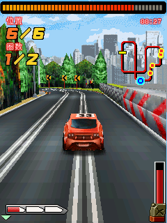
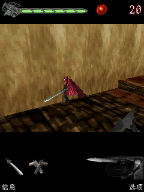
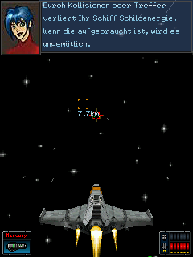

# Compatibility

What a J2ME title can rely on, what it cannot, and why. This file is meant to be
read *before* debugging a game: most "the emulator is broken" reports turn out
to be one of the gaps listed here, and knowing which one saves an afternoon.

The ledger of what has *already* been verified - real titles, subsystems and
their evidence - is [docs/VERIFICATION.md](VERIFICATION.md). Check it before
re-running a verification: a title listed there with its evidence does not need
the pass repeated unless the code path it exercised changed.

## Profiles and configurations

| | Status |
|---|---|
| CLDC 1.1 (JSR 139) | implemented |
| CLDC 1.0 | implemented — the runtime is a superset; class files with major version 45–48 load unchanged |
| MIDP 2.0 (JSR 118) | implemented, see the API table below |
| MIDP 1.0 | implemented — every 1.0 call exists in 2.0 |
| JSR 75 (FileConnection/PIM) | `FileConnection`, sandboxed to `--fs-dir`, and `RecordStore`; the PIM half (`ContactList`) is not implemented |
| JSR 82 (Bluetooth) | implemented, on ten port hooks (`nj_port.bt_*`): `LocalDevice`, `DiscoveryAgent.startInquiry`/`searchServices`, `UUID`, `DeviceClass`, `DataElement`, `ServiceRecord`, `RemoteDevice`, and RFCOMM `btspp://` / L2CAP `btl2cap://` connections both ways — a client through `bt_connect`, a server through `bt_listen/accept/read/write`. Any of the hooks may be NULL, and then that URL is refused by name. With no hooks at all (or a radio the port cannot reach) every operation raises `BluetoothStateException`, because a MIDlet that is told "no radio" keeps working and one that is told "no such class" does not. `DataElement` covers the int/boolean/String/UUID/sequence types; `L2CAPConnection` is a byte stream with the default 672-byte MTU |
| JSR 256 (Sensor) | implemented: `findSensors`, `getSensorConnection`, channels, measurement ranges and data listeners, with the sensors themselves supplied by the port (`nj_port.sensor_list/open/read/close`). A port that has none reports none. Conditions are not evaluated — `addCondition` raises `UnsupportedOperationException` — and availability push answers `false` |
| JSR 120/205 (messaging) | classes present; connections refuse the same way |
| JSR 135 (Mobile Media) | tone and sampled PCM playback, WAV from a stream or a JAR resource, MIDI rendered by the runtime itself (or by the platform's synthesizer through the port's MIDI hooks), and AMR narrowband decoded by the runtime itself; no video. MP3, AAC and anything else the platform can decode arrive through `nj_port.audio_decode`, which is what the Android port does with MediaCodec |
| JSR 184 (Mobile 3D Graphics) | the classes, the scene graph, the transform maths, a `.m3g` container parser, the member surface real titles use, and a software rasteriser with a depth buffer, perspective-correct texturing (nearest, bilinear, and a level chain built from the image for minified surfaces), back-face culling and per-vertex lighting — all behind `NJ_ENABLE_M3G`. `浴火银河2完整版_7689` renders its 3D scenes through it (thousands of triangles, `tris=` in `--stats`), and `3D拉力赛-进化汉化版_6366` now draws its race with blue sky and mountains, textured road and markings, rear car livery and the HUD: 120,397 triangles in 2,700 paced frames, including acceleration and steering (`docs/images/rally3d-race.png`); the rest of the collected titles keep their 3D behind menus, so each of them is judged by its 2D interface (see below) |
| Mascot Capsule Micro3D v3 | behind `NJ_ENABLE_MASCOT`: MBAC model loading, MTRA skeletal animation, indexed BMP textures, fixed-point transforms, lighting, depth-sorted deferred rendering and primitive drawing. Devil May Cry reaches interactive combat; see the replay evidence and command-list limitations below |

A missing class or member raises a named linkage error. A present member does
not guarantee complete behavior: some optional APIs still contain stubs, and
Micro3D's command-list interpreter supports a documented subset. Unsupported
command types raise `UnsupportedOperationException`. The API-specific notes
below identify those gaps. Bluetooth classes instead report unavailable
hardware at run time, and sensors absent from a port are omitted from
`findSensors()`.

Modules a platform may want to leave out entirely are switched off with a
compile-time macro rather than by editing the tables, so the same source builds
for a microcontroller and for a desktop. `NJ_ENABLE_M3G` is the first of these;
see `include/nj2me/nj_config.h` for the list and what each one costs.

## Class file support

The loader accepts major versions 45 through 49 and does not verify. No
verifier is needed because an interpreter cannot be talked into memory
unsafety the way a JIT can — but every array access, cast and stack-depth
assumption is still checked at run time, so malformed input raises a Java error
rather than corrupting C state.

## Verified titles

`tools/fetch_test_games.sh` pulls the published binaries for *J2ME Games with
MIDP 2* (Apress, 2004), built by javac 1.4 targeting CLDC 1.0 - class file
version 46, with the legacy jsr/ret finally blocks a 2004 toolchain emitted.

Every title is run by `tools/run_game_corpus.sh`, which tries a list of screen
sizes per title and records which one worked - the gates differ, and a title
that rejects one size is not a broken title. Tumbleweed is the strict one:

    if (DISP_WIDTH < 150 || DISP_HEIGHT < 170) throw new Exception("Screen too small");
    if (DISP_WIDTH > 250 || DISP_HEIGHT > 250) throw new Exception("Screen too large");

so it wants 176x208. It renders its own error Alert, correctly, at anything
outside that - which is how the gate was found.

| Title | Class | Size | Result |
|---|---|---|---|
| Tumbleweed (`jump.jar`) | `net.frog_parrot.jump.Jump` | 176x208 | **plays**: scrolling ground, an animated sprite, a live score and a countdown - [screenshot](images/tumbleweed.png) |
| Maze (`maze.jar`) | `net.frog_parrot.maze.Maze` | 176x208 | **runs**: generates and draws a maze with the player marker - [screenshot](images/maze.png) |
| Hello (`hello.jar`) | `net.frog_parrot.hello.Hello` | 176x208 | **runs**: draws "Hello World!" (a legitimately static screen) |
| **Bubblet** (`bubblet.jar`) | `Bubblet` | 176x208 | **plays**: a full bubble-popper grid, and the only title here that is not from the Apress book - see below |
| Dungeon (`book{5,6,7}.jar`) | `net.frog_parrot.dungeon.Dungeon` | 176x208 | **plays**: a platformer with tiled walls, keys, a door and a timer - [screenshot](images/dungeon.png) |
| Platformer (`book4.jar`) | `net.frog_parrot.jump.Jump` | 176x208 | **plays**: the same Tumbleweed game at a later stage of the book |

**Bubblet is built from source, not fetched.** `tools/make_bubblet_jar.sh`
clones [Summeli/Bubblet-Asha](https://github.com/Summeli/Bubblet-Asha) (GPL v2,
~900 lines, a Nokia SDK 2.0 project) and compiles it against this project's MIDP
stubs. That proves something a prebuilt JAR cannot: that the API surface this
runtime implements is the one javac resolves against, so a missing or
differently-described method is a compile error rather than a NoSuchMethodError
found later by a player. It found five things, all fixed, and two more that are
recorded in docs/notes/OPEN-issue-stack-slot.md.

`tools/run_game_corpus.sh` is the gate over all of them: it fails on "not a
MIDlet suite", "could not start", an uncaught exception, "nothing ever
presented" or a single flat colour, and reports - without failing - whether the
picture changes, because a title is allowed to be static. Current result: 7
passed, 0 failed.  The later chapters all build to `book.jar`, so they are
stored by chapter.

A sweep runs the titles **uncapped** (`--fps 0`), so 600 frames can cost a tenth
of a second of wall clock - and a title whose own loop is paced by
`Thread.sleep` has barely executed when its pixels are read. That is a claim
about the harness, not about the title: `开心农场_240` was written down as a
blank screen (0 colours, 4 Graphics calls, 1750 bytecodes over 600 frames) and
draws a 61-colour screen once its frames are 33 ms apart. `纯爱物语3之梦想之翼_5112`,
`新三国志_10225` and `PC正版-使命召唤5_7199` are the same story. So a verdict
that still has no colour on screen after the longer re-run is checked once more,
paced at `NJ_PACED_FPS` (default 30 - the frame rate of the phones being
imitated) for `NJ_PACED_FRAMES` (default 300, ten seconds of the game's own
time), and the row records which pace its verdict came from: "the picture
appeared only when the run was paced at 30 fps" or "still flat when paced at
30 fps". `--where` is the diagnostic that explains such a row, since it names
the frame the game's own loop is parked in (`af.a()V pc=30 / ab.b()V pc=60 /
ab.run()V pc=11` for 开心农场_240, a loop that sleeps between frames).

Frames are not time, and a frame budget is spent as fast as the runner can
present frames: a title that spends its first seconds in a sleep driven loading
animation presents very few of them, so thousands of frames go by while the
game's own clock has barely moved.  `反恐精英2正式版_5836` is the case that made
this concrete - its opening is a progress bar that advances on `Thread.sleep`,
and after the uncapped run, the long re-run and the paced re-run it was still
flat.  A title that still has no picture after all of those now gets
`NJ_SLOW_SECS` (default 90) seconds of wall clock in one more run and is judged
on what it drew; the row says so ("the picture appeared only after 40s of its
own clock").  The notes the shorter passes wrote are dropped in that case,
because "still flat when paced at 30 fps" next to a `PASS` contradicts the row's
own verdict.  Titles that could not start, or are not MIDlet suites, skip the
pass: more time cannot help them.

### Where the collected 395 stand

`NJ_FRAMES=600 NJ_TIMEOUT=25 tools/run_game_corpus.sh` over `tests/games`, with
the long re-run, the paced re-run, the wall-clock re-run, the device re-run and
the two heap re-runs below: **393 passed, 2 failed**.  The two are
`鲁宾逊漂流记汉化BT版_4677` (a truncated JAR: 286,534 bytes with no
end-of-central-directory record, which python's `zipfile` refuses as well) and
`乱世Q三国_1649`, whose own licence-time check prints `授权过期` and exits -
the reference emulator does the same.  A sweep on a fresh corpus work
directory had counted `实况足球经理2009_10609` as a third failure, and the
title was long described here as flaky; it was a runtime bug instead - a
`DataInputStream` that could not rewind the stream it wraps
(`docs/notes/2026-10-21-datainput-rewind.md`, commit `239ccec`) - and the fix
moved it into the passing set.  The 392/3 sweep is history, and so is the
older 393/2 one that preceded it; the full snapshot and classification are in
`docs/VERIFICATION.md`.  The sweeps before them were 374/21 (before the pacing
retry), 376/19, 381/14, 384/11, 385/10, 386/9, 387/8, 389/6, 390/5 and 393/2,
and every drop came from a bug the corpus itself pointed at rather than from a
title being excused.  The last drop was three passes at once: the pacing
re-run (six titles draw only at 30 fps), the wall-clock re-run (a loading bar
paced by the title's own clock) and the device re-run (`1945空战英雄_6105` runs
as a Nokia 6230).

### The six that still fail, and what each one turned out to be

Five titles do not paint a frame.  They have been looked at one by one, because
the last three bugs came out of exactly this list, and the honest answer differs
per title:

| title | what happens | what it is |
| --- | --- | --- |
| `1945空战英雄_6105` | `IllegalAccessException` out of its own MIDlet constructor | the title's own platform check: it demands `microedition.platform` start with `Nokia`, and runs (`frames=60 paints=60 gfx=180`) with `--device nokia6230` |
| `鲁宾逊漂流记汉化BT版_4677` | `not a MIDlet suite` | the JAR is truncated: 286,534 bytes with no end-of-central-directory record at all (python's `zipfile` refuses it too) |
| `灌篮高手-爆发!樱木_7947` | `ArithmeticException: / by zero` in `w.paint()` | the class file really does `getWidth() / 0` (`iconst_0; idiv`) once its image field is loaded - no runtime can finish that paint |
| `战争艺术2之全球联盟中文版_1918` | NPEs in `n.a(String,int)`; nothing drawn | same shape: `d.f()`, which builds the config array `b.bb`, is never called |
| `午夜台球圣诞中文版_8677` | `NegativeArraySizeException` in its own decoder (`c.a(I)`), then a flat frame | its resource reader computes a negative length; the title is the only thing that can fix that |

Three titles left this table, and all three were the runtime:

* `模拟人生2_10762` was the row nobody could explain: its `paint()` made no
  Graphics call at all and its game thread returned before the first frame.  A
  wrapper class without `toString()` sent the game looking for a JAR entry named
  `global_data/java.lang.Integer@c1803e7` (see *A missing override is not a link
  error*).
* `实况足球经理2009_10609` was catalogued here as "the method that builds its
  string table has no caller" - a dead initialiser, we thought.  With the same
  wrapper overrides in place it loads its strings and paints, so the caller was
  there and the missing `Integer.toString()` was what stopped it.
* `仙魔飞行棋_417` was the one row with no exception at all; it was
  `Canvas.repaint()` dropping the request (see *MIDP paints on request*).  It now
  paints 79 colours and 16,206 Graphics calls per run where it painted black.

A fourth title left this table with the wall-clock pass described above:
`反恐精英2正式版_5836` was never stuck, it was slow.  Its opening is a sleep driven
progress bar, so a frame budget ran out while the bar was still moving, and with
`NJ_SLOW_SECS=40` the same binary paints its menu at 84 colours.  Its assets are
**not** the blocker either: every `l*.png` in the JAR is XOR-obfuscated (rolling
key from 100), the title tries the raw bytes first (one `unrecognised image
format` per attempt, all for the same resource), then retries with its own
`h.b(byte[],100)`, and that decrypted buffer is a valid PNG this runtime decodes
without a further error.

Every row in that table has since been re-run with the passes above, and four of
the five pass: `1945空战英雄_6105` as a Nokia handset, `灌篮高手-爆发!樱木_7947`
and `战争艺术2之全球联盟中文版_1918` when paced, `午夜台球圣诞中文版_8677` the
same way (the negative length is in a later menu, not in the first screen).
What is left is `鲁宾逊漂流记汉化BT版_4677`, whose central directory was never
written, and `乱世Q三国_1649`'s expired licence check.

`实况足球经理2009_10609` used to deserve a paragraph of its own here, because
its row changed between sweeps: it drew a nine colour screen at 176x208 and a
flat one at 320x240, and its row said its own initialisation raced - the
`NullPointerException` in `d.T(int)` (its string cache) appeared only in the
runs where its loader thread did not finish first.  It looked like a title
drawing only when its own race went its way.  It was not: its resource loader
died at a `DataInputStream.reset()` that the runtime had bound to the empty
close slot, so the stream never rewound and the loader read its packed
container 44 bytes off.  Whether the title reached a stable state or died in
that parse is what made runs differ.  With the rewind forwarded it boots
deterministically to its sound dialog, main menu and player-creation screens
(`docs/notes/2026-10-21-datainput-rewind.md`, commit `239ccec`).  The lesson is
kept rather than the paragraph: a title whose failure depends on timing is
still worth a second look at what the timing is racing.
None of them is known to be the runtime's - which is a different statement from
"the runtime is perfect", and it is the reason the sweeps keep being re-run:
every one of these numbers has moved because of a bug the corpus itself pointed
at.


### MIDP paints on request

The runtime used to paint the current displayable on every frame, whether the
application had asked for it or not.  That is not what MIDP specifies, and the
difference shows in a title that publishes the state its `paint()` reads in a
field and clears it again right after forcing the paint:

```java
state = 1;
canvas.repaint();
canvas.serviceRepaints();   // paint() runs here, with state == 1
state = 0;
```

`paint()` clears the screen and then draws whatever `state` describes, so any
later paint in the same frame finds `state == 0` and leaves the screen blank.
`仙魔飞行棋_417`'s `mobile/k.e(I)V` is exactly this (`f = state; repaint();
serviceRepaints(); f = 0;`), and its board stayed black for a whole run while the
runtime reported a paint for every frame.  With both halves fixed the same title
paints 79 colours and 16,206 Graphics calls where it painted one colour and 370.

Two things were wrong:

* `Canvas.repaint()` with no arguments was routed through the four-argument
  form, which reads `x/y/w/h` out of argument slots `repaint()` does not have.
  It read a width of zero, took that as an empty region and requested nothing,
  so the matching `serviceRepaints()` had nothing to service.  It now requests
  the whole canvas.
* the runner painted again in a frame the application had already painted.  It
  now skips its own paint for that frame (`vm->painted_in_frame`).  That was not
  enough, because the two painters did not take turns evenly: `合金弹头2013BT版_678`
  paints itself every second frame, and on the frames in between the runner
  painted the same canvas with the title's own `paint()` - at a different camera
  position, because the title's state had moved on.  The screen alternated
  between two scenes every frame: exactly the "scenery behind the character
  flickers" a player reported.  Measured over 900 dumped frames, 362 of 898
  frame pairs showed the two-frame cycle before and **0** after.
* so the runner now stops painting altogether once the APPLICATION has painted
  by itself (`vm->app_painted`, set when a paint runs with `vm->in_paint` already
  set, i.e. from `serviceRepaints()`).  A title that paints itself is left to
  paint itself, which is what a device does; the runner only paints before the
  first application paint, which is what draws a title that never asks for one
  (`炸弹人_10311` never calls `repaint()` from its loop, and relies on exactly
  that).

The frame boundary also moved.  `present()` used to happen at the end of the
paint path, which is not the end of the drawing: a title that keeps the
`Graphics` from `paint()` and draws with it afterwards - out of spec, but
universal - had its scenery presented only by luck.  The canvas mirror now lives
in `nj_midp_present()`, called once per frame by the hook in
`nj_lib_midlet.c` after everything that frame drew, and it mirrors the current
plain `Canvas`'s buffer (a `GameCanvas` and a `Screen` keep their own, earlier
path).  `tests/savedgfx/SavedGfx.java` and `tools/check_savedgfx.sh` (ctest
`check_savedgfx`) pin it: the fixture draws a red block through the saved
`Graphics` after `serviceRepaints()` returns, and the check requires the last
presented frame to hold it.  Against the pre-fix runtime the same check reports
0 red pixels.

`tests/repaintdemo/RepaintDemo.java` and `tools/check_repaint.sh` (ctest
`check_repaint`) hold the idiom: a worker thread runs it for the whole length of
the run and the check requires the last presented frame to still be the red
block it drew inside the window.  Reverting either half makes the check fail.

A `GameCanvas` that flushes is the third case, and the one a player reported
twice.  Its buffer is not double buffered: the title draws a whole frame into
it, calls `flushGraphics()`, and starts drawing the next frame into the same
pixels.  The runner painting that canvas once per frame therefore copies
whatever is in the buffer at that moment - and if the title is halfway through
the next frame, the screen gets a frame that is part filled with the new frame
and part left over from the previous one.  Terrain drawn in blocks shows up as
blocks appearing and disappearing behind the character, which is
`鲁宾逊漂流记汉化版_702`'s flicker (its `data.k` game canvas flushes once per pass
of its own loop).  `flushGraphics()` now marks the frame as the application's
own (`vm->painted_in_frame`, `vm->app_painted`, `vm->app_painted_frame`, the
same bookkeeping `serviceRepaints()` uses), so the runner does not paint the
same buffer again in that frame; the adaptive rule still takes the frames back
if the title stops flushing.

`tests/flushdemo/FlushDemo.java` and `tools/check_flushdemo.sh` (ctest
`check_flushdemo`) pin it: the worker paints the top quarter of its frame one
pixel at a time, sleeps 45 ms across a frame boundary, finishes the frame and
flushes, alternating the whole screen between blue and red.  Every presented
frame must be one colour.  Against the pre-fix runtime the check reports 38 torn
frames out of 60, the worst holding 9152 pixels of the other colour; with the
fix, zero.

The runtime-side way to look for this class of defect is
`tools/scan_frame_health.sh`: it runs a title with `--dump-every 1` and counts
the pixels that flip back and forth - equal two frames apart, different from
the frame between - which the corpus sweep cannot see at its fortieth-present
sampling rate.  `鲁宾逊漂流记汉化版_702` with the pointer script that reaches its
map is `two=7164px worst=4632 verdict=flicker` against the runtime before
`08c7c26` and `two=0px verdict=static` against the fixed one.  Size alone is
not enough - an animated logo flips thousands of pixels too, in thin streaks
(`波斯王子之武者之心_8424` is `two=2123px` with a largest connected piece of
243), while a tear is one piece of thousands - so the verdict uses the largest
connected `blob`.  `NJ_KEYS` drives
a title past its menu, and `tools/frame_health.py` does the counting.  A run over all 395 titles with no input flags fifteen; eight of
them re-checked with the blob rule are four tears and three suspects, and
reading the frames shows what they are: an animated logo, a screen blanked
for exactly one frame between two identical ones (`男摄影师_11003`), a
loading spinner that blinks.  None of them is the runtime's - the two that
were are the ones 08c7c26 fixed.

### A mutable image is white, and always opaque

MIDP 2.0 says of `Image.createImage(int, int)`: "Every pixel within the newly
created image is white", and "Every pixel within a mutable image is always fully
opaque."  Neither held: the pixel array was allocated and never filled, so a
fresh mutable image was transparent black (`0x00000000`), and a translucent
source drawn into it kept its alpha.  A title that builds a scene off-screen and
blits it back therefore saw through the parts it had not painted.  The array is
now filled with white when a mutable image is created, and the blend keeps an
opaque destination opaque (which is what the alpha composition already did once
the destination was not transparent to begin with).

`tests/alphademo/AlphaDemo.java` and `tools/check_alphademo.sh` (ctest
`check_alphademo`) hold the rule: `fresh`, `drawn`, `blend`, `rgbkeep` and `copy`
are read back through `Image.getRGB()` and compared field by field - before the
fix, `fresh=0` and `drawn=0x80800000`; after, `fresh=0xffffffff` and
`drawn=0xffff7f7f`.

### GameCanvas polling retains keys until release

`GameCanvas.getKeyStates()` now combines keys that remain held with presses
latched since the previous poll, clearing only the latch. Previously the first
poll consumed a held direction, so games such as `3D版田园物语_6744` moved once
and then stopped until another press event arrived. SDL keyboard, SDL touch pad,
and Android touch controls share this input state. Callback suppression does
not change the polling behavior. `test_game` covers repeated polls, simultaneous
directions, release, quick taps, and suppressed callbacks.

Fresh SDL2 runs of the original farm JAR reached the yard. Holding the keyboard
Down key moved the character continuously, and releasing it stopped movement.
A separate replay injected one SDL mouse-down on the virtual Up key, followed
by mouse-up 1.5 seconds later; the character walked to the house and triggered
its dialogue. Android's keypad decision tests pass, and APKs build for
arm64-v8a and x86_64 with zero writable static data. On an x86_64 Android
emulator, a separately packaged test app loaded the original JAR with isolated
storage and reached the yard. One continuous 2.2-second touch on Down moved
the character through multiple positions; release stopped movement, confirmed
by two subsequent captures. This verifies Android touch input through the Java
keypad and shared native polling state; physical-device gameplay is untested.

### The MIDlet clock is not the scheduler's tick count

`nj_now_ms()` folds the port's millisecond clock into `vm->scheduler_ticks`, and
`nj_yield()` and the end of `scheduler_step()` each incremented that same
counter - so every scheduler pass added a millisecond of MIDlet time on top of
real time.  A busy title gained about 30 ms of clock per 5 ms frame, the
runner's frame pacer measured every frame as over budget and never slept, and
`--fps 30` ran `合金弹头2013BT版_678` at 154 fps (2,479 fps uncapped): every
countdown, animation and `Thread.sleep()` in every title was scaled by the same
factor.  Both increments are gone; `tests/test_speed.c` pins it with "a
scheduler pass does not move the clock" (5,000 `nj_yield()` calls leave
`nj_now_ms()` unchanged) and the same title now runs at 30.0 fps.

Software-rendered 3D games also need more than one bytecode quantum per
video frame. The MIDlet loop now runs fair scheduler rounds for up to 8 ms,
stopping on presentation, blocked threads, or 256 rounds. This avoids
artificially limiting Java rendering to one quantum per 30 Hz tick, while
keeping input polling and rendering bounded. `test_lifecycle` checks the
round cap and presentation stop; the portable interpreter dispatch also
checks its quantum on fast opcode paths.

The original `3D坦克对战1944_7139.jar` and
`3D孤胆枪手2010_4634.jar` were replayed after the change. The shooter reaches
its corridor battle in SDL2, accepts held controls, and has no uncaught
exception in the bounded run. Its green touch controls are also present in
FreeJ2ME-Plus. This is a startup and gameplay smoke test, not a complete
playthrough. The motorcycle game's null-canvas TimerTask exception also
occurs in FreeJ2ME-Plus; correcting Timer lifecycle does not repair that
application-level initialization race.

### The passes reach further than the table did

The table above is a snapshot of one sweep, and three of its rows were written
before the tool learned to pace a title, to give it real seconds, and to hand it
the phone it was written for.  Run with those passes:

* `1945空战英雄_6105` passes - `PASS (static picture; only ran as a nokia6230
  handset)`.  The runtime has had device profiles all along; the sweep now uses
  one for a title that did not start.
* `灌篮高手-爆发!樱木_7947` passes - `PASS (the picture appeared only when the
  run was paced at 30 fps)`.  Its class file really does divide by zero inside
  `paint()`, which is why the row said so, but the frames drawn before the
  division stay on the screen and the tool accepts a static picture.
* `战争艺术2之全球联盟中文版_1918` passes the same way, with 405 colours: the
  initialiser with no caller is on a later menu path, not on the first screen.

What has NOT moved is the truncated JAR (`鲁宾逊漂流记汉化BT版_4677`): no pass
helps a suite whose central directory was never written.  The honest reading of
a row is therefore "this is what one pass of the tool saw", which is why the
tool prints the note that made a title pass.

### A title is allowed to ask how much memory it has

`Runtime.totalMemory()` is a real question with a real answer, and one title
uses the answer to decide whether to run at all: 有女倾城破解版_11525 calls
`notifyDestroyed()` out of its own `startApp()` when the total is above 6 MB
(the bytecode is `Runtime.getRuntime().totalMemory()` `>> 20`, compared with
`6L`). At `--heap 16` the sweep sees a MIDlet that presented nothing and exited
in 7 ms; at `--heap 4` it runs and draws 627 Graphics calls a second. A Java
heap of 1-4 MB is what the phones being imitated actually had, so the smaller
heap is the faithful run, and the sweep now asks once more with
`NJ_HEAP_RETRY` (default 4 MB, `0` switches it off) when a title paints
nothing. The row says which run the verdict came from: "the picture appeared
only with a 4 MB heap".

The same question has an opposite answer. 愤怒的小鸟-高清版_2353
ships a 13,059,116-byte music WAV; its WAV sample data totals about 16.6 MB.
The desktop CLI now defaults to at least 64 MB of Java heap so these resources
and the game state fit together. `--heap` still overrides that default, and the
embedded/library heap default is unchanged. An out-of-heap sweep result should
be retried with more room before trying a smaller handset-sized heap.

Further gameplay testing exposed runtime defects too: Canvas key methods had
incorrect static metadata, and media input stopped at 4 MB. The key methods
now consume their instance receiver correctly; media loading uses the stream's
available-byte hint, releases superseded growth buffers, and permits input up
to the heap limit. A 5 MB WAV regression verifies every decoded sample, including
the last one. An SDL2 run of the original JAR reached the first-level slingshot
with directional/fire input and opened stereo 44,100 Hz audio, completing 1,200
frames without an uncaught exception or `OutOfMemoryError`. This verifies the
start and early gameplay path, not a complete playthrough.

The same title also exposed a redundant full-size allocation for 16-bit WAV.
The runtime now moves PCM to the start of its private stream buffer and reuses
that allocation. The caller's stream backing array stays unchanged. The original
JAR now reaches the first level and responds to pause/continue at `--heap 32M`,
with 1,200-frame headless and SDL2 replays. A 6 MiB stereo regression on a 16 MiB
heap checks the peak-memory case, every sample, RIFF/trailing-chunk removal,
duration and input isolation; see the [WAV allocation note](notes/2026-10-20-wav-buffer-reuse.md).

The eight that remain are each classified, not just counted:

| kind | titles |
|---|---|
| a broken JAR (truncated, no end-of-central-directory) | 鲁宾逊漂流记汉化BT版_4677 |
| a title that refuses a platform string this runtime does not imitate (`--device nokia6230` runs it) | 1945空战英雄_6105 |
| flat under every pace and every heap tried at the time, cause not yet found | 灌篮高手-爆发!樱木_7947, 午夜台球圣诞中文版_8677, 战争艺术2之全球联盟中文版_1918 (反恐精英2正式版_5836, 实况足球经理2009_10609 and 仙魔飞行棋_417 were in this row then; all three run now — the football manager only deterministically since the `DataInputStream` rewind fix, commit `239ccec`) |

The most recent fix to come out of this list is a good example of why it is
worth keeping: 疯狂农场2_2375 showed a black screen with 0 Graphics calls, and
the reason was that its class `h` declares a static `Vector b` while its
superclass declares an instance field of the same name and descriptor, so the
resolver linked `getstatic`/`putstatic` to the instance offset and both accesses
silently did nothing. Fixing field resolution the way JVMS 5.4.3.2 specifies
took that title, 疯狂企鹅中文版_10228 and 模拟人生3中文版_6162 off the flat list
in the same sweep. Two of those had been written down as "the game is stuck in
its own flow", which is exactly the conclusion this list exists to avoid.

All three parse and link with zero failures. Tumbleweed is the demanding one: it
uses `GameCanvas`, `LayerManager`, `Sprite` with frame animation, `TiledLayer`,
`Font` metrics, `Image` loading from the JAR, a background game-loop thread, and
`System.getProperty` - and it is the title that found most of the bugs listed at
the bottom of [ARCHITECTURE.md](ARCHITECTURE.md).

It also gates itself on the device, which is worth knowing when trying it:

```java
DISP_WIDTH  = getWidth();
DISP_HEIGHT = getHeight();
if (DISP_WIDTH < 150 || DISP_HEIGHT < 170) throw new Exception("Screen too small");
```

so run it with `--size 176x208` or larger; at 240x320 it refuses with its own
Alert (which the runtime renders correctly, title bar and all).

Specifically supported:

- `long` and `double` throughout, including the two-slot stack discipline
- legacy `jsr` / `ret` (old toolchains emit these for `finally`)
- `tableswitch`, `lookupswitch`, `multianewarray`
- `checkcast`, `instanceof`, `athrow`, `monitorenter` / `monitorexit`
- modified UTF-8 (CESU-8) constants, including embedded NULs
- class file attributes that matter (`Code`, `ConstantValue`); the rest skipped

## The downloaded corpus: 29 JARs, stage by stage

A second, independent set of real titles lives in `/home/lucinhu/Downloads/jar` -
29 files, 27 unique SHA-256 (three of them are byte-identical). Every one of
them has been **run**, and for each the reachable stage, a screenshot with its
hash, the exception text verbatim, a compatibility verdict and a runnable
repro are tabulated in
[docs/notes/2026-10-22-corpus-29-compat-matrix.md](notes/2026-10-22-corpus-29-compat-matrix.md).
The master log with the per-round evidence is
[docs/notes/2026-10-17-download-corpus.md](notes/2026-10-17-download-corpus.md).

The verdicts use one vocabulary, so they can be compared:

| verdict | meaning |
|---|---|
| usable | a real game screen was reached and input advanced to a meaningful interaction point - **not** a completed playthrough |
| partly usable | a real game was reached, but a named feature (turn advance, building, saving, a whole run) is still unverified |
| limited | it starts, but the title's own logic or a platform check stops it; there is no matching defect in the runtime |
| externally blocked | it needs a live server or an account; no amount of emulator work changes that |
| title-side defect | the title throws and exits on its own; the reference emulator does the same |

Four things in that corpus are **outside** what an emulator can fix, and are
recorded as limits rather than gaps:

1. **The servers are down.** The MMORPG and browser titles (仙镜OL, 侠义OL, UC)
   point at endpoints that no longer answer. A *controlled* local proxy proves
   that the request leaves the device and that the response is consumed - it
   does not prove that any server is alive. 仙镜OL does not even go through the
   HTTP proxy: a confirmed-live 503 proxy logged **zero** requests.
2. **No accounts exist.** Registration, login, character creation and online
   play were never performed. Chinese text appearing in an account field proves
   the **input path**, not that the account works.
3. **A controlled response is not the server's answer.** UC's 41-byte allocation
   response is test data built locally from the bytecode; it only advances the
   parse path.
4. **No real handset.** All Android evidence comes from an API 26 x86_64
   emulator. A real arm64 phone has a different IME and a different touch stack.

Android text input was verified end to end against the **system Google Pinyin**
(composing "ni hao", committing with the space key, and the game's own
registration form then showing `游戏账号: 你好`), and on the desktop against
**fcitx5** (`Control+Space`, `nihao`, space - the committed screenshot is
byte-identical across four runs). One desktop run in four does not commit
because the host IME context did not switch to pinyin, so that pass is judged
from the screenshot hash, never from the exit code. The desktop pre-edit is
**not** pushed into the widget (`src/port/posix/nj_port_sdl2.c:1128-1130` sets
`ime_composing` only), so the candidate window is drawn by the host, not by
the game. Details and hashes:
[docs/notes/2026-10-22-android-desktop-ime-regression.md](notes/2026-10-22-android-desktop-ime-regression.md).
The last round rebuilt the APK **with** the classless-array fix and walked the
same path again on the emulator: the registration form still ends up reading
`游戏账号: 你好` (APK `a10061b9b2461ba0`), and the controlled network still
separates the two cases - 503 gives five `GameComm` POSTs and the error page,
an empty 200 gives two POSTs and none.

One title in the corpus is **keyboard-only by construction**: Townsmen 6 (the
N73 build) registers no pointer handling at all - `javap` shows
`pointerPressed`, `pointerReleased` and `pointerDragged` as `0: return` - so a
synthetic touch can never drive it, and the only way in is the keyboard
(D-pad moves the hand pointer, Return/F1/5 confirm, F2 cancels). The same
title saves and reloads correctly: exit through the pause menu, restart on the
same `--rms-dir`, and the village comes back whole.

The keyboard is enough to **build** too, and that was worth pinning down with
pixels rather than with a panel that merely opened: `fire` opens the action
menu (four icons), `fire` again enters placement mode (red = cannot build,
green = can build), the D-pad moves the hand pointer onto a green plot and
`fire` puts a house on it - the plot turns into a wooden scaffold and the new
building's panel appears.  An earlier note claimed the build did not reproduce
on a clean HEAD build; that turned out to be a *rendering* difference of that
build (the action-menu icons, the building shadow and the plot highlight are
not drawn there), not a statement about the title.  Free mode is reachable from
the keyboard as well, and it is the only place this JAR has an enemy count -
but **combat is blocked by construction**: the region panel's hit test is
reached only from the touch path, the Canvas ignores pointers, and the keyboard
resolves grid coordinates only, so the "dispatch" button cannot be pressed
without a touch.

### A Canvas that draws its own editor had no way to receive a character

MIDP 2.0 puts `getKeyChar()` on `Displayable`: "Gets the character representing
the key that was pressed."  The runtime did not have it at all, so a title
that asked for the character got a `NoSuchMethodError` on the first key press
and the input was lost.  It answers now, with the MIDP keypad table (`KEY_NUM5`
is `'5'`, `KEY_STAR` is `'*'`, `KEY_FIRE` has none), and a port may hand over
the character the user really typed.

That second half is what a Canvas needs when it draws its own editor instead
of using a MIDP `TextField`: the desktop port now delivers typed characters to
such a Canvas - ASCII through the key path, and a host-IME commit through the
text path (`NJ_SDL2_TEXT=always`), so `a` arrives as `code=97 char=97` and
fcitx5 pinyin `nihao` + space arrives as U+4F60 and U+597D.  The IME's preedit
never leaks, so an editor does not receive `nihao` and then the two Chinese
characters.  The cost is 136 bytes.

## Fixes found by that corpus

Running the corpus is what turned up the defects; these are the ones that were
fixed and locked behind a test in this round.

### An array with no class used to crash the interpreter

UC's address editor segfaulted the runtime (exit -11) while the MIDlet was
painting. The cause was not timing, network or the in-flight interpreter work:
an array **created by a native** (`String.getBytes()` hands back a `byte[]` that
the runtime allocates without a class) has `cls == NULL`, and the
`invokevirtual` dispatch then built its "X does not implement Y" message out of
that null pointer - `recv->cls->name`.

Three changes, all of them "turn undefined behaviour into the answer a phone
gives":

- the error message now uses a helper that renders a classless array as
  `[B`/`[I`/... from its element kind;
- a classless receiver is dispatched against `java/lang/Object`, so
  `getBytes().toString()` returns `"[B@1a2b3c"` - exactly what a handset
  returns - instead of crashing;
- `Object.toString()` uses the same naming for a classless array.

The regression test is a two-line MIDlet (`tests/arrcls/ArrClsDemo.java`); its
fixture JAR is **generated, not checked in** (`tests/fixtures/` is gitignored) by
`tools/make_arrcls_jar.sh`, and `check_arrcls` in ctest exercises it. Before the
fix it exits 139 every time; after the fix it exits 0 and prints `[B@...` for
both a heap array and a native array, and a `ClassCastException` for a
non-String argument.

### `String.startsWith`/`endsWith`/`equals` on an empty argument

UBSan flagged `null pointer passed as argument 2, which is declared to never
be null` in `src/core/nj_lib_string.c`: with an empty prefix the code called
`memcmp(x, NULL, 0)`, which the C standard does not allow. The comparison is
now guarded; the **observable** result is unchanged (an empty prefix still
matches), only the undefined behaviour is gone.

Full write-up, backtrace, hashes and the boundaries:
[docs/notes/2026-10-22-uc-null-class-crash.md](notes/2026-10-22-uc-null-class-crash.md).

## API coverage

### Streaming XML (optional SAX subset)

`NJ_ENABLE_SAX=1` provides `SAXParserFactory.newInstance()`,
`newSAXParser()`, `SAXParser.parse(InputStream, DefaultHandler)`, the document,
element, text and processing-instruction callbacks, and the `Attributes` query
methods. Attribute snapshots remain valid if a handler retains them. UTF-8 and
UTF-16 LE/BE streams, XML declarations, comments, CDATA, predefined entities and
numeric character references are supported. Stream and callback exceptions are
propagated unchanged, including when a UTF-16 surrogate spans a failed read.

This is a non-validating, namespace-disabled parser: qualified names and `xmlns`
attributes are preserved, while URI/local-name queries are empty. Requesting
validation or namespace processing is rejected by `newSAXParser()`. DTDs,
external entities, DOM and the wider JSR-172 web-services APIs are not implemented.
There are explicit limits of 64 nested elements, 128 attributes per element,
65,536 UTF-16 units per token and 1,048,576 decoded characters per document.

Desktop CMake enables this subset by default; `-DNJ_ENABLE_SAX=0` removes its
classes and reader. Standalone ports default to disabled. See the
[Angry Birds SAX investigation](notes/2026-10-20-sax-angry-birds.md) for original
JAR validation, memory use and measured binary costs.

### java.lang

| Class | Status |
|---|---|
| `Object` | complete (`hashCode` is a stable identity hash) |
| `String` | complete; both the embedded and the wrapped representation, including the `byte[]` constructors and `getBytes`, named or not |
| `StringBuffer` | complete |
| `StringBuilder` | present as a `StringBuffer` subclass — not in CLDC, but every modern javac lowers `a + b` to it |
| `Math` | complete, plus `cbrt`/`rint` beyond CLDC |
| `System` | `currentTimeMillis`, `nanoTime`, `arraycopy`, `identityHashCode`, `gc`, `exit`, `getProperty`, `out`, `err` |
| `Thread`, `Runnable` | green threads, `sleep`, `join`, `yield`, `wait`/`notify` on `Object` |
| `Throwable` and the full exception hierarchy | complete, with `toString`/`getMessage`/`printStackTrace` |
| `Class` | `getName`, `isArray`, `isInterface`, `isInstance`, `getSuperclass`, `forName` |
| `Integer`/`Long`/`Short`/`Byte`/`Character`/`Boolean`/`Float`/`Double` | constructors, `*Value`, `parseInt`, `toString(radix)`, `toHexString`, `valueOf`, and the value semantics of `toString()`/`equals(Object)`/`hashCode()` |
| `Runtime` | `gc`, `freeMemory`, `totalMemory`, `exit` |

`System.getProperty` answers for `microedition.platform`, `.configuration`,
`.profiles`, `.locale`, `.encoding`, `line.separator`, `java.version` and
`os.name`. A key the runtime does not know, the installed device profile does
not carry and the port does not answer returns `null`, which is what a real
device does for unknown keys. The platform string is itself overridable — see
[the device a title believes it is on](#the-device-a-title-believes-it-is-on).

**Encoding names are case-insensitive**, as the spec says, and the table is
deliberately closed. `String.getBytes`/`new String(byte[], String)` decode the
platform encoding this runtime advertises (ISO-8859-1, with every alias and
spelling seen in a jar), the ASCII family, and UTF-8. Anything else —
`Shift_JIS`, `GB2312`, `Big5`, `UTF-16` — refuses **by name** with
`UnsupportedEncodingException` rather than decoding as Latin-1: a title that
asked for one of those and got mojibake has no way to find out where it went
wrong. The corpus is the reason the table exists at all — 48 collected titles
spell UTF-8 some other way than `"UTF-8"` (`"utf-8"`, `"Utf-8"`, `"utf8"`), and
`疯狂战机_2013` died on every run at `getBytes("utf-8")` until the comparison
stopped being case-sensitive. `tools/check_encoding_names.sh` is the regression
test.

### A missing override is not a link error

CLDC declares `toString()`, `equals(Object)` and `hashCode()` on every wrapper
class. This runtime declared none of the first and, outside `Integer`, none of
the others - and a missing override here is invisible: the call resolves up to
`java.lang.Object`, so the method exists, runs, and answers the identity form.

`模拟人生2_10762` is what that costs. Its content loader
(`com/ideaworks3d/sims/util/a.a`) names a file by concatenating
`"/global_data/" + <content id>`; `String.valueOf(Object)` reached
`Integer.toString()`, the runtime answered `java.lang.Integer@c1803e7`, the
lookup for the JAR entry `global_data/java.lang.Integer@c1803e7` found nothing,
the game threw `Failed to locate content: 34795` into its own catch-all handler,
and its game thread returned before the first frame - a MIDlet that looks alive
and paints a black screen for as long as you watch it. With the value semantics
in place the same run reaches `loadAllSounds` and `start menu`, and paints
(401 paints / 8,635 Graphics calls in 400 frames, 2.4 M bytecodes/s).

The same gap made every `Hashtable` keyed on a `Long`, `Short`, `Character`,
`Boolean`, `Float` or `Double` compare identities, and `Boolean.hashCode()`
answered the identity hash instead of 1231/1237.

`Float` and `Double` follow Java's own details rather than a `printf`: a whole
value prints with its `.0` (`2.0f` is `"2.0"`, not `"2"`), `equals()` compares
the bit patterns - so `NaN` equals `NaN` and `+0.0f` does **not** equal `-0.0f` -
and `hashCode()` is `floatToIntBits()`, or the xor of the two halves of
`doubleToLongBits()`. `NaN`, `Infinity` and `-Infinity` are spelled the Java
way, not `printf`'s.

`tests/boxdemo` and `tools/check_boxing.sh` pin all of it, including the
cross-class rule (`new Integer(5).equals(new Long(5L))` is false) and the
float/double cases above; the negative check is the same fixture against the
pre-fix runtime, which prints `java.lang.Integer@e85f125` for `new Integer(34795)`.

### Every member the reference declares, or a line saying why not

A missing builtin member is not a link error: the class loads, the call sites
in other classes resolve nothing, and the title dies later with a
`NoSuchMethodError` that names a method the javadoc says exists.  That is how
`java.lang.Integer.toString()` went missing for ten rounds while 65 titles
kept working (the identity string was a plausible-looking resource name), and
it is why this round stopped reading the corpus and started reading the
specification.

`tools/build_api_ref.py` downloads the CLDC 1.1 and MIDP 2.0 javadoc pages,
plus the **Nokia UI API**, and writes `tools/data/api-core.txt`: 982 members
over 83 classes, one `class name (args)` line each.  The Nokia pages are there
because that vendor surface is the one the corpus leans on hardest - 83 titles
reference `FullCanvas`, 74 `DirectGraphics`, 73 `DirectUtils`, 14 `Sound` and
10 `DeviceControl` - and the first audit of those seven classes found thirteen
missing members, one per family: `drawTriangle`, both `drawPixels` overloads,
the `byte[]`/`byte[][]` `getPixels` and `getAlphaComponent` on
`DirectGraphics`; `createImage(byte[], int, int)` on `DirectUtils`;
`flashLights(long)`, `startVibra(int, long)` and `stopVibra()` on
`DeviceControl`; and `resume`, `getGain`, `getConcurrentSoundCount(int)` and
`getSupportedFormats()` on `Sound`.  A title that hits one of those loses the
frame it was drawing, and `DirectUtils.createImage(byte[], int, int)` is the
one a PNG-based title cannot work around at all.

The scan that says whether any of it matters to a title is
`tools/scan_api_gaps.sh`: it runs every collected title for 400 uncapped frames
and greps for `NoSuchMethodError`, `NoSuchFieldError`, `ClassNotFoundException`,
`UnsatisfiedLinkError` and `AbstractMethodError`.  Over all 395 titles it finds
ten titles with a missing member and **not one `NoSuchMethodError` or
`NoSuchFieldError`** - every line is a title asking `Class.forName` for a vendor
class inside its own `try`, which is a title looking for an emulator it is not
running on, not a gap in this runtime.

`tools/api_audit.py` then parses this runtime's
own builtin tables the way the compiler does - macro expansion, the class
table, every `M(...)` row, the registration table, the superclass walk - and
reports what cannot resolve.  It runs as the `check_api_audit` ctest, so it now
fails the build the moment a member disappears again, and
`tools/data/api-allow.txt` names the gaps that are accepted on purpose (two
`HttpConnection` members that belong to the HTTP lane) and is checked in both
directions: a line that starts resolving is a failure too.

Two things about that list are worth keeping.  The flags are not part of it:
`Sound.getSupportedFormats()` and `Sound.getConcurrentSoundCount(int)` are
static in the API and this runtime first declared them as instance methods,
which the audit cannot see (it compares names and argument lists) and which a
title would meet as an `IncompatibleClassChangeError` on the
`invokestatic`.  And a member that exists but does nothing useful is not a gap
either, which is why the vendor calls have a fixture: `tests/nokiademo` drives
`DirectUtils.createImage(16, 16, ...)` and `createImage(byte[], int, int)` (the
jar carries a real two-by-two PNG), checks that the triangle's top edge came out
red where it was drawn and white where it was not, that a `byte[]` pixel reads
back as its own grey and an ARGB `int` survives the round trip, and that
`Sound` plays, keeps gain, resumes, lists two formats and one channel.
`tools/check_nokiademo.sh` is that fixture's assertions and runs as the
`check_nokiademo` ctest.

The first honest run of the CLDC/MIDP audit said 81 members.  They were filled in two batches
(java.io: Reader/Writer/InputStreamReader/OutputStreamWriter/PrintStream;
core: String.valueOf/intern, Thread(String), Class.isAssignableFrom,
Throwable.printStackTrace(PrintStream), Calendar.before/after, Display colours,
TextBox/TextField.getCaretPosition, the five-argument Command and ImageItem
constructors, RecordStore.setMode, Player.getContentType, StringBuffer's
missing insert overloads and Object.wait(long,int)).  java.io mattered most:
`new PrintStream(new ByteArrayOutputStream())` used to write to the port log
and nowhere else, because PrintStream's own class row lives in
`src/core/nj_lib_system.c` while the natives lived in the io module - the
registry is keyed by (class, name, descriptor), so the bodies bind across
modules but the *declaration* has to be in the file that owns the class.

The audit's own blind spots are worth knowing: 35 of the 50 java.io rows were
false positives, because `reader_methods[]` and friends were written with a
private `RM(...)` macro that only knew `M(...)`; and a table that is empty
because nobody can parse it looks exactly like a table with nothing in it.
`-v` prints the other direction (members this runtime declares that the
reference does not list: the Mascot Capsule, m3g and JSR 75 extensions), which
is how a typo in a descriptor shows up.

### java.util

`Vector`, `Hashtable`, `Random` (the 48-bit LCG, so sequences match a real
device), `Date`, `Calendar`, `TimeZone` (UTC), `Stack`, `Enumeration`,
`Timer`/`TimerTask` (driven by the VM scheduler, so background timers work),
`NoSuchElementException`, `EmptyStackException`.

Timer queue changes wake idle helpers and interrupt later deadlines. Cancelling
a Timer, or an uncaught exception in its task, clears its queue and terminates
its helper; completed internal helpers are reclaimed when creating another
Timer. Cancelling a TimerTask before scheduling permanently invalidates it.
The deterministic `test_timer` and parked-callback fixture cover these paths.

`Calendar` does real calendar arithmetic; `TimeZone` is UTC-only, so a game that
displays local time will show UTC.

### java.io

`InputStream`, `OutputStream`, their `Data*` subclasses (big-endian, modified
UTF-8 via `readUTF`/`writeUTF`), `ByteArrayInputStream`,
`ByteArrayOutputStream`, `PrintStream`, and the `IOException` hierarchy.

`Reader`, `Writer`, `InputStreamReader` and `OutputStreamWriter` are present.
The reader base class provides protected `lock`, `Reader()` and `Reader(Object)`;
subclasses can implement range reads and inherit single-character reads and
skip. InputStreamReader retains its stream-based implementation. This is the
subset exercised by the I/O fixtures and collected titles, not a claim that
all desktop Java encodings or Reader/Writer behavior are implemented.

`DataInput.readFloat/readDouble` and `DataOutput.writeFloat/writeDouble/writeChars`
are declared on the interfaces as well as their stream implementations. This
matters for real `invokeinterface` bytecode: the earlier missing interface rows
stopped `急速公路狂飙－新年版_84` while loading a track, even though direct calls to
DataInputStream worked. Compiled Java fixtures compare the values and exception
paths with the desktop JVM, including signed zero, infinity, NaN and short input.

### javax.microedition.io

`Connector.open` for `file://`, `http://`/`https://` and `socket://`.

`HttpConnection` is complete for what a MIDlet uses: the URL accessors,
`setRequestMethod`/`getRequestMethod`, `setRequestProperty`/`getRequestProperty`,
`getResponseCode`/`getResponseMessage`, `getHeaderField` (by name and by
index) with `getHeaderFieldKey`, `getType`/`getEncoding`/`getLength`, and
`openInputStream`/`openOutputStream`. The request is made when the MIDlet
first asks for a response, and the response body is buffered whole - which is
what the API's shape implies and what these titles do with it (99 of the 436
titles in `tests/games` name `HttpConnection`).

The socket work belongs to the port: `nj_port.http_request` is one synchronous
call that takes the URL, method, request headers and body and returns the
status, response headers and body. With no hook installed - a bare-metal
target, or an Android build whose `PlatformHttp` did not resolve - `http://` is
still refused for real, but by name: `IOException: this build has no HTTP
support; the port must supply it`. On Android the hook is `HttpURLConnection`
and the app declares `INTERNET` plus a cleartext-permitted network security
config (MIDlet URLs predate TLS, and a per-host allowlist cannot be written
for software that hard-codes hosts from 2005).

`SocketConnection` is implemented for TCP, on four more port hooks
(`socket_connect/read/write/close`): `getAddress`, `getPort`,
`getLocalAddress`, `getLocalPort`, `openInputStream`/`openOutputStream` (and the
`Data*` wrappers), `getSocketOption`/`setSocketOption` for the five option ids
(this runtime remembers what was set and answers `-1` for an option no MIDlet
has asked for, rather than inventing a socket-level default), and `close`.
`setSocketOption` is registered under both `(BI)V` - the descriptor JSR 118
declares - and `(II)V`, because a title compiled against a stub that typed the
option id as an `int` exists in the corpus. Four of the 436 titles in
`tests/games` open a socket; an end of stream reaches `read()` as `-1`, and a
read that times out is not an end. With no hooks the URL is refused by name
(`this build has no socket support; the port must supply it`), which is what
the desktop build does and what `tools/check_socket.sh` asserts.

Datagrams, server sockets, OBEX and the push registry are **not**
implemented: `Connector.open` raises `ConnectionNotFoundException` naming the
scheme.  JSR 82 Bluetooth is implemented both ways, as described above, on a
port that writes the hooks; a port that writes none refuses the URL by name
rather than failing halfway, and the Android port writes them all — servers and
clients alike — subject to the platform's own permissions.  L2CAP here is a byte
stream rather than a datagram service (`L2CAPConnection.receive()` reads, it
does not wait for a packet boundary, and `ready()` answers `false`).

Bluetooth Low Energy has **no** Java ME standard API at all: JSR 82 predates it
by a decade, and the vendor extensions that exist (`com.nokia.mid.bt.*` and
friends) are not in any collected title.  A port that wants BLE would add it as
its own extension beside `javax.bluetooth`, the same way the camera and the
accelerometer arrived in this runtime: classes here, hardware there.

### javax.microedition.lcdui

`Display`, `Displayable`, `Canvas`, `Graphics` (the complete drawing API),
`Image`, `Font`, `Command`, `Ticker`, `Alert`, `AlertType`, `Form`, `List`,
`TextBox`, `Item`, `StringItem`, `ImageItem`, `Gauge`, `ChoiceGroup`,
`TextField`, `DateField`, `Spacer`, and the three listener interfaces.

`Graphics` implements all three overloads of `drawString`, `drawRegion`,
`drawRGB`, `copyArea`, alpha blending, XOR mode, dotted strokes, rounded
rectangles and arcs with MIDP's counter-clockwise degree convention.

### javax.microedition.lcdui.game

`GameCanvas`, `Layer`, `LayerManager`, `Sprite`, `TiledLayer` — including all
eight transforms, reference-pixel arithmetic in the rotated coordinate space,
frame sequences, animated tiles, and **pixel-level collision detection** that
uses the same transform as drawing (a mismatch there produces collisions that
do not match what the player sees, which is the classic bug in this area).

### javax.microedition.rms

`RecordStore` with real persistence through the port's file hooks, so a high
score survives a restart. `RecordEnumeration` is implemented; listeners are
accepted and ignored.

One file per store, named `<store>.rms`, in `nj_port.rms_dir`.

`getLastModified()` has the MIDP descriptor `()J` and returns the stored last
successful mutation time, in milliseconds. Creation, add, set and delete update
it; reads and close/reopen do not. It survives a fresh VM, and a closed-store
query throws `RecordStoreNotOpenException`. The VM anchors this clock to the
port's `now` callback when available; ports without a wall clock cannot provide
a meaningful epoch timestamp.

The existing NJRS v1 header and record bytes remain unchanged. An optional
16-byte trailer follows them: `NJMT`, big-endian u32 version 1, big-endian u64
last-modified milliseconds. Old readers stop after the declared records, so
they can still read new stores. An old build rewriting a store drops the
metadata but preserves its records. Bare v1 stores load normally; their time
falls back to filesystem mtime for the direct libc backend, or **0 (unknown)**
for port file hooks, which have no metadata callback. A successful mutation
writes the timestamp trailer. Unknown, truncated or extra trailer bytes do not
prevent reading the records.

Records longer than 65535 bytes used to be silently truncated to their low
16 bits on disk: a 134044-byte database came back as 2972 bytes, with no
exception, and the next save wrote a 2988-byte store. The v1 record area still
writes `0` as such a record's length and appends the payload in an `NJBG`
section between the records and the timestamp trailer: `NJBG`, big-endian u32
version 1, big-endian u32 count, then per record a big-endian u2 id, u2 zero and
u32 length followed by the bytes. Old readers stop after the declared records,
so the one long record comes back empty - the truncation they always did - and
every other record still loads; an old build rewriting the store loses only
that record. A store with no long records is byte-for-byte v1, because the
section is omitted entirely.

The timestamp replaces an unused boolean field. Packing the private access
mode into a boolean slot reuses alignment padding: the measured host RecordStore
instance remains 80 bytes. Its public `getMode()I`/`setMode(IZ)V` API is unchanged.
I/O failures do not advance the timestamp; short writes are reported as
`RecordStoreException`. Store rewrites still truncate the destination directly:
they are **not atomic**, so this does not add power-loss protection or transaction
rollback. `tests/test_rms.c` covers 563 assertions including a separate old-format
decoder, malformed trailers, clock advancement, restart, closed stores, access
mode changes, injected write-open failure, and records of 65535/65536/134044
bytes that round-trip, re-save, shrink, and survive a file truncated inside the
long payload (only that record is lost; the ones after its placeholder still
load).

**The runner derives that directory per game**, because the old default - the
working directory - had two problems. It littered: a repository accumulated 45
`.rms` files in its root, named after whatever each title called its store
(`bubblet`, `shushan`, `__sfSmsInfo`). And worse, it collided: two games that
both call their store "save" shared one file, so the second one to run read the
first one's high scores.

The default is now

    $XDG_DATA_HOME/nano_j2me/<jar-name>/      or
    $HOME/.local/share/nano_j2me/<jar-name>/  when XDG_DATA_HOME is unset

created on demand, with `--rms-dir` still overriding it and a port that sets
`rms_dir` itself left alone. A bare-metal port with no filesystem still gets the
exception it would get from `openRecordStore` either way.

These are the player's saves, not project files - never commit them. `*.rms` is
gitignored for that reason.

## javax.microedition.media

Implemented, and tested end to end by `tests/test_audio.c` (38 assertions)
driving `tests/fixtures/audiodemo.jar`, built by `tools/make_audio_jar.sh`;
the decoder itself by `tests/test_amr.c` (119 assertions).

| | |
|---|---|
| `Manager` | `createPlayer(InputStream,String)`, `createPlayer(String)`, `getSupportedContentTypes/Protocols`, `playTone`, `TONE_STOP`/`TONE_BLOCKING`/`TONE_CONSTANT_DURATION`, `TONE_DEVICE_LOCATOR` |
| `Player` | the full state machine, `realize`/`prefetch`/`start`/`stop`/`deallocate`/`close`, `setLoopCount`, `getState`/`getDuration`/`getMediaTime`, `add`/`removePlayerListener`, `getControl(s)` |
| `PlayerListener` | `started`, `stopped`, `closed`, with the event strings interned so the reference comparison the javadoc recommends actually works |
| `ToneControl` | real JSR-135 parsing: big-endian length, note/duration triples, malformed input refused at `realize()` rather than mid-frame |
| `VolumeControl` | `setLevel`/`getLevel`/`setMute`/`isMuted` |
| WAV | RIFF/WAVE PCM, 8- and 16-bit, mono and stereo, from a stream or a JAR resource. Behind `NJ_ENABLE_WAV`, on by default; `=0` hands a WAV to `nj_port.audio_decode` instead |
| AMR | AMR-NB (`#!AMR`) speech in all eight modes, 4.75–12.2 kbit/s, decoded by the runtime itself into 8 kHz mono PCM — no host codec, no dependency. `nj_port.audio_decode` is offered the file first, so a platform with its own AMR codec wins; behind `NJ_ENABLE_AMR`, on by default, and `=0` removes the built-in decoder, leaving the port hook and then a refusal by name. AMR-WB has no built-in decoder at all and is refused by name |
| MIDI | Standard MIDI Files, type 0 and 1, played by the runtime's own synthesiser: 16 timbres, channel volume (CC7) and expression (CC11), pitch bend, sustain pedal, channel 10 percussion, 22050 Hz mono or stereo. A file that contains a second `MThd` chunk is two files glued together and only the first is played — every other player does the same, and merging them lets the second file's tempo land on tick 0 |
| `MIDIControl` | all of it: `setChannelVolume`/`getChannelVolume`, `setProgram`, `getProgram` (both spellings), `shortMidiEvent`, `longMidiEvent`, `getBankList`, `getProgramList`, `getProgramName`, `getKeyName`, `isBankQuerySupported`. It is offered for a MIDI `Player` only, and works whether the platform's synth or the runtime's renderer is playing |

**`Controllable.getControl` takes either spelling.** The javadoc asks for
"either ... the fully-qualified name of the class; or if the package of the
class is not given, the package `javax.microedition.media.control` is assumed",
and titles use both. Only the short form used to match, so
`getControl("javax.microedition.media.control.VolumeControl")` answered `NULL`;
`开心农场_240` then died with `NullPointerException at g.b(I)Z pc=65`, because a
`checkcast` on `null` succeeds and the `setLevel` that follows does not. The
last dot-separated component is what gets compared now, so both spellings reach
the same control and a name in somebody else's package is accepted rather than
turned into a null.

`TONE_BLOCKING` blocks the CALLING JAVA THREAD cooperatively: it returns
`NJ_ERR_TIMEOUT` and the interpreter suspends that thread, exactly as
`Thread.sleep()` does. Sleeping the C thread instead would freeze every other
thread in the VM, which for a game means the picture stops.

**A port's synth plays the file until a game sends it an event.** `MIDIControl`
cannot be honoured by a synth that only takes whole files - Android's
`MediaPlayer` is one - so the first `shortMidiEvent`/`longMidiEvent`/
`setProgram`/`setChannelVolume` call moves the song to the runtime's renderer,
seeking to the position the platform player had reached; a port whose synth
*can* take single events (the two optional hooks `midi_short_event` and
`midi_long_event`) keeps playing instead. The takeover is logged, because the
timbres change audibly and a listener deserves to know why.

**The renderer can be left out.** `NJ_ENABLE_MIDI=0` (CMake variable, or
`-DNJ_ENABLE_MIDI=0` for the hand-built Android library) removes the synthesiser
and the injection API with it: a `.mid` then becomes a silent `Player` unless
the port's `midi_open` takes it, and `MIDIControl` disappears (there is nothing
left to send events to). On Android it saves 18,680 bytes of `.so` per ABI
(x86_64: 1,100,768 -> 1,082,088) and 8,192 bytes of the single-ABI APK
(505,928 -> 497,736).

**MIDI is rendered, not delegated.** The runtime's synthesiser is deliberately
small — sixteen generated timbres, one-pole envelopes, no samples — and it is
what plays a `.mid` on every port that has no synthesiser of its own. A port
that *does* have one can take the whole file over: `midi_open` returning a
handle is the port saying "I have this", and `NULL` leaves the file to the
runtime, exactly like `audio_decode` does for a container. The rest of the hooks
(`midi_start`, `midi_stop`, `midi_close`, `midi_seek`, `midi_time`,
`midi_volume`, `midi_finished`) then back the same `Player` state machine, so
`getDuration()`, `getMediaTime()`, `setLoopCount()` and `VolumeControl` keep
working without the media layer knowing which of the two is playing. On Android
the platform's own synth (Sonivox EAS, behind `MediaPlayer`) plays the file, so
a phone gets the platform's timbres while a microcontroller still gets the
built-in ones. `tests/fixtures/mididemo.jar` (`tools/make_mididemo_jar.sh`)
covers the runtime path, and `tests/test_midi.c` asserts among other things that
a glued second sequence is ignored rather than merged.

**Not implemented, and refused by name rather than silently:** `http://` and
`rtsp://` raise `MediaException` naming the protocol, as does AMR wideband. There
is no video, no audio capture, and no custom controls beyond the two above.

**The headless port records sound instead of playing it** - tone calls, tones
offered, stops, PCM opens, frames accepted, device format - so a test can assert
that a MIDlet asked for the right notes in the right order without a sound card.
A port with no audio leaves the hooks NULL and sound does not play, which is not
an error.

**The SDL2 port really plays it.** Tones are synthesised as square waves - which
is what the format sounds like, a sine would be prettier and wrong - and queued
with `SDL_QueueAudio`, so a one-second tone does not stop the frame loop for a
second. `pcm_free()` reports the queue depth so a long WAV is throttled rather
than buffered without bound. Verified headless with SDL's dummy driver, which is
the one check that distinguishes "the game is silent" from "the device never
opened":

    SDL_VIDEODRIVER=dummy SDL_AUDIODRIVER=dummy \
        build/nj2me --port sdl2 tests/fixtures/audiodemo.jar
    INFO: audio: dummy opened, 22050 Hz, 1 channel(s)
    INFO: AUDIO wav=200000 state=400

## The device a title believes it is on

`System.getProperty("microedition.platform")` is how a J2ME title decides which
handset it is running on, and a great many of them decide badly: they ask, get a
string they do not recognise, and take a path that was never finished. A few
stop outright. `1945空战英雄_6105` reads the first five characters, requires
`"Nokia"`, and throws `IllegalAccessException` out of its MIDlet constructor
when it does not get one — the runtime's own `"nano_j2me"` is a refusal, and the
title never draws a frame.

Of the 394 readable collected titles, 65 ask for `microedition.platform` and 31
of those also compare it against `"Nokia"`. The corpus probes the handset's
*identity* far more often than its platform: `com.sonyericsson.imei` in 14
titles, `com.nokia.mid.imei` in 13, `com.nokia.IMEI` in 12, `com.samsung.imei`
in 12, `com.nokia.mid.imsi` in 8, `com.siemens.IMEI` in 8, and a dozen more
spellings of IMEI, IMSI, MCC and MNC. A real device answers all of them; a
runtime that answers `null` leaves the MIDlet holding a null it never checks
for.

So the runtime can be told which handset it is on:

    build/nj2me --list-devices                       # the built-in profiles
    build/nj2me --device nokia6230 game.jar          # answer as that phone
    build/nj2me --prop microedition.platform=Nokia6230/05.50 game.jar

A gate can also live in the JAR rather than the code: `蹦球传说_7801` scans its
own `META-INF/MANIFEST.MF` for `Nokia-Platform: Nokia*` and calls `System.exit`
unless `microedition.platform` matches the pattern, so it boots (and plays)
only as a Nokia handset. That behaviour is recorded in
`docs/notes/2026-10-21-bounce-platform-gate.md`.

`--prop key=value` may be repeated and wins over the profile. The profiles
themselves live in `include/nj2me/nj_device.h` and `src/core/nj_device.c`, and
carry the platform string plus the vendor's own IMEI/IMSI/network spellings —
`nokia6230` answers `Nokia6230/05.50`, `com.nokia.keyboard.type` as
`PhoneKeypad` and eight identity keys; `generic`, the default, answers only the
port's own identity and no vendor keys at all.

The IMEI/IMSI values are **synthetic**: a valid length and Luhn check digit, a
TAC and an MCC/MNC that belong to nobody. They are there so a title that reads
or parses an identity sees something shaped like one. They identify neither this
host, nor its owner, nor any subscriber. An embedding installs the same table
through `nj_run_opts.props` / `nj_vm_set_system_properties()`.

The lookup order is: the installed table (last match wins, so a caller puts its
own overrides after a profile), then the runtime's own facts, then the port's
`device_property` hook, and only then `null`. A port's answer for
`microedition.platform` is therefore live — it used to be unreachable, because
the runtime answered that key before consulting the port.

## Known behavioural differences

| Area | Difference |
|---|---|
| Threads | cooperative, switched at an instruction-count boundary. A tight loop with no allocation or I/O still yields (the quantum is enforced), but a thread that never blocks cannot be preempted *mid-instruction* — irrelevant for correctness, occasionally visible in interleaving |
| `synchronized` | compiles and runs, but does not lock: a cooperatively scheduled thread is never preempted inside a critical section |
| `Object.wait`/`notify` | implemented; a `wait` with no notifier left is detected and the game is reported as finished rather than hanging |
| `System.exit` | stops the VM cleanly and the code reaches the host |
| `Class.forName` | works for classes the archive actually contains plus the built-in library |
| Reflection | absent, as in CLDC |
| Networking | `file://` and `http://`/`https://` through the port; sockets, datagrams and OBEX are absent |
| `TimeZone` | UTC only |
| Locale | `en-US` fixed; `toLowerCase`/`toUpperCase` are ASCII-only |
| Fonts | three built-in bitmap sizes from Liberation Mono; CJK needs a glyph provider installed through the font fallback hook |
| Image size limits | 8192 px per axis, checked in 64-bit before any allocation |

### The clip does not move when the coordinate system does

MIDP 2.0 states the rule in an unexpected place — `Graphics.translate()`:

> Operations on the coordinate system, such as `translate()`, do not modify the
> clip. The methods `getClipX()`, `getClipY()`, `getClipWidth()` and
> `getClipHeight()` must return a rectangle that, if passed to `setClip` without
> an intervening change to the `Graphics` object's coordinate system, must result
> in the identical set of pixels in the clip.

So the clip is a rectangle of *pixels* on the target: `setClip()` takes its
coordinates in the coordinate system current at that moment (which is why
`setClip` after a `translate` lands somewhere else), and `translate()` itself
moves only the origin. The runtime used to drag the clip along with the origin,
which makes the two orders equivalent — convenient, and wrong.

帝国时代3-亚洲王朝_6288 is what that cost. It draws its campaign map by
translating the origin by the camera offset (`-336,-216` in the mission that was
tested) and then blitting tiles at *map* coordinates: the tiles land on the
screen, but with the clip dragged off it every one of them was discarded. The
game ran, drew its HUD (which is not translated), and presented a black field.
With the clip left where it belongs, the same run draws the terrain, the units
and the tutorial panel: `gfx` calls in the map frames went from a few hundred to
tens of thousands, and the frame is no longer one colour.

Two tests pin it down, because the pixel layer and the MIDP layer can disagree:
`tests/test_clip.c` (both orders, plus the empty clip) and the
`check_clip_translate` fixture, which runs the four cases through a real MIDlet
and also checks the `getClipX()` round trip above.

Coverage glyphs now apply that same origin offset before device clipping. This
restores translated Latin/CJK antialiased text, including the Chinese dialogue
in Ancient Empires II at its native 128×116 size. The mixed-font pixel regression
covers positive/negative translation, clipping, alpha and XOR across three
surface formats; see the [game validation and resource measurements](notes/2026-10-20-ancient-dialogue-translation.md).

## Codec coverage

Decoding goes through a registry
([`include/nj2me/nj_codec.h`](../include/nj2me/nj_codec.h)) so a platform can
substitute a hardware decoder; see [PORTING.md](PORTING.md).

| Format | Built in | Notes |
|---|---|---|
| PNG | yes | all colour types, bit depths 1–16, Adam7 interlacing, `tRNS`. `NJ_ENABLE_PNG=0` removes it and leaves an actionable refusal |
| JPEG | yes by default | a software baseline decoder; `NJ_ENABLE_JPEG=0` leaves an actionable refusal instead |
| GIF | yes | first frame only, as MIDP expects. `NJ_ENABLE_GIF=0` removes it |
| BMP | no | never built in; a provider can be installed |
| WebP | no | never built in; a provider can be installed |
| WBMP | no | never built in; a provider can be installed |

Benchmark titles overwhelmingly use PNG for sprite art. JPEG appears mostly for
splash screens and photographic backgrounds, which is why it is the first thing
to hand to a hardware block.

**Every decoder is cuttable and replaceable.** Two independent mechanisms, and
a build can use either:

* *Cut it out.* `NJ_ENABLE_PNG`, `NJ_ENABLE_JPEG`, `NJ_ENABLE_GIF`,
  `NJ_ENABLE_INFLATE` (DEFLATE, used by every zip entry and by PNG's IDAT),
  `NJ_ENABLE_WAV`, `NJ_ENABLE_AMR` and `NJ_ENABLE_MIDI` are CMake variables and
  `-D` defines, all on by default. Switching one off removes its code and
  leaves the runtime saying *which* format it cannot read rather than
  mis-detecting the file, so a MIDlet can fall back to another asset.
* *Replace it.* A port registers a provider through `nj_port.install_codecs`
  (see [PORTING.md](PORTING.md)) and the registry prefers it over the built-in
  decoder. The Android port does exactly this for BMP and WebP, which nothing
  in this runtime can read, and for PNG/JPEG/GIF/AMR/MP3/AAC once the built-in
  decoder is cut.

The two compose: cut the built-in decoder, and the platform's provider answers
instead of a refusal.

## JSR 184 (Mobile 3D Graphics): what it takes

Three collected titles need it - need-for-speed 14 and 16, and
Metropolis (du-shi-mo-tian-lou) - and they are the only class-level gap
left anywhere in the corpus.  A scan of every unresolved reference in all
58 titles found exactly three names, all of them m3g:

    javax/microedition/m3g/Image2D
    javax/microedition/m3g/Graphics3D

"Add the missing classes" is the wrong reading of that, and it is worth
writing down what the surface actually is before anyone tries.  Reading
every m3g call out of those three titles gives 70-odd distinct methods
across about 25 classes, including:

    Node.setRenderingEnable(Z)V          114 calls
    Group.addChild(Node)V                 74
    Transformable.setScale(FFF)V          24
    Transformable.setTransform(Transform)V 21
    Object3D.animate(I)I                  12
    Graphics3D.render(World)V              6
    Graphics3D.bindTarget(Object)V         4
    Loader.load(String)[LObject3D;        1
    Image2D.set(IIII[B)V                   1
    Camera.setPerspective(FFFF)V           1

Those are not class declarations, they are a scene graph, a fixed-point
transform stack, a camera and projection pipeline, a software rasteriser
with depth buffering, and a parser for the .m3g binary container that
Loader.load() reads.

It is being implemented, behind `NJ_ENABLE_M3G`, in the order titles stop
failing in:

1. the classes and the scene graph, so a title runs at all and can draw its
   2D interface around an empty 3D view - **done**;
2. the transform stack and camera - **done**; the software rasteriser draws
   textured, lit geometry for real titles (`3D拉力赛-进化汉化版` and
   `毁灭战士3` both render their race scene and level);
3. `Loader.load()` and the `.m3g` container, for the titles that read a
   resource rather than build their scene from code - **done**: sections
   (including zlib-compressed ones), the object table, a `World`'s children
   along with its active camera and background, and `find()` falling back to
   the file's own object table when the child list does not name the object a
   title asks for.

`毁灭战士3_10598` is the title this was written against. Earlier failures
included `addChild(null)` and
`NoSuchMethodError: javax/microedition/m3g/Group.postRotate(FFFF)V`.
A historical 120-frame probe observed `m3g=2`, `tris=0`, but ended before the
constructor timeout and did not establish successful startup. The MIDlet starts
worker threads and joins them inside its constructor; the old C-to-Java bridge
aborted an indefinite blocking call after five seconds, even when the worker was
sleeping until a later deadline. The bridge now keeps pumping while another Java
thread can run or wake, and runner input is available during construction.
A fresh 1000-frame run reaches the main menu with 358 paints and 339540 triangles,
without the constructor error or an uncaught exception. The wait fixture checks
a six-second worker, cancellation during construction, and the existing deadlock
case. Gameplay is verified as well: pressing Down then Fire on the menu enters
New Game, and the level draws its textured corridor, dark rooms, door frames,
crosshair and ammo HUD. In a 900-frame headless replay (isolated RMS, 30 FPS)
holding UP and then DOWN changed the view (47,973 and 38,187 pixels), holding
RIGHT and then LEFT changed it symmetrically (69,444 and 69,448 pixels; the
returned view differs in only 36 pixels), and the run finished with `frames=900
paints=360 tris=144203 m3g=53621 time=33.665s fps=26.7`, exit status 0 and no
uncaught exception. Firing the pistol before the player has a weapon or
ammunition produced no visible change; that is game state, not a renderer
defect. Evidence frames are under
`.local-tools/debug-runs/doom-gameplay-round18/`; the per-World lighting repair
behind the picture is described in
`docs/notes/2026-10-21-m3g-world-lights.md`.

### Mutable texture uploads: from a black race scene to driving

`急速公路狂飙－新年版_84` exposed two separate failures. Missing
`DataInput.readFloat()` on the interface stopped track loading. Once that was
repaired, the race HUD advanced but the road and cars stayed black:
`Image2D.set(x, y, width, height, pixels)` read the coordinates as image metadata
and the height as a reference, instead of copying the fifth argument's pixels.

The upload now copies a tightly packed rectangle into owned storage, preserves
pixels outside it, and invalidates any old mipmap. Repeated uploads reuse that
storage. Mutability is a constructor property packed into the existing format
word; it remains true after an upload, and `getFormat()` exposes only the format.
No field is added to Image2D. Pixel storage is allocated on the first upload;
new pixels outside a partial upload are zero. Bounds, short input, null input,
immutable images and large allocation sizes have explicit error paths.

A fresh 1,800-frame replay at 240x320, 30 FPS and a 16 MiB heap now shows the
textured track, cars, trees and buildings. Holding acceleration and steering
changes the vehicle position and view. It ends with no uncaught exception,
254,677 triangles and 12,118 M3G render calls. Heap used/peak is
10,731,168/10,734,224 bytes, including the texture data that the broken path never
stored correctly. These are compatibility results, not a speed comparison with
the black scene or a claim that a full race has been completed.



Replay input (frame-based, fresh RMS):

```text
180:soft1 300:fire 420:fire 540:fire 660:fire 780:fire
960:5 1020:fire 1140:2:down 1320:2:up 1325:6:down 1450:6:up
1455:4:down 1550:4:up 1560:2:down 1780:2:up
```

Local logs, frame captures and the frozen executable are under
`.local-tools/debug-runs/compat-round6-20261022/lead/road-texture/` and its parent.

### A declared member is not a working member

The member list is not an impression: `tools/data/m3g-api-1.1.txt` is the JSR 184
API surface (30 classes, 308 constructors, methods and constants), and
`tools/m3g_api_audit.py` parses `src/midp/nj_lib_m3g.c` the way the compiler
would, follows superclasses for inherited members, and exits non-zero for the
first member that is missing.  It is a ctest (`check_m3g_api`), and it reports
31 classes / 330 members against the reference's 30 / 308 - the extra class is
`Sprite`, the JSR 184 1.0 name the loader maps file type 18 to.

Completing the surface raised the more interesting question: how much of it
*behaved*.  `tests/m3gdemo/M3GDemo.java` calls every area once and prints one
summary line (`M3G checks=104 failures=0`); `tools/check_m3gdemo.sh` asserts it
as a ctest (`check_m3gdemo`).  The first run reported fourteen defects, and they
were not exotic:

| what the fixture asked | what the runtime did |
| --- | --- |
| `Group.getReferences()` | never reported the group's children, only AnimationTracks |
| `new VertexArray(n, c, 2).getComponentType()` | answered BYTE; `set()` clobbered the type |
| `new VertexArray(1, 3, 4).getComponentType()` | answered FIXED for a four-byte component's size, which is right, but the ctor read the third argument as a type |
| `new Sprite3D(false, img, app)` | stored nothing: `getImage()` answered null |
| `Graphics3D.setLight(i, light)` | counted the light and kept none, so `getLight()` threw |
| `Background.setImageMode(x, y)` | stored only `x` |
| `CompositingMode.getAlphaThreshold()` | answered the float's bits as an integer |
| `Object3D.getReferences()` with a too-small array | no `IllegalArgumentException` |
| `MorphingMesh`/`SkinnedMesh` `instanceof Mesh` | false: their class rows named Object3D as the superclass |
| `Transformable.align()` then `getAlignmentReference(NONE)` | the reference was stored and not found again |
| `Transform.transform(VertexArray, float[], boolean)` | transformed two components per vertex: `_nj_compSize` was read where `_nj_numComp` was meant |
| a `VertexArray.set(0, 3, byte[9])` of normals, read back | vertices 1 and 2 came back zero and 144: the same `_nj_compSize`-as-count mistake copied 3 of the 9 bytes |
| `VertexBuffer.getPositions(float[])` | read two components of a three-component position, so `z` was 0 |
| a model `Transform` handed to `render()` | ignored: `nj_array_length()` answers *elements*, and the code compared it against `sizeof(float) * 16` (64), so the matrix was never copied |
| `setCamera(cam, transform)` | the camera's placement was used *as* the view matrix instead of its inverse, and then read with the wrong layout |
| `setLight(1, light, transform)` | threw `InternalError`: the array helper was asked for an element of type `Light` for a field declared `[LLight;` |
| `TriangleStripArray(int[] indices, int[] stripLengths)` | stored the **indices** as the strip lengths (found while adding lighting; the C test had encoded the same mistake) |
| `g3d.clear(background)` then a second `render()` | the second render was rejected by the first one's depths: `clear()` cleared the colour and not the depth buffer |

Most of them were a line or two.  The lesson is the one this file keeps
recording: a member that exists can still be a member that lies, and only a
caller that uses the answer finds out.

The fixture prints `M3G checks=130 failures=0` since the rasteriser and lighting
rounds below added checks that read pixels back off the target (depth, culling,
texture, lighting, a model transform, the viewport after `bindTarget`).

### The geometry reaches the target

`Graphics3D.render(VertexBuffer, IndexBuffer, Appearance, Transform[, int])`
used to answer without drawing (the `World` overload was the only one with a
path).  It now transforms the vertices - view matrix from the camera, the
projection from the camera's own fields (a camera whose angles were never set is
the JSR's default perspective: 45 degrees, aspect 1, near 1, far 1000), the
model matrix from the `Transform` - and draws every triangle through
`nj_m3g_project` + the target's `Graphics.fillTriangle`, with the viewport
origin honoured (it used to be dropped, which put a viewport that was not at
(0, 0) in the wrong place).

What is honest about it: positions are read from the `VertexArray` as BYTE,
SHORT or FIXED (the last divided by 65536) with the `setPositions` scale and
bias applied; the fill colour is the appearance's `Material.DIFFUSE` when there
is one and the average of the per-vertex colours otherwise; indices come from an
explicit `IndexBuffer`, from a `TriangleStripArray`'s strip lengths, or from
consecutive vertex triples.  The `--stats` line carries `tris=` so a title can
be checked for it, and `tests/m3gdemo/M3GDemo.java` asserts the pixels of a
rendered triangle and of a strip.

That first version drew through the target's `Graphics.fillTriangle`, one
interpreter round trip per triangle and a flat colour per triangle: no depth,
no texture, no culling.  It has since been replaced by a rasteriser that writes
the target's pixels itself - see the next section.

One real bug came out of wiring it: `new TriangleStripArray(indices,
stripLengths)` stored the **indices** array as the strip lengths (the
constructor's arguments were swapped), so every strip was one vertex long and
no triangle was ever assembled.  `tests/test_m3g.c` had encoded the same
mistake, which is why it passed.

### The rasteriser: depth, texture, culling

`Graphics3D.render(VertexBuffer, ...)` now rasterises into the target surface
itself (`nj_midp_surface()` answers an ARGB8888 view of an `Image`, or the
screen when the target is a `Graphics` for the display), which is what makes
the three things a flat `fillTriangle` cannot express possible:

- **A depth buffer per target.**  Four fields on the `Graphics3D`
  (`_nj_zbuf`, `_nj_zw`, `_nj_zh`, `_nj_zframe`) hold a Java `int[]` of
  `1/w * 65536`, so **larger is nearer** and a freshly allocated (all zero)
  array already means "nothing has been drawn here" - the right initial state
  for free.  It is cleared once per frame and reset at `bindTarget`, because
  the depth buffer belongs to the target the way the viewport does.  The
  fixture renders two triangles three units apart in z in both draw orders and
  requires the nearer colour both times; without the test the far triangle wins
  when it is drawn second.
- **Perspective-correct texture mapping.**  Unit 0 of the `Appearance`:
  nearest sampling, `WRAP_REPEAT` (the default) or `WRAP_CLAMP`, `MODULATE`
  with the material colour.  s/w and t/w are interpolated and divided by the
  interpolated 1/w.  The fixture renders a 2x2 texture with a different colour
  at each corner and reads three pixels back.
- **Back-face culling** from the appearance's `PolygonMode` (default
  `CULL_BACK`, winding `WINDING_CCW`).  The sign convention is worth writing
  down because it is easy to get backwards: the JSR's front face is
  counter-clockwise in NDC (y up), and this projection flips y for the screen,
  so a **front face has a negative screen-space signed area**.  The first
  version had it inverted and culled exactly the wrong triangles; the fixture
  now pins both directions, and `CULL_NONE` must draw the same triangle.
  A triangle strip alternates winding between its triangles, so the strip
  walker swaps the first two vertices of its odd triangles.

- **Alpha blending and the alpha test** from the appearance's
  `CompositingMode`: `ALPHA` (the JSR default) writes
  `src·a + dst·(1−a)`, `ALPHA_ADD`, `MODULATE`, `MODULATE_X2` and `REPLACE`
  are implemented, and `setAlphaThreshold` discards a fragment **before** the
  depth write - so a cut-out sprite leaves no depth behind and the thing
  behind it shows through.  The source alpha comes from the texture
  (`Image2D.RGBA` texels); a `Texture2D.FUNC_REPLACE`/`FUNC_DECAL` texture
  keeps its own colour instead of being tinted by the material.
- **Fog** from `Appearance.getFog()`: `LINEAR` fades towards `Fog`'s colour
  between its near and far distances, `EXPONENTIAL` by `exp(-density·d)`,
  where d is the depth along the view axis - the fog coordinate GL ES uses by
  default.  The factor is computed per vertex and interpolated with the rest
  of the colour, which is what the fixed-function pipeline does; the fixture
  puts a triangle half way into a 4..6 fog and reads the pixel back.

What is still honest about it: no mipmaps, no bilinear filtering
(`FILTER_LINEAR` samples nearest), no `FUNC_ADD`/`FUNC_BLEND` (they need a
second texture unit), no per-fragment lighting (lighting is per vertex,
below), and no stencil or `PolygonMode` offset.

### Lighting, and two matrix conventions that cannot be mixed

`Light`, `Material` and `Appearance` were data holders until this round: the
values round-tripped and nothing read them.  A mesh with three normals and an
appearance with a material is now lit per vertex and Gouraud-interpolated
across the triangle:

- emission plus `Material.AMBIENT` against every `AMBIENT` light, then one
  term per other light: `Material.DIFFUSE * light * max(N.L, 0)`, plus a
  specular term `Material.SPECULAR * light * pow(max(N.H, 0), shininess)`
  when the material asks for one.  `N` is the eye-space normal (the upper 3x3
  of the model-view matrix), `L` points at the light, `V` at the eye.
- `DIRECTIONAL` lights shine along the **negative** z axis of their own
  transform, `OMNI` lights sit at the transform's origin, `SPOT` adds the
  `spotAngle` cone and the `spotExponent` falloff, and attenuation is
  `1 / (a0 + a1 d + a2 d^2)` with the JSR's `(1, 0, 0)` default.
- `Material.VERTEX_COLORS` replaces the ambient and diffuse material colours
  with the vertex colour. RGB arrays get opaque alpha; RGBA arrays retain it.
- A `VertexBuffer` with no normals is not lit. The renderer also keeps geometry
  unlit when no lights are collected. World rendering collects `Light` nodes
  from the scene graph as well as supporting explicit `Graphics3D.addLight`.
  Rally's World contains an ambient light with intensity 1.9.

The World path (`render(World)`) uses the same mesh pipeline and composes each
mesh's accumulated world transform. Its `Background` clears the viewport and
draws the image with crop and repeat/border modes. Rally references external
PNG images relative to its M3G resource: these supply both sky and track
textures. A white sky or road in earlier captures was a loader/background gap.
Texture2D now inherits Transformable storage and methods; Rally's `(1, 600, 1)`
texture scale restores asphalt detail and yellow road markings instead of
longitudinal grey bands. A fresh 2,450-frame race confirms the fix at 101 km/h.
Depth clearing is independent of the colour-clear flag.

The two conventions are the part worth remembering, because getting them
crossed is silent:

| where a matrix comes from | storage | translation |
| --- | --- | --- |
| the Java API: any `Transform`, `setCamera`'s transform, `Camera.setGeneric` | row-major, acting on column vectors (`v' = M v`), which is what `m3g_xf_transform` and `mat_translate` implement | last **column**: `m[3]`, `m[7]`, `m[11]` |
| the M3G file loader, `nj_m3g_project()`, `m3g_cam_projection()` | the transpose of the above (OpenGL's column-major layout) | last **row**: `m[12]`, `m[13]`, `m[14]` |

Feeding a Java matrix to `nj_m3g_project()` produced a camera at the origin and
a model that never moved - every `translate()` and `rotate()` in a title was
silently dropped, and the scene still rendered, which is why it survived a
whole round.  `Render(VertexBuffer, ...)` now has its own reader (`jr_project`)
and multiplies with `mat_mul()`, the world path transposes the camera with
`mat_from_java()`, and the light transform is read the Java way (origin in the
last column, z axis in the third column).

The second half of the same problem: `setCamera(camera, transform)` stores the
transform **as the title set it** (because `getCamera()` hands it straight
back), but a transform that *places* a camera is not a view matrix - the view
is its inverse.  Both render paths now invert a copy at render time.
`Graphics3D.clear(background)` also clears the depth buffer now, not only the
colour: a second `render()` into the same target in the same frame was being
rejected by the first one's depths.

All of it is pinned by pixel checks in `tests/m3gdemo/M3GDemo.java` (130
checks): a directional light that lights the face towards it and only grazes it
after a 90-degree rotation, a buffer without normals staying flat, a model
transform moving the geometry across the viewport, the depth test, the texture
corners and the culling both ways.  The rounded shapes in
`浴火银河2完整版_7689` (Galaxy on Fire 2) are now shaded rather than flat.

A bug the fixture caught immediately, and the kind that only a pixel test
finds: the three edge functions were paired with the wrong vertices.  Each edge
function skips one vertex, so `e0` is the weight of `v2`, `e1` of `v0` and
`e2` of `v1`; using them in order rotated every vertex's colour and texture
coordinate onto its neighbour.  The triangle still covered the right pixels and
still had the right depth, so only the texture corners gave it away.

### Three more things between a 3D title and its first frame

Driving `浴火银河2完整版_7689` (Galaxy on Fire 2) until its engine runs found
the rest of the chain.  Each link was invisible until the one before it was
fixed, and the run went from an IOException with `m3g=0 tris=0` to
`m3g=461 tris=5763` with a textured planet on the screen:

| what the title did | what the runtime did |
| --- | --- |
| `Loader.load(byte[], int)` on a `.m3g` it had unpacked itself | checked the file identifier and then threw "this runtime has no object parser yet": the `String` overload had the parser, the `byte[]` overload never got it.  Both call one `m3g_build_objects()` now |
| `Image.createImage(bytes, 0, len)` of `data/interface/items.png`, a 5456x15 sprite sheet | refused it - "PNG image is larger than 4096x4096".  The single-dimension cap was ours, not the format's: 81,840 pixels is nothing.  The cap is now 65535 a side, with a 16.7-million-pixel bound, which is what actually costs memory |
| `bindTarget(g)` and then `render(world)` once a frame, never calling `setViewport` | skipped every frame ("no viewport, no pixels"): the viewport fields started at 0x0 and stayed there.  The JSR says the state is "viewport : undefined (reset at bindTarget)", so binding now resets it to the whole target, and `render()` still falls back to the target's size if it is unset |

The third has a footnote worth keeping: the fallback first asked the `Graphics`
for `getWidth()`, which is a `Canvas`/`Displayable` method - the title's thread
died on `NoSuchMethodError: Graphics.getWidth`, which is how the mistake was
found.  A `Graphics` reports `getClipWidth()`/`getClipHeight()`, and a Graphics
nobody has clipped is clipped to its whole target.

`tests/m3gdemo/M3GDemo.java` now asks for the reset as well ("a render after
bindTarget covers the target"), so a title that never sets a viewport cannot
regress to a black screen: 140 checks, 0 failures.

### A float stored in an array came back as 1.06535e9

The fixture's simplest check - put `1.0f` in a `float[]` and read it back -
failed.  The interpreter's `fastore` took the operand from the operand stack's
`.i` (the bits) and then wrote `(float)bits` into the array, so `1.0f`
(0x3F800000) was stored as the integer 1065353216 converted to float and read
back as 1.06535e9.  `src/core/nj_interp.c` now copies the four bytes instead.
Any title that kept float state in an array was reading noise; no collected
title's verdict changed, because they keep state in fields, which had been
fixed already.

A platform that cannot afford the rasteriser builds with
`-DNJ_ENABLE_M3G=0` and gets the previous behaviour back - the classes are
gone and a MIDlet that needs them gets `NoClassDefFoundError`, which is the
honest answer for a build that left the module out.

What was *not* acceptable is the middle ground of declaring the classes and
letting the calls do nothing: that moves the failure from "no such class" to
a wrong picture, and a wrong picture is the harder bug because it looks like
it works.

## Reporting a gap

The failure modes are designed to name themselves:

```
java.lang.NoSuchMethodError: javax/microedition/lcdui/Form.append
java.lang.UnsatisfiedLinkError: <init>
link com/example/Game: superclass not found: javax/microedition/lcdui/Canvas
link com/example/Game: interface this runtime does not provide: java/lang/Runnable
```

Run `tools/nj_inspect game.jar --parse-only` first: if that is clean, the class
files are fine and the problem is an API gap, which the message will name.

## Mascot Capsule V3: original API inventory

JSR 184 is not the only 3D API in the collection.  Two titles call Mascot
Capsule instead (鬼泣3D中文版_3376, 生化危机3D(CAPCOM经典)_3671), and `javap` over
every class in both says the caller-side surface is **13 classes and 41
distinct members** - the same order of magnitude as the JSR 184 work, with the
same shape: a scene description (Figure, FigureLayout, ActionTable, Light,
Effect3D, Texture) plus a rasteriser (`Graphics3D.renderFigure`,
`renderPrimitives`).

    AffineTrans.rotationY(I)V                        37 calls
    AffineTrans.multiply(AffineTrans, AffineTrans)V  26
    Vector3D.unit()V                                 24
    Graphics3D.flush()V                              21
    FigureLayout.setAffineTrans(AffineTrans)V        18
    Graphics3D.renderPrimitives(Texture,II,FigureLayout,
                                Effect3D,II,[I[I[I[I)V  15
    Util3D.sqrt(I)I                                  13

Two details that change the estimate:

  - The same API appears under **three package names**: `com.mascotcapsule.
    micro3d.v3`, the older flat `com.mascotcapsule`, and Capcom's own
    `com.capcom.mascotcapsule`.  The class tables are constant data, so the
    aliases cost table entries, not code.
  - `Util3D.sqrt(I)I` returns an **int** - fixed-point arithmetic throughout.
    A rasteriser here cannot be float-only and still match what the titles
    expect.

This was the inventory before implementation. Transform maths and a subset of
primitive rendering now exist; it does not establish support for model loading,
animation, textures, or every listed package alias. The later replay and
compatibility notes below describe the remaining gaps.

## Startup API sweep: coverage limits

`tools/fetch_52emu_games.py` has collected 395 real titles.  A sweep over all of
them (8 frames each, `--port headless`, 240x320, `--heap 16`) looks for the
runtime *naming* something it does not have:

    NoClassDefFoundError | NoSuchMethodError | NoSuchFieldError
    UnsatisfiedLinkError | ClassNotFoundException

Historical result: **0 of 395** reported one of those errors during the first
eight frames. This is startup coverage, not a complete constant-pool resolution
audit or proof that every member a title can name exists. Deeper replay later
found missing `Figure(String)` and `DataInput.readFloat()` calls; executing an
original game method also found the wrong `RecordStore.getLastModified()`
descriptor. Missing APIs and behavioral gaps both remain possible beyond the
paths exercised by this sweep.

Re-run it with:

    for jar in tests/games/*.jar; do
      build/nj2me --port headless --size 240x320 --heap 16 --run-frames 8 "$jar" 2>&1 \
        | grep -oE "(NoClassDefFoundError|NoSuchMethodError|NoSuchFieldError|UnsatisfiedLinkError|ClassNotFoundException): [^ ]+"
    done | sort -u

The count is a moving target only in one direction: new titles get fetched, and
if one names something new, this is how it gets found.

## 0e: the whole corpus under ASan + UBSan + LSan

Built on a clean detached worktree at the revision named below, not on the
shared tree, so an in-flight edit by another writer cannot poison the build:

    git worktree add --detach /tmp/wt118 <rev>
    cmake -S . -B b -G Ninja -DCMAKE_BUILD_TYPE=RelWithDebInfo -DNJ_SANITIZE=ON
    cmake --build b -j 4 --target nj2me-cli
    ASAN_OPTIONS=detect_leaks=1:abort_on_error=0:halt_on_error=0
    UBSAN_OPTIONS=print_stacktrace=1:halt_on_error=0
    # every title: ./b/nj2me --port headless --size 240x320 --heap 16 --run-frames 10

| revision | titles | sanitizer findings | non-standard exits | timeouts |
|---|---|---|---|---|
| 298-title corpus (earlier) | 298 | 0 | 0 | 0 |
| `b869aff` | 395 | **0** | 0 | 0 |
| `406fc7b` (Mascot titles only) | 3 | **0** | 0 | 0 |

Zero AddressSanitizer, LeakSanitizer and UndefinedBehaviorSanitizer findings
across 395 real titles, and zero timeouts -- the titles that used to hang all
end at the frame budget now.

Two notes on how to read this, because a sweep is easy to run in a way that
reports a comforting nothing:

* **An empty findings file is not a result.**  The first version of this script
  used `set -e`, and a MIDlet exiting non-zero is a normal outcome, so the sweep
  aborted at the first such title and left `/tmp/san118.txt` empty.  That file
  is byte-identical to one written by a completed, clean sweep.  Check the
  script's own summary line (`ran=… findings=…`), not the file's emptiness.
* The sweep covers the revision it was built at.  `406fc7b` is a three-line
  move of a statistics counter in `src/midp/nj_lib_mascot.c`, so the three
  titles that can reach that code were re-run at it rather than re-sweeping all
  395.

## Micro3D: startup probes versus actual gameplay

### Historical probes, before model rendering was implemented

Four collected titles reference `com.mascotcapsule.micro3d.v3`:
鬼泣3D中文版_3376, 生化危机3D(CAPCOM经典)_3671, 浴火银河_10189, 浴火银河_3621.
All four read `tris=0`, and the rasterizer they would exercise is real code
(`mascot_g3d_renderPrimitives` projects through the layout matrix and fills
triangles).  Two probes settled why.

**They never call it.**  A probe at the top of `mascot_g3d_renderPrimitives`,
plus one on each early-return path, run over all four titles for 60 frames:

    entered=0  early=0      (all four titles)

**The probe works.**  A negative result is worth nothing without a positive
control, so `test_mascot` -- which does drive the rasterizer -- was run against
the same build:

    PROBE renderPrimitives ENTERED   x2      (test_mascot, 40 checks / 0 failures)

So `tris=0` describes those **60-frame runs** correctly. It does not prove
that the referenced methods are dead paths throughout gameplay.

A deeper replay on 2026-10-22 reaches mission 1 loading in
`鬼泣_3376.jar`, then logs six `NoSuchMethodError` failures for
`com/mascotcapsule/micro3d/v3/Figure.<init>(Ljava/lang/String;)V` in
`DevilMayCry_J_Canvas.st_init__reloadBac(I)V` at pc 155. The 1,800-frame,
30-FPS run ends on `paintState_Error`, with `tris=0` and `m3g=0`.
This was an API compatibility blocker before real 3D gameplay; at that revision
`renderFigure` was also a no-op. The software primitive path
has unit-test coverage, but these runs establish neither Micro3D gameplay
support nor a game performance improvement. Logs, input scripts and frames
are preserved locally under
`.local-tools/debug-runs/perf-round5-3d-20261022/scout/dmc-deep/`.

### Primitive rendering repaired in the next pass

The original primitive implementation read the call's y-offset as its count and
mistook packed XYZ, normals and UV arrays for separate x/y/z arrays. The corrected
11-argument ABI uses command/count at arguments 5/6 and packed XYZ at argument 7.
Pixel tests exercise points, lines, triangles and quads, per-command/per-face
colours, affine transforms, parallel scale and perspective FOV, and near/far
clipping. Parallel scale 4096 means 1:1; the default 512 is 1/8. Drawing uses
framebuffer coordinates and does not change the bound Java Graphics state.
The batch loads that state once, instead of once per triangle. FigureLayout
keeps its original object layout: an unset transform represents identity without
an allocation. `getAffineTrans()` materializes and stores that mutable identity
only when Java requests it; repeated calls return the same object, and
`setAffineTrans(null)` resets the layout to identity.

That intermediate renderer supported opaque and approximate HALF blending,
but still lacked models, textures, lighting and sorting. The model-rendering
pass below supersedes those limitations.

### Model rendering and API completion (2026-10-22)

The runtime now decodes MBAC v2–v5 models and MTRA v2–v5 animation tables from
byte arrays or JAR resource names. `Figure.setPosture` evaluates the bone pose
and dynamic pattern at a 16.16 frame value. `ActionTable.getNumFrames` returns
that same fixed-point unit. Texture loading supports uncompressed 8-bit indexed
BMPs with CORE/INFO40 headers, padded model textures and 64×64 environment maps.
It does not provide a general PNG/JPEG `Texture` decoder.

`renderFigure` and `renderPrimitives` submit transformed, clipped primitives to
a queue. `flush` draws them far to near; equal-depth items retain submission
order. `drawFigure` submits and flushes. Bind captures the Graphics clip;
rendering does not overwrite the Java Graphics fields. Model and primitive
quads preserve their different reference diagonals. The rasterizer supports
texture colour keys, opaque/HALF/ADD/SUB blending, smooth and toon lighting,
environment maps and point sprites. This is painter sorting, not a depth buffer;
intersecting polygons have the same ordering limitations as the reference.

The API additions include resource constructors and disposal, model patterns
and texture selection, action counts and frame queries, vector copy and static
products, `AffineTrans.lookAt`, copy/multiply/rotation aliases, `Effect3D.getLight`,
parallel-size and perspective-width/height projection. Correct Java integer
wrapping, vector normalization, view translation and matrix rounding matter:
loading the same models with the old transform arithmetic produced unusable
camera/character positions.

`drawCommandList` supports both Texture and Texture[] overloads. Its implemented
commands are VERSION, END, NOP, FLUSH and LINES, including per-command/per-face
colours. The payload starts immediately after the command word; there is no
stored offset word. END leaves queued items for explicit `flush`. Other known
command types throw `UnsupportedOperationException`; unknown commands and
truncated payloads are rejected. Array-of-transforms selection and the remaining
state-changing command-list operations are not implemented. Degenerate zero-size
parallel/width-height projections currently produce no draw; the reference can
retain a previously valid projection. Cross-architecture save-state portability
for the native-endian decoded blobs has not been established.

The decoders and renderer follow the MIT-licensed FreeJ2ME-Plus implementation
at `baca76a4dda6f30abac67fb4a3db009eed05f91c`; notices are retained in the source.
Independent comparisons cover all 26 DMC models and 17 DMC animations, all 25
Galaxy on Fire animations, and 44 texture/raster outputs. Hand-built fixtures
exercise errors, source ownership, GC lifetime, deferred drawing, snapshots,
sorting, blending and pixels. These checks do not establish full API conformance
or completion of either game.

Memory is allocated on demand: compact model/animation/texture blobs, reusable
vertex/bone scratch, a primitive queue and sort indices. Queue and scratch
buffers remain attached to Graphics3D for reuse; there is no depth buffer. `NJ_MASCOT_MAX_QUEUED_TRIANGLES` defaults to
16384 and limits each Graphics3D queue; lowering it reduces the maximum queue
budget but may cause `OutOfMemoryError` in complex scenes. Exceeding the limit
never silently discards geometry. `NJ_ENABLE_MASCOT=0` removes the optional Java
library; `NJ_MASCOT_FAST_FIELDS=0` selects the general field lookup path.

### Devil May Cry: interactive combat verified

The original `鬼泣3D中文版_3376.jar` (SHA-256
`ddc43800481c4ea831c81abcde3788d5981437f7ceefa81df31853f4dd51fd63`)
now reaches mission 1 combat. Paced 240×320 headless replays with fresh RMS
verify title/menu/mission selection, the briefing, animated Dante and enemies,
directional movement and turning, attack, death, and retry back into combat.
Two 1,800-frame runs emitted 381,180 and 410,366 triangles; the 4,500-frame
extended replay emitted 1,468,142 and exercised death/retry. A separate 900-frame
smoke on the final clean-build executable again reached the battle scene,
movement and attack (121,693 triangles, no uncaught exception). These counts
show that model rendering actually ran; they are not a speed comparison.



Only the already-caught startup `EOFException` was logged; there was no uncaught
exception, missing-method error or incompatible-class error in those runs.
The game polls `GameCanvas.getKeyStates()`, so directional input needs explicit
`frame:key:down` / `frame:key:up` holds. A one-frame tap can be missed. Both the
reference and our runtime were driven into gameplay; their real-time sequences
are not expected to have identical full-frame hashes.

This establishes a working initial gameplay loop, not completion of the game.
The pause-menu flow on the final candidate, opening the arena door, bosses,
mission completion and save/continue have not been verified. The reproducible
commands, held-input scripts, logs and death/retry evidence are recorded locally
in `.local-tools/debug-runs/micro3d-round7-20261022/games/DMC-CANDIDATE2.md`.

### Galaxy on Fire: space-flight scene verified

The original `浴火银河_10189.jar` (SHA-256
`513d3558b7d0edc119f632e62188e4639d1a6d02fc653f21a9456a6e908f5618`)
also runs its Micro3D model path. A 4,500-frame, 30 FPS replay with fresh RMS
passes the introduction and dialogue into the flight scene: ship, stations,
asteroids, HUD and waypoint distances render, and menu/dialogue input advances
the game. All 50 sampled frames contain content. It emits 732,695 triangles,
with no uncaught exception, missing method or incompatible-class error. Its
first-run missing-RMS exceptions are caught by the game. A separate 2,400-frame
replay on the final clean-build executable again reaches flight (369,561
triangles). Left/right holds visibly bank and turn the ship, unlike the earlier
run without directional input; no claim is made about flight-model accuracy.



The planet's appearance and the fighter's framing differ in some wall-clock
comparisons with FreeJ2ME-Plus. Those comparisons also show different waypoint
distances, so the camera/game states are not identical. A bounded review found
no confirmed projection or clipping cause; these observations remain unresolved,
not a claim of pixel equivalence. Mission completion, combat success and saving
have not been established by this replay. This is the original Galaxy on Fire
Micro3D title, separate from the M3G-based Galaxy on Fire 2 discussed above.

Reproduction, input scripts and comparison images are under
`.local-tools/debug-runs/micro3d-round7-20261022/games/GOF-CANDIDATE3.md`;
the bounded visual review is in `gof-audit/REPORT.md` under the same round directory.

### Round-8 sweep: three stalled titles cleared, one more title played

The next pass re-ran the riskiest stalled corpus states against FreeJ2ME-Plus
with the same logical input, using the frozen `fe974fc` executable, 30 FPS,
240×320, fresh RMS and pinned core. The point was to separate our defects from
title behaviour, and three titles came back as **not ours**:

* `3D台球之王_5014` reaches its "开启音效" (enable sound) dialog and stops there
  for every key tried (fire, soft1/soft2, digits, d-pad). The reference build
  driven with the same logical taps stays on the same dialog with identical
  frames. The dialog wants pointer/numeric-specific input that neither runtime
  synthesises, so no runtime change is warranted.
* `灌篮高手-爆发!樱木_7947` logs repeated caught `ArithmeticException: / by zero`
  in `w.paint()`. The reference prints the very same exception from the same
  paint path and advances through the same screens, so the division is
  title-internal and already handled by the game.
* `战争艺术2之全球联盟中文版_1918` reaches its menus, difficulty screen and
  campaign story, with 11 caught NPEs in `n.a(String,int)` and one caught
  `EOFException` from `DataInputStream.readUTF`. The NPE is an `aaload` on a
  config array the title never initialises because it reads
  `/GMG/GMG_settings.txt`, and the original JAR has 64 entries and no such file.
  A 1,200-frame run reaches the story with 415 paints, 0 uncaught exceptions and
  exit status 0. This is a title fallback, not a missing runtime API.

One more corpus title was verified into gameplay rather than cleared:
`3D城市桌球_8299` (`Pool2`, Biliardo 3D Urban Tour 1.5.9, SHA-256
`83dc363657b78fbc306a801fb035fbeceed9fc8649f6ebd7fb395ae84233a791`) now runs
menu → GAME MODE → practice/quick play → the rendered table with cue, balls and
power meter, driven by menu taps and a short directional hold. A 1,200-frame
paced replay paints 601 frames, 44,923 Graphics calls and 20,534 triangles with
296 M3G render calls and 3,632,960/3,633,440 heap bytes used/peak; the only
logged exception is the first-run `RecordStoreNotFoundException` the game
catches itself. The replay
commands, logs and frames are under
`.local-tools/debug-runs/compat-round8-20261022/city-play/`. This is a different
title from the stalled `3D台球之王_5014` above.

The evidence for the three cleared titles is in
`.local-tools/debug-runs/compat-round8-20261022/games/ROUND8-SCOUT.md` and the
per-title directories next to it, including the reference runs and the
stage-by-stage comparison sheet `round8-compare.png`.

### A whole-corpus API sweep, and one non-declared exception

A 395-title sweep (every JAR in `tests/games/`, 240 frames each at 30 FPS,
240×320, fresh RMS, eight workers) found **no accidental missing API at all**:
zero `NoSuchMethodError`, `NoSuchFieldError`, `NoClassDefFoundError` and
`AbstractMethodError`, and zero uncaught exceptions escaping any title. The only
`UnsupportedOperationException`s were four titles hitting our two intentional
refusals, both caught by the games: `com.nokia.mid.ui.FileSelect.launch` (the
reference VM does not even have that class) and `MIDlet.platformRequest`.

`platformRequest` was the one worth changing. Three titles call it
(`LOVExLOVE恋爱学院_4424`, `圣百合女子学园-纯色序曲_4875`,
`恋色狂想之魔女恋歌_4899`) and our binding threw
`UnsupportedOperationException` - an exception the method does not declare and
that a title not wrapping the call cannot survive. MIDP 2.0's "the platform has
no capability for this URL" outcome is a `false` return, and that is what the
reference VM does; the runtime now does the same. Re-running the three titles
shows the exception gone,
exit status 0, the same paint counts (240/92/91) and no uncaught exception; the
only change is which branch of each title's own no-browser handling runs. The
240-frame frame dump differs between the two arms on two of the three titles,
but it also differs between two runs of the *same* binary, so that is the
titles' wall-clock animation, not the change. The sweep's limits are recorded in
its report: a 240-frame startup window without deep gameplay input, so it cannot
speak for late-game code paths.

A deeper follow-up swept 40 of the most active titles from that pass for 1,200
frames each (about 40 s past startup) with a generic interactive key script -
fire, soft keys, 20-frame d-pad holds and digit 5. The result was again no new
gaps: zero missing-member errors of any kind, zero uncaught exceptions and zero
non-zero exits or timeouts across all 40 titles. 34 of the 40 end on a drawn
screen; the other six are on black transition or loading screens at the sampled
frame while still painting during the run. Four titles quit themselves through
`notifyDestroyed()` when the generic keys landed on a quit menu item, and the
exceptions the games catch are title-internal - a repeated
`NumberFormatException` from `Integer.parseInt`, an array index error inside game
code, and an `NPE` from `new ByteArrayInputStream(null)`, which is the documented
contract. The limits are real: 40 of 395 titles, generic keys instead of
title-specific scripts, no reference comparison, and later boss and ending paths
still untested. The report and per-title logs are under
`.local-tools/debug-runs/compat-round8-20261022/deep-sweep/`.

## The crash `Object3D.find()` caused when the receiver was not a World

The round-9 deep sweep of 40 more titles found one reachable native crash.
`蓝牙真3D格斗_3424` (SHA-256
`6d90379d1f1031285a59e32d63292597db95e9542dc4246b0c8bb0d48266edef`) died
with `SIGSEGV` after about 12 seconds of paced play, when the key script
turned the menu into the fight scene; without key input the same JAR never got
there and ran cleanly. The core ended in `nj_array_length()` called from
`m3g_find`.

`Object3D.find(int)` is inherited by every node type, but the fallback that
searches the file-wide object table reads `World._nj_all` — a field that
exists only on `World`. The native read that slot out of whatever node called
`find()`. On a `SkinnedMesh` the read landed inside the object -- offline
field-offset accounting puts `World._nj_all` at offset 192, which is
`Mesh._nj_nsub` on the 240-byte `SkinnedMesh` instance -- so the submesh count
(1) was handed to `nj_array_length()` as if it were an array reference, and the
dereference crashed the VM. A debug print of the receiver confirmed
the path (`DEBUG find_in_table receiver=javax/microedition/m3g/SkinnedMesh`,
ten times in the 600-frame repro).

The fix asks the receiver's own class whether it really is a `World` (a
subclass check against the `World` class) before touching the file table;
every other node answers from the scene graph only and returns `null` when the
id is not there. The same 1,200-frame replay that crashed at about frame 375
now runs to the end: exit status 0, no uncaught exception, 3,360 triangles
drawn (the fight scene), and the other World-only reads
(`getActiveCamera`, `getBackground`, the loader's write) stay bound to
`World` itself or are already class-checked. `tests/test_m3g.c` now also asks
a `Mesh` for an id after a `World` exists and requires a `null` answer with no
exception (550 checks pass). The repro and core are under
`.local-tools/debug-runs/compat-round9-20261022/deep2/` and `crash-repro3/`.

## The 64-bone limit that hung a boxing title on its loading screen

`3D激爆拳击_8805` stayed on `LOADING` for a whole 1,200-frame replay
(`tris=0`, 251 paints, four identical dumps) while FreeJ2ME-Plus reached its
`SELECT BOXER` screen. Our log had 66-70 caught (run-dependent)
`IndexOutOfBoundsException: ... this runtime keeps 64 bone links`:
`SkinnedMesh.addTransform` recorded each bone link in a fixed 64-slot Java
array and refused the 65th, and this title's rigs need more (its largest
built by our run had 535 links across 14 rosters; 5,197 calls in total).

The roster is still a per-receiver Java `Object[]` - the capacity is the array
length, so no VM state is added - but the first `addTransform` now allocates
the old 64 slots exactly as before, and a larger rig doubles it
(128/256/512/1024) before publishing the new array. A rig with 64 or fewer
bones takes the same single allocation and behaves byte-identically; an
allocation failure throws `OutOfMemoryError` and leaves the old roster and
count untouched; `addTransform(null)` still throws `NullPointerException` and a
corrupt negative count is refused.

Verified on the title: true pre-fix build (parent commit) 70 bone exceptions
with `tris=0`, `m3g=0` and 226-234 paints; fixed build 0 bone exceptions and
650-711 paints, 22,848-36,288 triangles, 136-216 `m3g` calls across runs
(the title's frame work is timing-coupled; `tris>0`, `m3g>0`, the loading
stages and the zero bone exceptions reproduce every run), no uncaught
exception. The replay
now advances from `LOADING` through `SELECT BOXER` to the `TRIVIA` screen, but
the match screen is still not reached: the boxer models fail through 46
pre-existing M3G `Loader.load` exceptions
(`section uses compression scheme 171; only 0/1 exist`) and the resulting NPE
flood. That is a separate container-format gap, recorded here rather than
implied fixed. `tests/test_m3g.c` gained 16 checks (0 bones, 64-fit, 65th
accepted, 200 links, null/negative) and is 569 checks now. Footprint: +640 B of
`.text` measured on the fixed build, no `.data`/`.bss`, `addTransform` stack
frame 240 -> 272 B.

## The reference that became an `Image`: an interned-literal GC bug

The round-9 title sweep left one defect open rather than explained away, and
the investigation turned it into two VM bugs and a real fix.

In `时光樱花册－遗失之心_1009`, during a 1,200-frame paced replay with the
generic key script at `--heap 16`, one call to the static helper
`ae.a(String, boolean)` received a `javax/microedition/lcdui/Image` where its
parameter is statically a `String`. The first symptom was quiet: our
`StringBuffer.append(String)` native does not check its argument's class, so
the game's `sndName === …` log line came out empty. The next use of the
reference, `invokevirtual String.compareTo` at bytecode offset 76 of `ae.a`,
fails with `NoSuchMethodError: javax/microedition/lcdui/Image does not
implement java/lang/String.compareTo` (our message reports the fall-through
pc, 79). FreeJ2ME-Plus runs the same JAR and the same path without an
exception, and all 132 `ae.a(String, boolean)` call sites pass either `ldc`
constants or elements of a table built in `ae.<clinit>` that Java never
reassigns - so this was ours.

### What actually happened

1. `nj_intern()` kept a fixed 512-entry table (`NJ_MAX_INTERNED` in
   `include/nj2me/nj_config.h`). When it filled up it returned the string
   **uninterned** instead of failing.
2. `nj_cp_resolve()` caches a `CONSTANT_String`'s `nj_ref` in the constant-pool
   entry (`NJ_LINK_STRING`) and `nj_cp_const()` returned it later without
   revalidating it. Constant-pool caches live in host memory and are not GC
   roots.
3. Only `vm->interned[]` was scanned by `nj_gc_mark_roots()`, so the
   uninterned literal was collected while a cache still pointed at it, and the
   arena block was handed to a new allocation - on this title, an `Image`.
4. A later `ldc` handed that recycled object to the caller as a `String`.

The title has **5,772** `CONSTANT_String` entries across 33 classes. An
instrumented build printed "table full at 512 entries" with 1,612 uninterned
literals, and a build with `-DNJ_MAX_INTERNED=4096` ran the same 1,200 frames
with zero occurrences while doing identical gfx/bytecode work. A 600-literal
minimal reproducer passes on desktop HotSpot and failed on our VM.

### The fix

The intern table is now a growable host array owned by the VM
(`nj_ref *interned; nj_u4 ninterned; nj_u4 intern_cap;`), starting at the old
512 entries and doubling when a class-file load interns more; if the host
allocator refuses, interning throws `OutOfMemoryError` instead of publishing
an uninterned String. The table stays a GC root through the existing
`vm->interned[]` scan, and `nj_vm_destroy()` frees it. The snapshot format is
unchanged (the header already stored `ninterned` as u32): the loader's sanity
bound is now derived from the arena size and the restore loop grows the table
before filling it, so a snapshot with more literals loads.

### The second bug the same audit found

The differential and GC-stress work behind that diagnosis forced a collection
before allocations that happen while a native frame is on the stack, and
`StringBuffer.append(Object)`, `append(int)` and `append(long)` were holding
the produced `String` in an unrooted C local across `appendChars()` ->
`ensureCapacity()` -> allocation. Under stress, `bench.jar` printed
`BENCH sum=BENCH sum= s=5` and the I/O fixture's sink came back as
`PHASE writ`: GC had recycled the temporary between its creation and the copy.
All three now root the temporary (`nj_root_mark()`/`nj_root()`/
`nj_root_release()`).

### Verification

- The title, same keys and 1,200 frames at `--heap 16`: pre-fix build 2
  `NoSuchMethodError` lines, fixed build 0, with identical
  `gfx=271301` and bytecodes (1,920,957,858 vs 1,920,956,191).
- A current-source build with forced GC before every native-side allocation
  now prints the correct `BENCH sum=-136042548` and the I/O fixture's correct
  `sink=-153712844`; before the fix both were corrupted.
- `tests/test_string_intern.c` (new, registered in ctest) interns 3,000
  distinct strings, checks JLS identity for duplicates and that every entry
  survives collections while dead temporaries are collected.
- `tests/test_save.c` now interns 600 extra literals before saving, so the
  snapshot carries more entries than the old limit; it checks the restored
  table, identity and a collection after the load (2,492 checks).
- Full ctest passes, and `bench.jar`/superinstruction digests are unchanged.

### What is not proven

The GC-stress audit ranked 84 further candidate sites that hold a reference
across a possibly-allocating call
(`.local-tools/debug-runs/compat-round9-20261022/gc-audit/scan-candidates.tsv`);
only the three `StringBuffer` temporaries are fixed here. Stress builds of
sampled titles still diverge, so more stress-only rooting bugs may remain -
none has been observed in normal-play sweeps, but "not reproduced" is not the
same as "proven absent". The read-only investigations are under
`.local-tools/debug-runs/compat-round9-20261022/string-anomaly/` and
`gc-audit/`.

## PNG chunk CRCs: the title that patches its own palette

`仙魔飞行棋_417` stayed on its loading board forever: our log had 80 caught
`IOException: cannot decode image: ... PNG chunk CRC mismatch`, each followed by
80 `NullPointerException at Graphics.drawImage: image is null`. The asset
itself is fine. The title's own loader (`mobile/g.class`,
`a(String, byte[])`) walks the PNG chunk list and, on `PLTE`,
`System.arraycopy`s its own palette straight over the payload before handing
the same buffer to `Image.createImage()`. The stored CRC is then stale by
design from the title's point of view - and Java's `ImageIO` never verifies PNG
chunk CRCs, so the reference decodes it and the phone renders it.

Our decoder verified every chunk CRC and rejected the file. It now matches the
platform the games were written for: chunk CRCs are still parsed but a mismatch
is not fatal by default. This is not "stop validating": the parser still walks
every chunk with bounds checks against both the chunk and the file, enforces
chunk order and required chunks, cross-checks the IDAT length in a two-walk
pass, caps dimensions and filter arithmetic (see the "Safety" comment at the
top of `src/gfx/nj_png.c`); a stale or damaged CRC cannot smuggle in a short or
oversized chunk. A hardening or fuzzing build can restore the fatal check with
`-DNJ_PNG_STRICT_CRC=1`.

Verified on the title, same keys and 1,200 frames: pre-fix build 80 CRC
mismatches + 80 decode failures + 80 null-image NPEs; fixed build 0/0/0, with
`paints=1197-1198` in both (frame-boundary variance) and frame 300 matching
the reference at a mean channel difference of 3.56/255 (99.1% of channel bytes
within 16). `tests/test_png.c` builds a
synthetic palette PNG in memory, patches its `PLTE` payload, and asserts both
that the patched file decodes with the patched colours and that truncated,
out-of-bounds and otherwise malformed files are still rejected (14 checks).

The 300-frame "stall" that followed the CRC fix was a replay-script
limitation, not a decoder or runtime defect: this title is an interactive
board game that waits for a **pointer tap** on the board (the 掷骰 dice).
`--keys` can already drive that path - `pressed@X,Y` / `released@X,Y` are
pointer edges - and with `450:pressed@130,205 456:released@130,205` (repeated
every 200 frames, plus FIRE) every dumped frame after 400 differs: frame 400
is the dice-roll animation, frame 600 the board after the roll and frame
1,200 the board with the moved piece, `paints=1,197`, no caught or uncaught
exception. The lesson is worth keeping because the same shape will look like
a hang in the next sweep: a title that never reads `getKeyStates()` and only
responds to taps needs pointer entries in its script, and the generic
key-only sweep script cannot tell "waiting for a tap" from "stuck".
Footprint: compile-time only, nothing is allocated and
there are no new globals or stack use; the `nj_png.c.o` object is 1,071 bytes
*smaller* on the Release flags because the default compiles the strict check
out (`-DNJ_PNG_STRICT_CRC=1` restores it).

This accepts what the reference accepts, nothing more: a stale CRC on a
chunk whose payload we read (PLTE, tRNS) can deliver corrupted palette bytes
and plausible-looking wrong colours, while corruption inside IDAT is still
caught by the zlib and scanline checks. That is Java parity by design, and a
hardening build restores the fatal check.

## The key editor the corpus expects (round 2, 2026-10-23)

`三国杀2．2美化版_1347` opened a MIDP `TextBox` ("创建用户", null, 10, 0) and
never got past it: the reference runtime's `TextBox` edits text from the key
pad (UP/DOWN cycle a character set, FIRE or NUM5 insert the selected
character, `*` deletes, `#` inserts a space), so three FIRE taps type `aaa`
and the 确定 command creates the character.  We had no such path at all -
text could only arrive through hosted IME events - so `getString()` stayed
empty and the title looped on "角色名不能为空".

`displayable_key()` now gives a focused `TextBox` or `Form` `TextField` first
refusal, with the reference's semantics: UP/DOWN cycle the selected
character of the current set, FIRE/NUM5 insert-or-replace at the caret, `*`
deletes at the caret, `#` inserts a space (refused only for the exact
NUMERIC|EMAILADDR|PHONENUMBER|DECIMAL constraint union), LEFT/RIGHT move the
caret and sync the selection, UNEDITABLE refuses, and `maxSize`/constraints
reuse the existing edit funnel.  Soft keys, non-editable screens and every
key the editor does not take reach the Commands exactly as before; two old
test expectations changed because the reference gives FIRE and DOWN to the
editor on editable screens.

Verified: `test_text_input` 1,023 checks / 0 failures, `test_lcdui` 2,889
assertions / 0 failed, full ctest 101/101; on the title, frame 300 shows
`提示 / CONFIRMATION / 创建角色 aaa 成功`, the same text as the reference
frame.  Footprint: the `nj_lib_lcdui.c.o` object grows 2,352 bytes of text and
64 bytes of data, with no heap, no new globals and no bss.

Still missing on that screen: `Alert` timeout auto-dismiss.  The title sets a
1000 ms timeout on its success alert; the reference dismisses it and returns
to the menu, ours keeps it up (the baseline's error alert was equally stuck),
so the title cannot get back to its menu yet.  That is tracked separately and
is not part of the key editor.

## The Alert that never left (round 2/4, 2026-10-23)

With the key editor landed, `三国杀2．2美化版_1347` could type a name and create
a character, and then it hung on the confirmation Alert: the title calls
`Alert.setTimeout(1000)` and switches screens itself only when the user
dismisses, so it expected the runtime to take the Alert away.  We had no Alert
timer at all - `Display.setCurrent(Alert)` did not even remember the screen it
replaced - so the Alert stayed forever and the game never reached its menu.

The timer now mirrors the reference implementation:

* `Alert`'s constructor installs the reference's `DISMISS_COMMAND` (removed
  again as soon as the game adds a command, re-added when the list empties).
* `Alert.setTimeout` validates like the reference (`t > 0` or `FOREVER == -2`,
  otherwise `IllegalArgumentException`), and a forced-modal Alert (two or more
  game commands) is not scheduled at all, which is what the reference does.
* `Display.setCurrent(alert)` records the screen it replaces;
  `Display.setCurrent(alert, next)` validates NPE/IAE like the reference.
* At the frame boundary a current Alert whose deadline passed is dismissed
  once: the game's `CommandListener` gets the left command if it installed
  one, otherwise the display returns to the recorded previous screen.

Verified: `test_lcdui` 3,108 assertions / 0 failed (was 2,889; new
`test_alert_timeout` covers 499/500 ms boundaries, one-shot firing, the
single-argument form, a deadline that expired while the Alert was hidden, the
`CommandListener` path, forced-modal no-op behaviour, and the validation
errors), `test_text_input` 1,023/0, sanitized build clean, full ctest 101/101.
On the title, frame 300 is still the confirmation Alert, frame 450 is the main
menu (`开始游戏 / 游戏设置 / 角色信息 / 创建角色 / 检查更新 / 推荐好友`) and
frame 750 the game's own help submenu - the same stages as the reference
screenshots; the remaining pixel differences are our built-in Alert skin and
the device clock the title draws.

Behaviour changes worth naming: the default Alert timeout is now
`Alert.FOREVER` (ours was 2,000 ms), non-positive timeouts other than `FOREVER`
throw, and a timeout set on a forced-modal Alert is ignored.  Texture of the
built-in Alert frame (heading, countdown line) still differs cosmetically from
the reference.

Footprint: `nj_lib_lcdui.c` +1,627 B text and +32 B field data; the whole
binary +2,024 B text; runtime RAM +4 B per Alert instance (one deadline), no
heap, no new thread, no writable globals.

Both screen-changing commits were probed against their parent on ten corpus
titles (300 frames each, paced, identical key script and a fresh store per
arm, parent built from `5699770`): 鬼泣3D, 1945, 合金弹头4, 午夜台球,
仙魔飞行棋, 实况足球经理, 3D城市桌球 produced the same caught-exception
sets and byte-identical dumped frames; 新西游记 and 浴火银河 differ only in
their animation phase; 纽约人生 sometimes raises a caught
`NullPointerException` from its own `g.c()` - 2 of 3 parent runs do the same,
so it is the title's timing, not the Alert timer.  A clean build of
`bf418ce` from `git archive` also passes its suite (62/65 first pass, the
three `build/nj2me`-path tests pass after the documented symlink; 65 rather
than 101 because that archive build disables the libretro/SDL2 ports).

## Progressive JPEG: decoded, and the last asset fixed (round 5/7, 2026-10-23)

`丧尸危机2-自由之翼BT版_997` was the last title in the corpus that died with an
uncaught decoder exception: `IOException: cannot decode image: 16693 bytes
starting ff d8 ff e0: progressive JPEG is not supported by this decoder`.  The
loader thread died and the title ran ~95% black.  The decoder only handled
SOF0/SOF1.

It now handles SOF2 as well: successive approximation (DC first/refine, AC
first/refine with EOBRUN and ZRL), arbitrary scan bands (Ss/Se/Ah/Al), restart
intervals, interleaved and non-interleaved scans, and the optimised Huffman
tables encoders emit (DC and AC table selectors 0..3).  The scans fill a
coefficient grid and the pixels are then produced by exactly the same inverse
transform, upsampling and colour conversion the sequential path uses, so a
progressive file and the same image encoded sequentially come out
byte-identical (verified).

Two bugs were found by that comparison, and both are worth recording because
they are the classic ones:

- the DC point transform of a refinement scan is an *arithmetic shift*, so the
  refinement bit appends the low bit of the two's-complement value: for a
  negative coefficient it still adds `1 << Al`, it does not subtract.  The
  first implementation refined by sign and magnitude and produced -103 where
  -101 was correct.
- the symbol bit of a newly introduced refinement coefficient comes
  **immediately after the Huffman code**, before the correction bits of the
  coefficients the run walks over.  Reading it after the walk desynchronises
  the whole scan; that was the second bug.

Verification: `tests/test_jpeg.c` now decodes progressive fixtures instead of
asserting that they fail (4:4:4 35x23, 4:2:2 35x23, grayscale 17x13, 120x90,
each against Pillow's own decode at the same MAE limits as the sequential
fixtures, plus a malformed-band negative case); a fuzz pass of 24 Pillow
progressive images (sizes 13..320, quality 60..92, subsampling 0/1/2) and 10
`optimize=True` images all decode to the same pixels as our sequential decoder;
ASan+UBSan+LSan decode the whole fixture set with no findings; full ctest
101/101.  Cost: a coefficient plane per component only while a progressive
file is being decoded (2 bytes per coefficient; ~150 KiB for a 240x320
4:2:0 image, freed before the image is returned), a 4 MiB cap so a hostile
file cannot ask for more, and `#ifndef NJ_ENABLE_JPEG_PROGRESSIVE` (default 1)
so a build can compile it out with `-DNJ_ENABLE_JPEG_PROGRESSIVE=0` and get
the old refusal back.  The sequential path is untouched.  The object grows
1,592 bytes of text; no data, no bss, no new globals.

The third bug was in the refinement *walk*, and it is the one the title's asset
found.  In an AC refinement scan a ZRL (`s == 0, r == 15`) skips sixteen zero
coefficients.  If the coefficient immediately after those sixteen zeros is
already non-zero, the walk must stop **at the 16th zero** and leave that
coefficient to the next symbol, because its correction bit is read after the
next Huffman code (T.81 G.1.2.3).  The first implementation "finished" the ZRL
by consuming the correction bits of every following non-zero until it found a
zero, i.e. it read one bit that belongs to the next symbol **before** that
symbol's Huffman code, and the rest of the scan desynchronised.  It only
triggers when a ZRL happens to end next to a non-zero coefficient, which is why
every earlier check passed - the four Pillow progressive fixtures, the 24 fuzz
images and even a cjpeg image with the identical 14-scan schedule never produced
that shape on the images used.  The fix makes `r` count the zeros still to
skip, so the loop stops at the (r+1)-th zero and a ZRL resumes after it.

The regression for it is a real fixture rather than a note:
`tests/fixtures/jpeg/progressive_scans_240x320.jpg`, produced by `cjpeg
-progressive -scans <the 14-scan script> -sample 1x1` on seeded noise
(`tests/gen_jpeg_fixtures.py`, only generated where `cjpeg` exists).  The
decoder before the fix rejects that file with "corrupt progressive JPEG scan
data"; the fixed decoder decodes it and matches Pillow's own decode at
MAE 0.84/255, the same residual every sequential fixture has.  On the title the
decode error is gone (no `cannot decode image` line at all), the loader thread
survives, and the game now reaches its own title screen with the difficulty
menu; pixels for the previously-failing buffer match Pillow's decode, so the
scan is decoded correctly, not merely "without an error".

## A key-only replay script misclassifies tap-driven titles (round 6, 2026-10-23)

The headless `--keys` format replays pointer edges as `pressed@X,Y` and
`released@X,Y`, but the sweep scripts used so far only pressed keys. That made
several board and card titles look static: they wait for a tap, so a key-only
script leaves them on one screen with almost no work done. Eight such titles
were run twice with identical frame counts, heaps, cores and RNG seeds - once
with a script that mixes keys and taps, once with keys only:

| title | bytecodes with taps | bytecodes keys only | paints with taps / keys only |
| --- | --- | --- | --- |
| 3D台球之王_5014 | 752,774 | 130,137 | 313 / 138 |
| 蓝白五子棋_9790 | 228,109,484 | 178,980,123 | 458 / 338 |
| 国色天香斗地主_1364 | 20,577,234 | 19,913,562 | 200 / 200 |
| 麻将象棋五子棋3合1_12014 | 4,678,592 | 11,993,396 | 600 / 600 |
| 麻将三国_5157 | 199,499 | 183,498 | 165 / 184 |
| 爆笑三国斗地主_10552 | 181,836 | 250,471 | 600 / 600 |
| 电玩美女麻将_7260 | 1,370,473 | 1,370,551 | 600 / 600 |
| 精品美女斗地主2013_104 | 168,385,160 | 181,191,994 | 155 / 257 |

`3D台球之王_5014` is the clearest case: the key-only run never leaves the
"是否开启音效" dialog (130 k bytecodes, one distinct dumped frame), while the
tap script dismisses it and the title does 5.8x the work with two distinct
frames. `蓝白五子棋_9790` places stones under taps (458 vs 338 paints, 3 vs 2
distinct dumps). `麻将象棋五子棋3合1_12014` reaches four distinct screens
instead of two. Two titles go the other way for an understood reason: a tap at
the soft-key row can activate an exit/menu command, so `精品美女斗地主2013_104`
ends early (362 of 600 frames) and `爆笑三国斗地主_10552` stays on its menu.

No pointer path crash or uncaught exception appeared in any of the runs: the
45 caught exceptions in `精品美女斗地主2013_104` are the title's own missing
assets (`/img/d.png`, `/ani/ept.png` and friends are not in its JAR) and a
title-side NPE in `af.e`, the same ones the key-only arm raises.

Guidance for future sweeps: always mix taps into the script; treat "static
under keys" as a finding only if taps also do nothing, and check early exits
against the soft-key positions before calling a tap a regression.

Raw logs, frames and the table are under
`.local-tools/debug-runs/compat-round9-20261022/ptr-sweep/` (`summary.txt`,
per-title `run.log`/`frames/`, plus the `keyonly-*` arms).

## The eight models in one buffer (round 8, 2026-10-23)

`3D激爆拳击_8805` stopped on its LOADING screen with forty-six caught
`IOException`s saying *the section at 517 uses compression scheme 171; only 0
(stored) and 1 (zlib) exist*.  The archive is not eight `.m3g` files: it holds
one 27,346-byte buffer in which the game itself packed eight JSR 184 files and
which it feeds to `Loader.load(byte[], offset)` one file at a time -
`load(data, 0)`, `load(data, 517)`, and so on.  Our loader walked sections
from the identifier until the end of the buffer and required that they tile it
exactly, so at offset 517 it read the next file's `0xAB` identifier byte as a
compression scheme and refused the model.  The file header says where the file
ends: `totalFileSize`, a little-endian u32 at offset 29.  The reference loader
bounds its section walk by that field for exactly this reason.

`m3g_file_extent()` now returns the declared length (falling back to the whole
buffer when the header carries no usable one), and both
`nj_m3g_container_probe()` and `nj_m3g_scan_objects()` bound their walk by it,
so the bytes after a file are treated as whatever container they came in.

Verified on the title, 1,200 frames: zero scheme-171 errors (was 46),
triangles 16,128 -> 58,337, `m3g=1050`; frame 900 is the TRIVIA / DID YOU KNOW
screen and frame 1,200 is the in-game pause menu (RESUME / RESTART / OPTIONS /
CONTROLS / MAIN MENU / QUIT), so the models load and the match screen is
reachable.  Five caught `NullPointerException`s remain, all in the game's own
`e.a`/`e.b` code; the trivia overlay's busy "LOADING" bar is the next layer and
not part of this fix.

`tests/test_m3g.c` gained a synthetic container case - one file followed by
the next file's identifier - plus the fallbacks: no usable declared length
(the trailing bytes are still caught), a length longer than the buffer, and a
nonsense length.  `test_m3g` is 576 checks.  Footprint: `nj_lib_m3g.c.o` text
262,417 -> 262,489 bytes (+72), data/bss unchanged.

The five remaining caught `NullPointerException`s are the title's own: the
bytecode that throws is `e.a(int, String, int, String, String)`, which reads
`MIDlet.getAppProperty("URL-" + key)` into a static `String[]` and later calls
`toUpperCase()` on the element.  The manifest carries no `URL-*` properties
(`MIDlet-1`, `MIDlet-Vendor`, the profile entries and nothing else), so the
lookup returns null - exactly as it does in the reference runtime - and the
title's defensive gap throws.  The reported pc (90) is the fall-through of
`String.toUpperCase` after the `aaload`, which matches, so we are not treating
it as a runtime defect.

A clean-tree verification of this fix together with the progressive-JPEG pair
(`0b2c125` vs `c03eca1`, both from `git archive`) reproduced the fail-before
side: `test_jpeg` 864 checks/2 failures -> 873/0, `test_m3g` 569 -> 576
checks, the JPEG title from 2 cannot-decode errors + 1 uncaught + one frozen
frame to 0/0 and advancing frames (frame 600 is the title screen, frame 1,200
the "20XX" story frame), and this title from 46 scheme errors and 16,128
triangles to zero errors and 59,479 triangles in the same 1,200 frames.  Both
arms keep `BENCH sum=-136042548` and the 27-value digest.

## The interface a title implements itself (round 10, 2026-10-23)

A 36-title sweep of corpus entries that earlier sweeps had never touched found
one real defect and one open question.  The sweep is the same shape as before:
1,200 frames each at 30 fps, 240x320, heap 16, the generic key script, fresh
RMS per title, eight workers; 35 of 36 exit 0 with no uncaught exception and
no missing member.  (The one exit-1 title, 鲁宾逊漂流记汉化BT版_4677, is the
known broken suite: its JAR carries no `MIDlet-1`, which is why
`tools/corpus_fatal.sh` has listed it for rounds.)

**魂斗罗V铁血兵团_119** died with an uncaught

    java.lang.NoSuchMethodError:
      javax/wireless/messaging/MessageConnection.setMessageListener(
        Ljavax/wireless/messaging/MessageListener;)V  @ aa.a+89

The title does not open an SMS connection - it bundles its own `XConnection`
class, constructs it, casts it to `MessageConnection` and registers itself as
the listener (`aa.a(String)Z`: `new XConnection`, `checkcast MessageConnection`,
`invokeinterface setMessageListener`).  That is a handset-without-radio shim,
and it is legal: the interface resolves the method, the shim implements it.
Our published `MessageConnection` declared only `newMessage(String)`, `send`,
`receive`, `numberOfSegments` and `close`, so the resolve failed before the
shim was ever consulted - the interface, not the receiver, is the declaration
the bytecode names.

`src/midp/nj_lib_wireless.c` now declares the rest of the JSR 120 surface:
`setMessageListener(MessageListener)V`, `getMessageListener()MessageListener`
and `newMessage(String,String)Message`.  They stay abstract: this runtime never
hands out a connection, so nothing can call them, and a MIDlet's own shim is
what actually runs.  `tests/test_wireless.c` asserts the three descriptors
resolve (and that a wrong descriptor still does not), 23 checks.

After the fix: 1,200 frames, exit 0, zero `NoSuchMethodError`, zero uncaught
exceptions, and the frames change - frame 1,200 is the title's own 发送成功
screen, which the uncaught error used to prevent.  Full ctest 101/101, bench
and digest unchanged.

**宠物王国4-白金_6531** raised an uncaught `OutOfMemoryError` from its own save
routine (`k.a`, `RecordStore.addRecord([BII)I` with 200- and 400-byte records)
while the VM's peak heap use was under 2 MB.  That was not memory pressure at
all: it was a state error reported as one.  See "The OutOfMemoryError that was
a state error" below.

## The OutOfMemoryError that was a state error (round 11, 2026-10-23)

宠物王国4-白金_6531 saves on exit: it writes 200- and 400-byte records through
`RecordStore.addRecord(...)` and then calls `notifyDestroyed()`.  Its thread
died with `thrown: java/lang/OutOfMemoryError at
javax/microedition/rms/RecordStore.addRecord([BII)I`, an uncaught
`java.lang.OutOfMemoryError @ k.a+69`, at every heap size where the title got
that far - while the VM's peak heap use was under 2 MB of 16 MB.

`notifyDestroyed()` runs `nj_vm_stop()`, which sets `vm->state =
NJ_VM_STOPPING` and `vm->running = 0`.  The save-on-exit code is ordinary
bytecode that keeps running after the call, and the record store pushes its
values through internal Java calls (`Integer.valueOf`): a native calling back
into Java.  `vm_invoke()` refused *any* call while `!vm->running`, returning
`NJ_ERR_STATE`, and the record store turned every failure into
`OutOfMemoryError` - so a legitimate save looked like exhausted memory.

`vm_invoke()` now refuses only a destroyed VM:

```c
    if (!vm->running && vm->state != NJ_VM_STOPPING) {
        return NJ_ERR_STATE;
    }
```

A stopping VM lets the thread finish the work it is in the middle of; a dead one
still refuses.  `tests/test_lifecycle.c` pins both halves (2,301 checks): a
`Integer.valueOf(int)` after `nj_vm_stop()` returns a value, and the same call
with the state marked dead returns `NJ_ERR_STATE`.  Against the old gate the new
test fails with two assertions ("a stopping VM still serves the call"), so it
discriminates instead of merely passing.

After the fix the title runs 1,200 frames, exit 0, zero `OutOfMemoryError` and
zero uncaught exceptions, and writes both of its stores
(`pk4_baijin.rms`, 22,872 bytes, and `baijinSMS.rms`, 28 bytes).  Full ctest
101/101, bench (`BENCH sum=-136042548 s=5`) and the 27-value digest unchanged,
no writable statics.

## A whole corpus with taps, not just keys (round 12, 2026-10-23)

Every corpus sweep until now drove titles with key events only, which left one
whole input class untested: the titles whose menus are only reachable by
touching the screen.  The replay script format has carried pointer events since
the runner grew them (`frame:pressed@x,y` / `frame:released@x,y`, see
`--help`), but no sweep used it.  This one did, over all 395 corpus JARs.

The script taps sixteen positions across the boot window (two per second, the
same spots a player would try) and then alternates keys and pointer presses
through the first twenty seconds; 600 frames per title, 60 KB heap floor,
eight workers.  The shape of the result:

* **395 of 395 ran, 394 exited 0.**  The one non-zero exit is
  `鲁宾逊漂流记汉化BT版_4677`, the known bad suite (no `MIDlet-1`).
* **No missing API at all**: zero `NoSuchMethodError`, `NoSuchFieldError`,
  `NoClassDefFoundError` or `AbstractMethodError` across 395 titles.
* **No crash, no hang, no timeout**, and only three uncaught exceptions - all
  three of them the *early* tap at 0.7 s arriving before the title had built
  its screen state:
  * `三国赤壁小乔秘史_7976` throws `NullPointerException` at
    `j.pointerPressed(II)V pc=13`, an `Image.getHeight()` on a static image
    that is still null; with the first tap moved to 2 s the title runs with no
    uncaught exception at all (its own code still catches 20 NPEs).
  * `哆啦A梦－3D卡丁车增值版_1560` parses `getAppProperty("FeeMode")` - a JAD
    property its JAR does not carry - and `Integer.parseInt(null)` throws; the
    reference has the same property table and the same hole, and with the later
    tap script the title runs 600 frames clean.
  * `愤怒的小鸟-高清版_2353` runs out of heap, genuinely: its working set is
    ~28 MB of images.  Measured peaks were 16,683,392 of 16,777,216 bytes at
    `--heap 16` (OOM), still OOM at `--heap 24` on one large allocation, and
    28,656,304 of 33,194,192 bytes and clean at `--heap 32`.
* The tap script unlocks screens the key scripts left static: `三国杀2.2` now
  paints all 600 frames and `仙魔飞行棋` draws its board, both of which used to
  need a page transition the key script never produced.

What this does not prove: 600 frames is a startup window, not a playthrough;
the scripts are generic rather than title-specific; and no per-title reference
comparison was done in this sweep.  It is a regression net for missing APIs and
crashes, and on that measure this was the cleanest sweep so far.

## The board whose button we still cannot hit (round 17, 2026-10-23)

`仙魔飞行棋_417` draws its board and then waits: `paints=1200`, 823,583
bytecodes and every 100-frame dump identical, while the reference advances to
its scenario screen. Earlier tap sweeps reached the title's "是否开启音乐"
dialog, so pointer events do arrive; this round fired three taps at the visible
投掷 button (160,185) at frames 300/700/1100 and all twelve dumps stayed
identical, so that coordinate is not the control's hit area. The remaining work
is to find the hit box (or the timer/state condition) the board waits on; no
runtime change was made and the item stays open.

A 30-point grid scan (one `pressed@` per 30 frames over the bottom bar and the
throw-button area) shows the board *is* pointer reactive: the first tap that
changes the picture is (20,312), which opens the title's own menu screen, and
later taps cycle between that menu and another panel. Tapping only the
throw-button area (140-190 x 175-195, 18 taps, 40 frames apart) leaves every
dump on the board, so that region is not the control that starts a turn. The
remaining work is to walk the menu and find the button that does; the runtime
is unchanged. Tapping (20,312) and then five rows down the middle of the screen
(x=120, y=80..240) leaves the resulting panel unchanged, so that panel's rows
are not at x=120 either. A 30-point grid over that panel (x=20..220 in steps of
40, y=60..280 in steps of 55) also leaves it unchanged, so either the panel is
not what starts a turn or its controls are smaller than this grid.

**Correction.** The board is not stuck: a plain key script of one soft key, one
soft key, fire and digit 5 at frames 200/500/800/900 walks it through six
distinct screens in 1,000 frames (hashes `7c27f4cc`, `9189d493`, `0e95a6e5`,
`efdfed4f`, `9943debe`), so the title is key driven and the earlier "identical
dumps" runs were sitting in a panel that waits for a different key. Nothing in
the runtime needs changing for it; the sweep scripts simply do not cover this
title's own menu path.

## The soft key a title was not ready for (round 15, 2026-10-23)

The pointer-and-key sweep script (first key at frame 20) times out on two
titles that play fine without it: `街头霸王2冠军典藏版_1812` and
`街头霸王2天下斗士_3247`. The failure is deterministic: with the key half of
the script the first one hangs 4/4 runs and with the tap half 0/4; a single
`20:soft1` hangs 2/2 where `185:fire` does not, and the same press at frame 300
is harmless.

A core dump (`kill -ABRT`, then `coredumpctl dump`) shows one thread inside the
interpreter called from `Canvas.paint`, and a temporary instruction trace names
the loop: the title's own `c.bZ()V pc=73`, which is the bytecode `goto 73` -
the handler it jumps to after catching an exception around its sound-data read.
Our exception is `NullPointerException at c.bZ()V pc=44`, the `baload` of field
`dB`; `dB` is assigned in `c.bB()` from `c.d(I)[B`, and the resources that
method reads (`/_Jar001.jar` .. `/_Jar030.jar`) do load - logged at 10,240
bytes each.

The reference reacts to the same early soft key by changing screens (two
different frames where a key-free control keeps one), so the difference is real
rather than a script artefact, but the cause is not established: either our
initialisation finishes later than the reference's and the press lands before
`dB` exists, or the title's state machine diverges for another reason. Nothing
in the runtime was changed for it, and the sweep script for these two titles
starts after frame 300. Recorded as an open question, not a defect claim.

A later run moves the first soft key to frame 400 (13 s): the process still
hangs, with the loading screen unchanged at frames 200 and 400, so this is not
"the key arrives too early" - our title never finishes the load the key starts,
and the soft key then walks into the paint path that reads the unloaded data.
That points at the load itself (its thread or its completion condition), not at
input timing, for the next investigation.

A temporary bytecode sampler (every 500,000 executed bytecodes) was then run
on the hanging case: in 30 s it printed only seven samples (3.5 M bytecodes)
and the last one was a `paint(Graphics)` method at pc=97, after which no
further bytecode ran. So the hang is not a Java-level loop - it stops inside
something that paint calls (a native or a wait) with the interpreter idle.
That is where the load completion, not the key timing, sits.

A `-pg` profile of the first 400 frames (no keys) rules out a CPU-bound startup:
the whole run samples 0.08 s of CPU, almost all of it `nj_region_draw`
(559 calls) with `nj_gif_decode` called 189,215 times for the splash
animations, so the sequence is animation-timer driven and our paint cadence is
what the title asked for (109 paints in 400 frames at 30 fps). The reference
answers the same early soft key by opening its own 载入中 loading screen and
finishing normally when the key arrives at 1.5 s or 3 s, so the difference is
in the title's load/state machine rather than in startup speed; the title's
canvas declares no Commands, so our soft key does reach `keyPressed(-6)` and
not a command activation.

The full corpus was re-run with the current build (395 titles, 600 frames,
pointer-and-key script): 4 non-zero exits - this pair plus the two known ones
(`1945空战英雄_6105` wants `--device nokia6230`, `鲁宾逊漂流记汉化BT版_4677` is
not a ZIP) - 3 caught-only uncaught-class titles unchanged from round 12, no
missing API, no crash outside the pair above.

## The store name that was a path (round 13, 2026-10-23)

`阿尔卑斯牧场物语_7043` opens a record store called `/A/AConfig`.  JSR-118 asks
for a name that is usable as a file name, but this title spells it like a path,
and the runtime took it literally: the file became
`<rms_dir>//A/AConfig.rms`, whose parent directory does not exist, so every
`openRecordStore(..., true)` and `addRecord` failed with

    RecordStoreException: cannot open the record store file for writing

and the title then threw `NullPointerException` at
`AlpsFarmCanvas.CallCheck+22` on the handle it never got.  The `corpus_fatal`
run listed it as a fatal title for exactly this reason.

The name is now flattened into a single file name: a leading separator is
dropped and any later `/` or `\` becomes `_`, so `/A/AConfig` is stored as
`A_AConfig.rms`.  Two properties matter:

* names that already worked are not rewritten - plain ASCII names and the
  Chinese names several titles use keep the very file names they had, so an
  existing save still opens; only names that could never be opened are
  affected;
* the RMS directory stays a boundary: a name like `../../escape` is flattened
  to `.._.._escape`, so a title cannot choose where its store lands.

Evidence: the same 150-frame run that used to create no files at all now writes
`A_AConfig.rms`, `A_Slot_0.rms`, `A_Slot_1.rms`, `A_Slot_2.rms` and
`s.dat.rms` with zero `RecordStoreException`s.  `tests/test_rms.c` gained
"a store name that is not a file name still saves": against the previous
`rs_path` it fails on `addRecord` (write failure), the reopened store
(`RecordStoreNotFoundException`) and the missing file, and it passes now
(593 checks, 0 failures).  The title still throws a few `NullPointerException`s
around its own audio and `Graphics` setup, and the reference runtime prints the
same two (`"this.sound" is null`, `"this.g" is null`), so those are the title's
own behaviour rather than something this runtime owes it.

Limitation: for such a store `listRecordStores()` now reports the flattened
name (`A_AConfig`).  A title that saves under a path-like name *and* enumerates
its stores would see the different spelling; nothing in the corpus does, and
stores that were filename-safe keep their name exactly.
