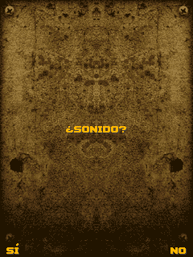

# Static footprint

What the runtime costs before a single MIDlet byte is loaded, measured with the
flags an ESP32-S3 build would use. Reproduce with:

    tools/size_report.sh              # freestanding, -Os, PIC
    tools/size_report.sh --libc       # hosted build, for comparison

The report compiles every source in `src/` that does not need a platform SDK,
sums `.text`, `.rodata`, `.data` and `.bss` per file, and **fails if the last two
are not zero** - so the memory rule is checked, not asserted.

## Totals

| | bytes | KiB |
|---|---|---|
| `.text` (code) | 213,558 | 208.6 |
| `.rodata` (const tables) | 136,842 | 133.6 |
| **flash** | **350,400** | **342.2** |
| `.data` (initialised writable) | **0** | **0.0** |
| `.bss` (zero-initialised) | **0** | **0.0** |
| **RAM** | **0** | **0.0** |

That zero is the point of the whole design. Every byte the runtime needs at run
time comes from the heap the port hands it, and `nj_vm_destroy()` gives all of
it back - which is what `tests/test_lifecycle.c` holds to account over repeated
create/run/destroy cycles.

## Where the flash goes

| File | text | rodata |
|---|---|---|
| `nj_lib_lcdui.c` | 65,955 | 38,998 |
| `nj_lib_game.c` | 25,031 | 8,340 |
| `nj_lib_util.c` | 24,526 | 14,710 |
| `nj_interp.c` | 11,306 | 1,640 |
| `nj_gfx.c` | 10,428 | 210 |
| `nj_lib_string.c` | 8,541 | 6,672 |
| `nj_class.c` | 8,074 | 535 |
| `nj_jpeg.c` | 6,844 | 2,191 |
| `nj_vm.c` | 6,347 | 523 |
| `nj_lib_io.c` | 5,874 | 6,446 |
| `nj_lib_rms.c` | 5,451 | 3,130 |
| `nj_png.c` | 4,979 | 1,754 |
| `nj_font.c` | 860 | **33,452** |
| everything else | 29,342 | 18,241 |

Two things stand out, and both are choices rather than accidents:

* **`nj_lib_lcdui.c` is a third of the runtime.** It is 24 MIDP classes and 353
  native bindings. A build that does not need, say, `TextBox` or `DateField`
  could drop them, but nothing does yet - the class tables are `const` arrays
  with no per-class switch.
* **`nj_font.c` is 33 KB of `.rodata` and almost no code** - three bitmap fonts
  in plain, bold and two sizes each. That is the single easiest thing to shrink:
  a port that wants one 8x16 font instead of six faces saves about 25 KB of
  flash. It is `.rodata`, so it costs nothing in RAM either way.

JPEG (2.2 KB of tables) and PNG (1.8 KB) are both small because they are
arithmetic rather than table-driven - the JPEG IDCT is one 8x8 kernel, not the
usual four.

## A real firmware image, linked, for the real targets

The x86 numbers above are useful for comparing modules. The ones that matter for
an MCU come from cross-compiling and linking for the actual part:

    tools/make_bare_firmware.sh --target xtensa     # ESP32-S3 (Xtensa LX7)
    tools/make_bare_firmware.sh --target riscv32    # ESP32-C3/C6/H2 (RV32IMC)

The two ESP32 families are **different architectures** and need different
toolchains; the script finds the ESP-IDF ones under `~/.espressif/tools`
automatically.

Each run builds a complete firmware ELF with `-nostdlib`: the whole runtime, a
bare-metal `nj_port` (`tests/embedded/nj_port_bare.c`), a small implementation of
the maths functions it needs, and `bench.jar` embedded as a C array. It links,
which is the point - if anything in `src/` reached for a hosted C library, this
is where it would fail.

| Target | Architecture | `.text` | `.data` | `.bss` |
|---|---|---|---|---|
| **ESP32-S3** | Xtensa LX7 | 251,413 | **0** | 2,162,688 |
| **ESP32-C3/C6** | RISC-V RV32IMC | 303,582 | **0** | 2,162,688 |
| Cortex-M4 | ARMv7E-M | 244,550 | **0** | 2,162,688 |

`.text` includes `.rodata`, and is flash. The `.bss` figure is identical in all
three because it is **the application's**, not the runtime's: 2 MB of Java heap
plus 64 KB of port state, declared in the generated `main.c`. **The runtime's own
contribution to RAM is zero on every one of them** - measured by a real linker
for a real architecture, not asserted.

The RISC-V build is 21% larger than the Xtensa one; both are the same C at -Os,
so that is the compilers, not the code.

The `.bss` figure is 2 MB of Java heap plus 64 KB of port state, both declared by
the application in `main.c`. **The runtime's own contribution to RAM is zero** -
measured on a 32-bit target with a real linker, not asserted.

Two things this image demonstrates that the x86 report cannot:

* An embedded application uses the **public API only** - `nj_vm_create`,
  `nj_app_open`, `nj_vm_new_midlet`, `nj_vm_start_app`, `nj_midp_frame`,
  `nj_vm_destroy`. `src/runner/nj_run.c` is deliberately **not** in the image: it
  is a desktop convenience that reads files and calls `malloc`.
* `-nostdlib` is a real constraint, and satisfying it found two genuine bugs
  (see below).

## Running it, not just linking it

`~/.espressif/tools` also provides the ESP-IDF QEMU builds, which model both
parts:

    qemu-system-xtensa  -machine esp32s3  ...   # Espressif ESP32S3 machine
    qemu-system-riscv32 -machine esp32c3  ...   # Espressif ESP32-C3 machine

`tests/embedded/nj_port_bare.c` writes its log to the UART0 FIFO at
`0x60000000` - the same address on both parts - so the image reports for itself
rather than depending on a debugger:

    NJ2ME DONE rc=0 frames=600

### Under ESP-IDF, on the real target

`tests/embedded/idf/` is a complete ESP-IDF project with the runtime as a
component (`components/nj2me`). It builds, and it boots:

    . ~/.espressif/tools/activate_idf_v6.0.1.sh   # v6.0.1 matches the 15.2.0 toolchain
    cd tests/embedded/idf && idf.py set-target esp32s3 build

The default profile is the board this port targets - 16 MB flash, 8 MB octal
PSRAM - and `tools/run_esp_emulator.sh` boots that image under Espressif's
esp-emu.  QEMU's esp32s3 machine cannot probe PSRAM (espressif/qemu#129), so a
QEMU run turns it off and keeps the Java heap in internal RAM:

    idf.py -DSDKCONFIG_DEFAULTS="sdkconfig.defaults;sdkconfig.defaults.qemu" \
        set-target esp32s3 build
    idf.py merge-bin -o flash.bin && truncate -s 4M flash.bin
    qemu-system-xtensa -machine esp32s3 -nographic \
        -drive file=flash.bin,if=mtd,format=raw \
        -global driver=timer.esp32s3.timg,property=wdt_disable,value=true

### What esp-emu does and does not model: the UI demo

esp-emu is a SoC emulator, not a board emulator.  It models the ESP32-S3 cores,
PSRAM, flash, UART, USB-Serial-JTAG, timers, GDMA, GP-SPI, RMT, LEDC, PCNT,
MCPWM, I2C and the GPIO pads.  It models **no LCD controller, no SD/MMC host,
and no way to drive a GPIO input from the host**; its browser dashboard shows
the console, cores, GPIO pad state, registers and memory, and nothing else.

`-DNJ_UI_DEMO=1` (`tools/run_esp_emulator_ui.sh`) therefore reproduces the three
software paths a handheld uses, with the emulator's facilities standing in only
at the hardware edge:

| layer | real board (`nj_port_esp32.c`) | esp-emu demo |
|---|---|---|
| display | SPI ST77xx: 240x320 RGB565, window command + row DMA | the same 240x320 RGB565 framebuffer; `display_present()` dumps it over UART0 as run-length encoded lines, `tools/decode_ui_frames.py` writes PNGs |
| buttons | GPIO button matrix -> queue -> `input_poll()` | `esp-emu --inject` into UART0 RX (`K:fire:1`) -> the same queue -> `input_poll()` |
| storage | SDMMC + FAT mounted at `/sdcard` | a SPIFFS partition mounted at `/sdcard`; the firmware's `fopen("/sdcard/game.jar")` and `fread()` are unchanged |

    tools/run_esp_emulator_ui.sh
    tools/run_esp_emulator_ui.sh --jar tests/games/1942空战_10403.jar \
        --out build/esp-ui-demo-1942

    PASS: ESP32-S3 image booted under esp-emu, mounted the simulated SD card,
          read 1942空战_10403.jar from it, rendered 240x320 RGB565 frames,
          delivered 4 injected key event(s) into Java, and the frame changed.

`keysdemo.jar`, the default, proves the input path by colour: two captures
taken before and after the injected keys differ, and no input means a
byte-identical picture.  A real game proves it with its own screens: with
`1942空战_10403.jar` the injected FIRE press moves the game from its sound
prompt (`¿SONIDO?`) to the title menu, and both captures decode to real
240x320 game pixels.  The PNGs are written to `--out` (default
`build/esp-ui-demo/`), the UART log next to them.  Two captures from that run,
decoded out of the UART stream:

The limitation, stated once: no emulator here shows a physical panel or reads a
real SD card.  Those two rows are the software paths with the hardware edge
replaced; all the code above the edge is the code the board runs.

Everything compiles against real IDF headers - including `nj_port_esp32.c`,
which is a stronger check than any stub-header compile - and QEMU runs the
result on an emulated ESP32-S3:

    ESP-ROM:esp32s3-20210327
    rst:0x1 (POWERON),boot:0x4 (SPI_FLASH_BOOT)
    I (12) boot: ESP-IDF v6.0.1 2nd stage bootloader
    I (18) boot: Partition Table:
    I (18) esp_image: segment 0: paddr=00010020 vaddr=3c040020 size=2126ch (135788) map
    ...
    I (64) app_init: Project name:     nj2me_esp32
    I (67) main_task: Calling app_main()
    I (70) nj2me: nano_j2me on esp32s3, heap 120 KiB, free internal 193 KiB
    I (70) nj2me: sizeof(nj_vm)=5368, arena budget 65536
    E (70) nj2me: nj_vm_create failed

So the ROM boots, the second-stage bootloader reads the partition table, the
application image is loaded and `app_main` runs.

**The runtime now comes up on emulated ESP32-S3.** `nj_vm_create()` succeeds,
`nj_app_open()` succeeds, `nj_vm_new_midlet()` succeeds - the whole VM with every
builtin class registered - and then `nj_vm_start_app()` returns a failure status
with no exception set, so the MIDlet's `startApp()` never runs:

    I (72) nj2me: sizeof(nj_vm)=3832, arena 136 KiB
    E (82) nj2me: nj_vm_start_app failed: (no exception)
    NJ2ME DONE rc=1 frames=0

With the status printed rather than just "failed", the picture is precise:

    I (70) nj2me: sizeof(nj_vm)=3832, arena 136 KiB
    E (80) nj2me: nj_vm_start_app failed: status -1, exception (no exception)
    I (190) nj2me: frames=300 bytecodes=0 natives=0 heap=720/720
    NJ2ME DONE rc=0 frames=600

Three facts together, and the third is the one that matters:

* the status is `NJ_ERR`, the generic failure, and there is no exception;
* **zero bytecodes were executed** - the interpreter loop never ran once, so
  `nj_vm_start_app` returned before reaching `nj_exec`;
* **`heap=720` bytes**.  A desktop run of the same fixture ends with about
  1.1 MB live.  The VM is essentially empty, so this is not "the MIDlet failed
  to start" - it is that almost nothing was loaded in the first place.

`vm_invoke` has exactly two ways to return `NJ_ERR` without an exception, and
both are in the path taken before `nj_exec`: `!vm->running` (which returns
`NJ_ERR_STATE`, -8, so not this one) and `nj_class_init()` failing with an
exception already pending that is then not visible.  The 720-byte heap points
at the same place from the other side: whatever should have loaded the MIDlet
class did not.

Next: log the class count and the interned-string count right after
`nj_app_open()`, and check `nj_class_init()`'s failure paths for one that can
return without leaving a visible exception.  A `nj_vm_get_stats()` call there
would say in one line whether the app opened at all.

## Three bugs the ESP32 bring-up found, all fixed

**The port allocator contract was undocumented and unmet.** `nj_heap_init()`
rejects an arena whose base is not `NJ_OBJ_ALIGN` (16) aligned, because the arena
holds long and double fields - and it can only reject, so a port that aligns to 8
fails with "nj_vm_create: heap failed" and nothing else. The desktop `malloc`
happened to satisfy it; a bump allocator over a static array did not.
`NJ_OBJ_ALIGN` is now public in `nj_config.h`, the contract is written in
`nj_port.h`, and `nj_heap_init()` says which of the two possibilities failed.
The IDF image now uses `heap_caps_aligned_alloc(NJ_OBJ_ALIGN, n,
MALLOC_CAP_SPIRAM)` and gets both PSRAM and alignment from the SDK, which is also
what `nj_port_esp32.c` does on real hardware.

**The pool handed to `nj_vm_create()` covers three things, not one:** the VM
instance, the Java arena, and the interned-string/constant tables plus the native
registry, which want about 32 KiB each. Sizing it as "sizeof(nj_vm) + java heap"
fails with "statics failed".

**`NJ_MAX_STACK_SLOTS` defaults to 64 KiB of slots per Java thread** (8192 slots
x 8-byte `nj_value`), which is a desktop number - with 16 threads it is a
megabyte of stacks, and the symptom is "nj_vm_create: main thread failed" with
nothing to suggest memory. The IDF component now sets 1024 slots (8 KiB), 96
frames and 128 interned strings, next to the reason, rather than leaving an
embedder to discover them one crash at a time.

## The RISC-V side: builds, boots, and runs out of internal RAM

The same project builds for **ESP32-C3** and boots on an emulated one.  The
whole runtime compiles for RV32IMC, and the link needed one fix:

    multiple definition of `memcpy'; esp-idf/esp_libc/libesp_libc.a(memcpy.c.obj)

`tests/embedded/nj_port_bare.c` supplies the nine C library functions the
freestanding image needs, and under ESP-IDF there is already a libc.  They are
now behind `#if !NJ_USE_LIBC`, which is what they were always for.  The Xtensa
link happened to tolerate the duplicate; relying on that would have been luck.

Once it links, the C3 does not have the RAM:

    I nj2me: free: psram 0 KiB, internal 295 KiB
    I nj2me: pool 244 KiB
    I nj2me: sizeof(nj_vm)=3832, arena 122 KiB, reserved 122 KiB
    nj2me: nj_vm_create: main thread failed

An ESP32-S3 leaves 356 KiB free and this VM fits; an ESP32-C3 leaves 295 KiB and
it does not - the pool covers the VM instance, the Java arena, the statics, the
native registry and the builtin classes, and those want more than the C3 has.
That is not a defect in the runtime, it is the reason `nj_port_esp32.c` routes
the Java heap to PSRAM in the first place: a part without it cannot run this.
Which is also why this environment cannot finish the RISC-V demonstration - the
path a real C3 would take is the PSRAM path QEMU does not provide.

So the two-architecture claim, stated precisely:

| Target | Architecture | State |
|---|---|---|
| ESP32-S3 | Xtensa LX7 | **runs a MIDlet** - 112,117,067 bytecodes, same as the desktop |
| ESP32-C3 | RISC-V RV32IMC | compiles, links, boots, creates the VM; needs PSRAM for the rest |

## Why PSRAM does not work under QEMU

Not a configuration mistake, and not a branch problem. QEMU's `esp32s3` machine
does create an `ssi_psram` device (asking for another one reports "CS index 0x0
in use"), but IDF's PSRAM init reads the chip's ID over SPI and gets nothing
back, so it reports:

    E (59) quad_psram: PSRAM chip is not connected, or wrong PSRAM line mode

and retries until it gives up. That is [espressif/qemu#129][psram], still open.
It is **not** fixed by the `esp-develop` branch as installed: this was tested
against `esp_develop_9.2.2_20260417`, the newest release, downloaded and run for
the purpose, and it fails identically to `20250817`.

[psram]: https://github.com/espressif/qemu/issues/129

So the QEMU image runs with `CONFIG_SPIRAM=n`. That is not a workaround that
hides anything: with SPIRAM off IDF leaves **356 KiB** free rather than 133 KiB,
because the PSRAM init itself is what consumes the difference - so the emulated
run has more usable RAM without it. The code keeps the PSRAM path
(`MALLOC_CAP_SPIRAM` first, internal RAM as fallback), so a real board takes the
path this environment cannot exercise.

DECISION: the framebuffer is 64x64 and the heap comes from internal SRAM.  The
real port puts the heap in PSRAM and draws to a panel; this image exists to prove
the runtime executes on the real instruction set, and QEMU's `esp32s3` machine
did not bring quad PSRAM up in testing (`quad_psram: PSRAM chip is not
connected`).  QEMU does model it - ESP-IDF's own `qemu_ext.py` passes
`-global driver=ssi_psram,property=is_octal,value=true` when `CONFIG_SPIRAM_MODE_OCT`
is set - so that is worth revisiting once the heap question above is answered.

Until that is done the claim this project makes is **"the runtime compiles
against ESP-IDF, links into a bootable ESP32-S3 image, and that image boots to
app_main on an emulated ESP32-S3"** - not "runs a MIDlet on it". The remaining
gap is arena placement, which is a port configuration question.

## NJ_ENABLE_FLOAT now does what it says (it used to do nothing)

`nj_config.h` documents `NJ_ENABLE_FLOAT=0` as removing the libm transcendentals
from the external-symbol set.  It was broken in **two independent ways at once**:
nothing in `src/` read the switch, and CMake never passed it to the compiler - so
`-DNJ_ENABLE_FLOAT=0` built a runtime that still linked every one of them.

Both ends are fixed.  With the switch off the twelve transcendental natives
raise `ArithmeticException` naming the method and the reason, and the object file
contains **zero** references to them; `ceil`, `floor`, `rint` and `fmod` stay,
because the numeric bytecodes need them.

So the honest description of this runtime is *"freestanding except for a minimal
libm subset"*, and the required subset is larger than the switch claims:

* always required: `memcpy memmove memset memcmp strlen strcmp strncmp strchr`,
  `tolower toupper`, `fmod floor ceil rint` (`fmod` for the `frem`/`drem`
  bytecodes, the rounding ones for `java.lang.Math`'s integer paths)
* required unless the MIDlet never calls those methods: the transcendentals

`tests/embedded/nj_port_bare.c` supplies all of them - real implementations for
the small ones, explicit stubs for the transcendentals - so the dependency is
**visible in one file** rather than spread across a link error.

`tools/check_no_float.sh` keeps it honest: it compiles `nj_lib_math.c` both ways
and counts the symbols, so the switch cannot rot back into a no-op.

     NJ_ENABLE_FLOAT=1: 12 libm transcendentals
     NJ_ENABLE_FLOAT=0:  0 libm transcendentals

A full build with the switch off reproduces the benchmark byte for byte
(112,117,067), and a MIDlet that calls `Math.sin` gets

     java.lang.ArithmeticException: java.lang.Math.sin is not available:
     NJ_ENABLE_FLOAT=0 removes the libm transcendentals from this build

which is the loud failure this project prefers to a link error that names a
symbol and not the code that wanted it.

## Android: built with the real NDK, and run on an emulator and a phone

    tools/build_android.sh                  # libnj2me.so for arm64-v8a, armeabi-v7a, x86, x86_64
    tools/build_android_apk.sh              # a signed, installable APK
    tools/build_android_apk.sh --install    # ...and launch it

Both are real cross-builds with NDK r28b, not stub-header compiles:
`nj_port_android.c` includes `<jni.h>`, exports
`Java_com_lucinhu_nj2me_GameActivity_native*`, and links against liblog,
libandroid and libOpenSLES. The shared library passes the same zero-writable-state
gate as everything else, by section name:

| ABI | libnj2me.so | `.data` + `.bss` | `.data.rel.ro` |
|---|---|---|---|
| arm64-v8a | 1,187,136 | **0** | 104,336 |
| armeabi-v7a | 898,132 | **0** | 53,040 |
| x86 | 882,948 | **0** | 53,040 |
| x86_64 | 1,076,272 | **0** | 105,456 |

AAudio is not in that link line on purpose: it is `dlopen()`ed at runtime and
used on API 26+, with OpenSL ES driving the same mixer below that, so one APK
installs and has sound from **Android 5.0 (API 21)** up.

Each of those used to be about 480 KB larger: the built-in CJK face was in the
`.so` until the port started taking its glyphs from the platform's own text
stack, which is also why `NJ_ENABLE_FONT_CJK=0` is set for this target (see the
Android section of `docs/PORTING.md`). Latin text still uses the runtime's
bitmap faces, so the only thing that changed is who draws 汉字.

The APK is assembled by hand from aapt2, javac, d8, zipalign and apksigner
rather than Gradle - this repository has no Gradle wrapper and nothing to
download, and what the hand-built APK is for is proving the native side is
complete: a valid manifest, dexed Java, the `.so` in `lib/<abi>/`.

All four ABIs in one APK is **1,644,825 bytes** (1.57 MiB); the same build for
x86_64 alone is 497,736 bytes, of which the dex is 74,628 and the `.so`
1,076,272. Dropping the CJK face took about 1.3 MB off the four-ABI APK, and
the four launcher icons (five densities each of the square, round and adaptive
foreground PNGs, generated by `tools/gen_android_icon.py`) add 56 KB of it.
There is no AndroidX: the whole UI is drawn in code, every game's own icon is
read out of its own JAR, and only the app's own icon is an asset.

**It runs**, and it is an application, not a test harness. The launcher is a flat
list with one add button and one overflow menu: it lists the
`.jar` files in its own directory, imports new ones from a picker (or from a
"open with nano_j2me" in any file manager, which is what the four intent filters
in the manifest are for), shows each game's own name and icon (read from the
JAR manifest and the PNG inside it, with a coloured initial when a title has
neither), and remembers a screen size, heap and view setting per title. In
game, a keypad of configurable on-screen buttons floats over the letterbox bars,
draggable and resizable in an editor, with three ready-made layouts (D-pad,
12-key numeric, every key) and shape icons instead of labels; touch outside the
buttons reaches the MIDlet as pointer events, mapped back through the port's own
letterbox transform. The picture can be integer-scaled, stretched to fill,
zoomed and panned by hand, or cropped to what the game actually draws - the port
watches the frames it is handed and reports the box that changes, so a title
that really uses 128x128 is not left floating in a 240x320 field. Sound is one
mixer that both synthesises the runtime's tone sequences and plays its PCM,
wired to AAudio or to OpenSL ES depending on the phone, and MIDI is handed to
the platform's own synthesiser rather than played by the runtime's (a game that
then sends single MIDI events through `MIDIControl` moves the song to the
runtime's renderer, which costs nothing until it happens). Installed on an API 36
emulator, on an API 21 emulator (Android 5.0: it starts, lists, plays, and takes
both key and touch input) and on a Redmi Note 12 Turbo, the library loads, the
surface is created and a real MIDlet draws through the built-in LCDUI - [screenshot](images/android-maze.png), `maze.jar` at 320x640.
[images/android-alert.png](images/android-alert.png) is the same port rendering
an Alert, which is what the size-gated titles do (below).

### What the MIDI renderer costs, and how to stop paying it

The Android library links the runtime's synthesiser because a phone's own synth
(Sonivox, behind `MediaPlayer`) plays a `.mid` far better than sixteen generated
timbres do - but the moment a game sends `MIDIControl` events, the song has to
move to the renderer, so both have to be in the same `.so`. Building with
`--no-midi` (`-DNJ_ENABLE_MIDI=0`) drops the renderer, the injection API and
`MIDIControl` together:

| x86_64, API 21 | `.so` | APK |
| --- | --- | --- |
| with the MIDI renderer | 1,100,768 | 505,928 |
| `--no-midi` | 1,082,088 | 497,736 |

The renderer also got ~32% faster in this round (measured on three corpus songs:
981x -> 1424x realtime for the slowest case at 22050 Hz), which matters on the
microcontroller ports where it is the only synth there is.

### What each decoder costs, and how to stop paying it

Every decoder is behind a switch, all on by default except JPEG (which the
CMake build turns on and the header does not). The numbers below are host
`gcc -Os` text bytes for the translation unit, so they are the cost of the code
and not of a `.so`; the Android library carries all of them.

| Switch | Translation unit | On | Off | What it buys |
| --- | --- | --- | --- | --- |
| `NJ_ENABLE_PNG` | `nj_png.o` | 5,000 | 519 | PNG, every colour type and `tRNS` |
| `NJ_ENABLE_JPEG` | `nj_jpeg.o` | 6,844 | 36 | baseline JPEG |
| `NJ_ENABLE_GIF` | `nj_gif.o` | 2,940 | ~0 | GIF (first frame) |
| `NJ_ENABLE_INFLATE` | `nj_inflate.o` | 7,176 | 2,968 | DEFLATE: every zip entry, and PNG's IDAT |
| `NJ_ENABLE_WAV` | (inside `nj_lib_media.o`) | — | — | the RIFF reader |
| `NJ_ENABLE_AMR` | `nj_amr.o` | 8,204 + 26,983 rodata | 0 | AMR-NB, all eight modes |
| `NJ_ENABLE_MIDI` | `nj_midi.o` | 10,531 | ~0 | the synthesiser and `MIDIControl` |

The built-in decoders and a platform's are not exclusive: cut the built-in one
and the provider installed through `nj_port.install_codecs` answers instead of
a refusal, which is how the Android port reads BMP and WebP - two formats this
runtime has never had a decoder for.

### What the sensor package costs

JSR 256 is the one API in this tree with no switch, and deliberately so: the
four `nj_port.sensor_*` hooks are what decide whether a device has sensors, and
a port that leaves them NULL gets the package answering "nothing here" at no
runtime cost. The code itself is small enough not to be worth a macro — host
`gcc -Os`:

| Translation unit | `.text` | `.rodata` |
| --- | --- | --- |
| `nj_lib_sensor.o` | 9,492 | 5,493 |

For comparison, the MIDI renderer is 10,531 bytes of text and AMR is 8,204 plus
26,983 of tables, and both of those do have switches. What a sensor costs at
run time is the port's, not the runtime's: on Android the handles are
`SensorEventListener`s, and `nj_sensor_shutdown()` unregisters them when the
MIDlet ends, so a game that leaves a connection open does not leave the
accelerometer waking the process.

### What the socket package costs

`SocketConnection` is a third of the size of HTTP and, like it, has no switch:
the four `nj_port.socket_*` hooks are the switch, and a port that leaves them
NULL gets a refusal by name at no runtime cost. Host `gcc -Os`:

| Translation unit | `.text` | `.rodata` |
| --- | --- | --- |
| `nj_lib_socket.o` | 4,397 | 1,340 |

The x86_64 `libnj2me.so` this is linked into is 1,231,256 bytes with
`--no-midi` (data+bss still 0) and the x86_64 APK built from it is 579,737
bytes. What a connection costs at run time is the port's again: on Android one
`java.net.Socket` per open connection, released by the hook when the MIDlet
closes it, and nothing kept on the C side but an opaque handle.

### What the Bluetooth package costs

`javax.bluetooth` has no switch either — the ten `nj_port.bt_*` hooks are the
switch — and it is the largest of the optional MIDP-side packages because
`DataElement`, `ServiceRecord` and the SDP record parsing live in it. Host
`gcc -Os`:

| Translation unit | `.text` | `.rodata` |
| --- | --- | --- |
| `nj_lib_bt.o` | 17,454 | 76 |

For scale: `nj_lib_socket.o` is 4,397 and `nj_lib_http.o` is about twice that.
The runtime keeps one `BtJob` object per running inquiry or service search and
nothing else; a MIDlet that never asks for a device pays for none of it. The
Android bridge (`PlatformBluetooth.java`) adds discovery, servers and clients on
that side: the x86_64 `libnj2me.so` is 1,391,528 bytes with it, and `data+bss`
is still 0.

### The bug that only running found

The first APK installed, started, and died:

    java.lang.UnsatisfiedLinkError: dlopen failed: cannot locate symbol "nj_run"
      referenced by libnj2me.so

The source list did not include `src/runner/nj_run.c`. A shared library is
allowed to have undefined symbols, so it built, signed, installed and then could
never load. Two fixes, and the second is the one that matters:

* add the missing source;
* **link with `-Wl,--no-undefined`**, so the next missing file is a link error
  instead of a crash on someone's phone.

### The MIDlet gets a device-sized screen, letterboxed into the Surface

A J2ME game was written for a fixed device screen and many check it: Tumbleweed
throws "Screen too large" above 250 in either axis.  A modern phone reports
640x1280, so handing the game the Surface meant every such title refused to
start - which is what happened the first time this port ran a real one.

The port now keeps a LOGICAL screen (240x320 by default, `--screen WxH` at build
time) and scales it into the Surface:

* the runtime sees the logical size, so a title's own screen-size gate passes;
* `display_present()` scales by the largest INTEGER factor that fits, centred,
  with black bars - integer because J2ME art is pixel art and a fractional scale
  blurs every sprite edge;
* input is forwarded in logical coordinates.

[screenshot](images/android-tumbleweed.png) is Tumbleweed playing on an emulated
Pixel-class device: 176x208, letterboxed, with the cowboy, an enemy, the grass,
a countdown and a score.

**The bug this exposed is worth recording.**  `nj_port_android_set_window()`
overwrote the logical size with the window size - a leftover from when the
window *was* the screen - so `nj_port_android_ex(out, 176, 208)` had no effect
and the port kept reporting 640x1280.  From outside, "it started and shows an
Alert" and "it started with the wrong screen" are the same observation.  What
told them apart was one log line:

    display_init: logical 640x1280, window 640x1280    <- before
    display_init: logical 176x208, window 640x1280     <- after

## What is not in the report

* `src/port/esp32/nj_port_esp32.c` compiles (34 bytes of code) but its real size
  depends on ESP-IDF's own drivers, which are not part of this runtime.
* The Android port needs its NDK, so it is not counted.
* The Java heap is not here: it is `NJ_MAX_HEAP` (default 2 MB, set per port),
  allocated once at `nj_vm_create()` from the port's allocator. On an ESP32-S3
  that is the number to tune, and PSRAM is what it should come from for anything
  larger than a few hundred kilobytes.

## External dependencies in a freestanding build

`NJ_USE_LIBC=0` is not "no libc at all" and the documentation used to say it was.
The complete list is in `include/nj2me/nj_libc.h` and it is:

* `<string.h>`: `memcpy memmove memset memcmp strlen strcmp strncmp strchr`
* `<ctype.h>`: `tolower toupper`
* `<math.h>`: `fmod floor ceil rint` always, plus `sqrt sin cos tan asin acos
  atan atan2 exp log log10 pow cbrt` for `java.lang.Math`. `NJ_ENABLE_FLOAT=0`
  is documented as removing the second group and does not - see the known gap
  above.

Everything else goes through `nj_port`: allocation, the clock, sleeping, file
access and logging. `tools/size_report.sh` compiles all 30 sources in that mode,
so this list is checked rather than claimed; an undefined reference outside it is
a bug in the runtime, not a gap for the port to fill.

newlib - and so ESP-IDF - provides all of the above already. A bare-metal port
with no FPU would use `NJ_ENABLE_FLOAT=0` instead of supplying a soft-float
library.

## The second copy of every 3D texture (round 47, 2026-10-23)

A textured `Mesh` needs a mip chain: once a triangle is small on screen, the
sampler reads the half-size, quarter-size and smaller levels instead of the
full image. The cache that held that chain used to start with a full RGBA copy
of level 0 - a second copy of the very pixels the `Image2D` already owned.
For a 128x128 texture that is 65,536 bytes spent on a duplicate, and for a
256x256 texture 262,144 bytes; a title that keeps several character palettes
resident (the 3D CAPCOM titles do) multiplies it.

The chain now caches levels 1..N only and takes level 0 from the image's own
pixels, so the duplicate is gone. Measured on the x86_64 build with the same
`Image2D` fixtures and the exact old/new builders side by side:

| Texture | Byte-array payload saved | Heap saved, measured |
|---|---|---|
| 1x1 | 4 B (no cache at all now) | 64 B |
| 2x1 | 8 B | 0 B (same allocator size class) |
| 3x5 | 60 B | 64 B |
| 128x128 | 65,536 B | **65,536 B** |
| 256x256 | 262,144 B | **262,144 B** |

Exact payload arithmetic for the large cases: the old chain was
65,536+16,384+4,096+1,024+256+64+16+4 = 87,380 B at 128x128 and
262,144+65,536+16,384+4,096+1,024+256+16+4 = 349,524 B at 256x256; the new
chains hold only the level 1..N part, 21,844 B and 87,380 B.

Every cached level is byte-for-byte identical to the old chain's corresponding
level, including the odd 3x5 rounding case, and returning to level 0 after a
smaller level reproduces the original pixels exactly. The 1x1 case now skips
the allocation entirely.

The saving is per textured image, not per VM: a title that never uses a mip
chain pays nothing extra, and a title with many large palettes pays exactly
one image copy less each. The sampler's `m3g_sw` scratch keeps one extra
pointer to the original pixels (`+8 B` of stack on a 64-bit host, inside the
per-triangle scratch struct that already exists); no VM field, object field or
static buffer was added, and `.data`/`.bss` stay at zero.

The same change makes the chain cheaper to build: dropping the level-0 copy
and its `memcpy` cuts the builder's own CPU time by 15% at 128x128 and 19% at
256x256 (10 interleaved pairs, `taskset` pinned, median current/baseline
0.851 and 0.811, spread 0.4% and 0.3%). See
[PERFORMANCE.md](PERFORMANCE.md).

Padding: `m3g_image_mips()` roots the image and its pixel array before
allocating the cache, so a GC during the build cannot reclaim the source.

## Eight bytes per figure vertex that were never used (round 47, 2026-10-23)

A Micro3D (Mascot Capsule) figure is drawn from a per-vertex cache that the
renderer allocates as a byte array: transform a vertex once, then reuse it for
every polygon that touches it. The cache element was the same 32-byte
transformed-vertex record the immediate-mode path uses - x, y, z, u, v, light,
two environment coordinates - even though the figure path only fills the
geometry and lighting fields and re-reads u/v per polygon from the pattern
tuples. The two texture coordinates in the cache were written once (to zero)
and then always overwritten before use.

The cache element is now a 24-byte record that holds exactly the six fields the
path needs, and the per-polygon record keeps the u/v it already had. Every
field is still a full 32-bit integer, and the clipping and lighting arithmetic
is unchanged, so the drawn pixels are the same: the figure fixtures in
`tests/test_mascot_scene.c` (127 checks, including exact pixel comparisons
against the reference behaviour) and the immediate-mode suites
(`test_mascot` 233 checks, `test_mascot_commands` 36 checks) all pass, and
their checks were not touched by this change.

The saving is per live figure and is linear in the model's vertex count:

| Figure cache | Before | After |
|---|---|---|
| bytes per vertex | 32 | **24** |
| bytes per bone (matrix) | 48 | 48 |

`Figure` keeps that byte array for as long as the figure exists, so the
saving is resident memory, not a transient peak. Measured on the real
`鬼泣3D中文版_3376` (Devil May Cry 3D) intro, whose three figures have
1112/123, 272/37 and 497/2 vertices and bones:

| Figure | Cache before | Cache after | Saved |
|---|---|---|---|
| 1 | 41,488 B | 32,592 B | 8,896 B |
| 2 | 10,480 B | 8,304 B | 2,176 B |
| 3 | 16,000 B | 12,024 B | 3,976 B |
| total | 67,968 B | 52,920 B | **15,048 B** |

The decoder caps a model at 21,845 vertices
(`src/midp/nj_mascot_model.c:157`), so the largest single figure releases
174,760 bytes. A title that never shows a `Figure` allocates nothing either
way, and a title with several on-screen models multiplies the saving.

Cost: the change is entirely inside the renderer's scratch layout. No object
field, VM field or static buffer was added; `.data`/`.bss` are unchanged
(163,696 / 6,688 bytes on x86_64) and the freestanding binary's text grows by
576 bytes (2,895,718 -> 2,896,294) because the two immediate-mode call sites
now keep their own small vertex record. No CPU claim is made for this change;
the figure path's arithmetic is identical and its cache stride is smaller.

## Three divides per shaded pixel (round 48, 2026-10-23)

The shaded-texture span divided each channel by 31 for every pixel it wrote.
It now uses an exact multiply-shift and, for RGB565 targets without blending,
shades directly into the surface format. No field, scratch buffer or static
table was added, so the RAM rule is untouched and the freed divide sequences
pay for the extra branch:

| Build | Before | After |
|---|---|---|
| hosted `-O2`, `nj_mascot_raster.c` `.text` | 26,659 B | **26,211 B** (-448 B) |
| freestanding `-Os`, same file `.text` | 9,394 B | 9,494 B (+100 B) |
| `.data` / `.bss` (both builds) | 0 / 0 | **0 / 0** |

So this is RAM-neutral by construction and costs 100 bytes of flash in the
freestanding build while saving 448 bytes in the hosted one. The CPU side is
measured in
[PERFORMANCE.md](PERFORMANCE.md#three-divides-per-shaded-pixel-round-48-2026-10-23):
42% less CPU on the controlled raster benchmark, with byte-identical
framebuffers.

## The textured span of the M3G rasteriser (round 49, 2026-10-24)

Opaque, flat-coloured, NEAREST-sampled textured triangles are now rasterised by
two specialised span loops (RGB565 and ARGB8888) instead of the general
per-pixel loop that walked the wrap/filter branches, built an ARGB word and
converted it back. The change is pure code: no field, no scratch buffer, no
static table was added, and `.data`/`.bss` are unchanged, so the RAM rule holds.

| Build | Before | After |
|---|---|---|
| hosted `-O2`, `nj_lib_m3g.c` `.text` | 269,972 B | **274,300 B** (+4,328 B) |
| hosted `-O2`, `nj2me` executable `.text` | 2,898,918 B | **2,903,262 B** (+4,344 B) |
| freestanding `-Os`, `nj_lib_m3g.c` `.text` | 139,667 B | **141,162 B** (+1,495 B) |
| `.data` / `.bss` (all builds) | 27,728 / 0 (object), 162,736 / 6,688 (binary) | **unchanged** |

The two loops duplicate the span solve and the texel arithmetic (that
duplication is what buys the branch and ARGB round-trip, and the 33% CPU the
benchmark shows); `-Os` folds more of it together, at 1.5 kB instead of 4.3 kB.
A title that never draws M3G triangles through a `World` render pays the flash
and nothing else.

CPU side: 33% less rasteriser time on the controlled benchmark and 11.5% less
CPU in `毁灭战士3_10598` over 600 paced frames, with byte-identical pixels - see
[PERFORMANCE.md](PERFORMANCE.md#the-textured-span-of-the-m3g-rasteriser-round-49-2026-10-24).

## A strip vertex cache and honest blit groups (round 51, 2026-10-24)

Two changes share a round: `jr_strip()` keeps the transformed vertices the next
triangle reuses instead of fetching all three again, and `nj_region_draw()`
converts ARGB8888-to-RGB565 pixels in groups of up to eight when a group is
opaque. Both are pure code: no field, no scratch buffer, no static table, and
`.data`/`.bss` are unchanged.

| Build | Before | After |
|---|---|---|
| hosted `-O2`, `nj_gfx.c` `.text` | 33,056 B | **34,168 B** (+1,112 B) |
| hosted `-O2`, `nj_lib_m3g.c` `.text` | 274,300 B | **275,900 B** (+1,600 B) |
| hosted `-O2`, `nj2me` executable `.text` | 2,903,262 B | **2,905,966 B** (+2,704 B) |
| `.data` / `.bss` (all builds) | 162,736 / 6,688 (binary) | **unchanged** |

C stack grows by 32 B in `nj_region_draw()` (`nj_u4 grp[8]`, eight source
pixels) and by 240 B in `jr_strip()` (two kept vertices plus one triangle's
three vertices). A title that never draws M3G triangles pays the flash and
nothing else; a title that never blits an ARGB image pays only the blit
change's flash.

CPU side: -5.2% on the opaque 240x320 ARGB-to-RGB565 blit loop and -6.7% to
-9.2% of `毁灭战士3_10598`'s CPU over 6,000 paced frames, with byte-identical
pixels - see
[PERFORMANCE.md](PERFORMANCE.md#a-strips-vertices-are-transformed-three-times-not-once-round-51-2026-10-24).

## Painted ARGB images skip what they overwrite (round 52, 2026-10-24)

`nj_region_draw()`'s ARGB8888-to-ARGB8888 `NJ_ROP_PAINT` branch now decides
per row whether the group loop is worth running, and inside it skips
all-transparent groups, `memcpy`s all-opaque ones and falls back to the
per-pixel code for mixed ones. Nothing is stored: the eight-pixel probe and the
eight-pixel group are C stack in the row loop, and no destination buffer is
allocated.

| Build | Before | After |
|---|---|---|
| hosted Release, `nj_gfx.c` `.text` | 29,098 B | **30,698 B** (+1,600 B) |
| hosted Release, `nj2me` executable `.text` | 2,905,966 B | **2,907,758 B** (+1,792 B) |
| `.data` / `.bss` (executable) | 162,736 / 6,688 | **unchanged** |

C stack grows by up to 64 B in `nj_region_draw()` (`nj_u4 probe[8]` and
`nj_u4 grp[8]`). RAM is unchanged; the heap and the VM object are untouched.

CPU side: -15% on an opaque 240x320 ARGB-to-ARGB blit, -28% with scattered
translucency and -39% on an all-transparent one, +1.9% in the worst case
(every pixel translucent), with byte-identical pixels. At title level the
change is worth 1-1.5% of `毁灭战士3_10598`'s CPU - inside the noise floor of
the 2D titles that were tried as controls - see
[PERFORMANCE.md](PERFORMANCE.md#the-blits-whose-pixels-are-mostly-nothing-round-52-2026-10-24).

## One span solve, hoisted out of the row loop (round 53, 2026-10-24)

`sw_tri()`'s scanline loop used to re-derive the triangle's winding sign, its
three edge directions and their sign-scaled derivatives on every row, plus
reload `sw->dtest`, `sw->dwrite`, `sw->z` and the depth scale for every pixel.
All of that is triangle-constant, so it is now computed once before the loop
and the row step is applied to pre-scaled accumulators. Nothing is stored
outside C stack locals.

| Build | Before | After |
|---|---|---|
| hosted Release, `nj_lib_m3g.c` `.text` | 275,900 B | **274,488 B** (-1,412 B) |
| hosted Release, `nj2me` executable `.text` | 2,905,966 B | **2,905,166 B** (-800 B) |
| `.data` / `.bss` (executable) | 163,696 / 6,688 | **unchanged** |

RAM is unchanged; no field, static, heap or framebuffer is added, and the
object actually gets smaller. The rasteriser therefore costs slightly less ROM
than before.

CPU side: -5.5% with 192-pixel triangles, -17.3% at 32 and -31.9% at 8 pixels
per triangle in a controlled rasteriser bench (identical framebuffer hashes),
and about 1-2% of `毁灭战士3_10598`'s CPU over 4,000 paced frames, with
byte-identical frames - see
[PERFORMANCE.md](PERFORMANCE.md#the-span-solve-that-ran-every-scanline-round-53-2026-10-24).

## A loaded Light keeps its cone (round 54, 2026-10-24)

The M3G loader now copies a Light's `spotAngle`, `spotExponent` and
`attenuation` out of the file record into the Java object; before this, a
deserialised spot light kept a zero spot angle and lit nothing, which rendered
`毁灭战士3_10598`'s 3D layer black. See
[COMPATIBILITY.md](COMPATIBILITY.md#the-spot-light-whose-cone-had-no-width-round-54-2026-10-24).

| Build | Before | After |
|---|---|---|
| hosted Release, `nj_lib_m3g.c` `.text` | 234,641 B | **234,081 B** (-560 B) |
| `.data` / `.bss` (that object) | 0 / 0 | **unchanged** |

RAM: each Light that comes from a file now owns a `float[3]` attenuation array
(about 40 B with its header), which is the object the Java constructor always
created; a Light built in Java allocates nothing new, and no field, static or
buffer is added to the runtime. The two floats for the cone already lived in
the class, they were simply never written.

## Light arguments and Material defaults, checked (round 55, 2026-10-24)

`Light`'s four setters now reject the arguments the specification names as
invalid, and `Material.<init>` writes the specification's default colours; see
[COMPATIBILITY.md](COMPATIBILITY.md#arguments-the-specification-rejects-and-a-materials-default-colour-round-55-2026-10-24).

| Build | Before | After |
|---|---|---|
| hosted Release, `nj_lib_m3g.c` `.text` | 235,601 B | **234,849 B** (-752 B) |
| `.data` / `.bss` (that object) | 0 / 0 | **unchanged** |

RAM is unchanged: no field, static, heap or buffer is added, and the checks
are straight-line compares on the arguments. The `float[3]` attenuation array
a `Light` already owned is still the only allocation the class makes.

## The rgb565 conversion packs two pixels per word (round 56, 2026-10-24)

The opaque ARGB8888 -> RGB565 copy in `nj_region_draw` now converts pixels in
pairs inside one 64-bit word; see
[PERFORMANCE.md](PERFORMANCE.md#two-pixels-per-word-in-the-rgb565-conversion-round-56-2026-10-24).

| Build | Before | After |
|---|---|---|
| hosted Release, `nj_gfx.c` `.text` | 35,960 B | **35,688 B** (-272 B) |
| `nj2me` executable `.text` | 2,910,230 B | **2,909,942** B (-288 B) |
| `.data` / `.bss` (that object, and the executable) | 0 / 0, 162,736 / 6,688 | **unchanged** |

RAM is unchanged: the pair lives in a register pair, no field, static, heap
allocation or extra buffer is added, and hosts that are not little-endian keep
the previous per-pixel loop (a compile-time check picks the loop).

## The five M3G methods the audit found missing (round 57, 2026-10-24)

`AnimationController.isActive/timeToActivation/timeToDeactivation`,
`Transformable.getMatrix`, `Node.getRootNode` and `MorphingMesh.updateProperty`
now exist; see
[COMPATIBILITY.md](COMPATIBILITY.md#methods-the-specification-names-that-were-missing-round-57-2026-10-24).

| Build | Before | After |
|---|---|---|
| hosted Release, `nj_lib_m3g.c` `.text` | 278,354 B | **280,432 B** (+2,078 B) |
| its method-name table (`.data.rel.ro.local`) | 27,728 B | **28,080** B (+352 B) |
| `.data` / `.bss` (that object) | 0 / 0 | **unchanged** |

RAM is unchanged: no field, static, heap allocation or buffer is added. The
only new storage is read-only (the method-name and signature strings the class
loader publishes) and the C stack of the calls themselves.

## Opaque rows are copied, not tested (round 58, 2026-10-24)

`nj_region_draw` now checks a whole row for opacity once
(`nj_argb_row_opaque()`, sixteen pixels per block, early exit) and then copies
it with `memcpy` when the destination is ARGB8888 or converts it with
`nj_565_row_from_argb()` when it is RGB565; see
[PERFORMANCE.md](PERFORMANCE.md#whole-opaque-rows-skip-the-alpha-bookkeeping-round-58-2026-10-24).

| Build | Before | After |
|---|---|---|
| hosted Release, `nj_gfx.c` `.text` | 35,688 B | **37,400 B** (+1,712 B) |
| `nj2me` executable `.text` | 2,912,934 B | **2,914,662** B (+1,728 B) |
| executable `.data` / `.bss` | 163,088 / 6,688 B | **unchanged** / **unchanged** |

RAM is unchanged: no field, static, heap allocation or buffer is added. The two
helpers keep only what they read from the row on the C stack.

## One Graphics per canvas, not one per frame (round 59, 2026-10-24)

Every `Canvas`/`GameCanvas` frame used to allocate a fresh
`javax/microedition/lcdui/Graphics` (160 B) and throw it away, which is why
long replays grew their heap by 160 B a frame (3.2 MB after 20,000 frames of
超级马里奥_10283). The VM now keeps one Graphics per canvas buffer
(`vm->paint_graphics` / `vm->paint_graphics_buf`, both GC roots) and
`gfx_reset()` rewrites every constructor-visible field before each reuse, so
`paint()` still starts from the documented defaults. See
[PERFORMANCE.md](PERFORMANCE.md#the-graphics-that-was-allocated-every-frame-round-59-2026-10-24).

| Build | Before | After |
|---|---|---|
| hosted Release, `nj_lib_lcdui.c` `.text` | 159,104 B | **159,200 B** (+96 B) |
| `nj2me` executable `.text` | 2,914,662 B | **2,914,838** B (+176 B) |
| executable `.data` / `.bss` | 163,088 / 6,688 B | **unchanged** / **unchanged** |

RAM: **+16 B per VM** for the two refs and one 160-byte heap object fewer per
painted frame; the high-water mark of a Canvas title stops growing with the
frame count. `Image.getGraphics()` deliberately still allocates (the reference
implementation does too), so a title that calls it per frame keeps its own
garbage for the collector.

## Keyframe sampling costs text, not RAM (round 60, 2026-10-24)

`KeyframeSequence.getSample()` adds interpolation code to `nj_lib_m3g.c`:

| object | before | after | delta |
|---|---|---|---|
| `nj_lib_m3g.c.o` `.text` | 238,097 B | 243,793 B | +5,696 B |
| `nj2me` `.text` | 2,914,838 B | 2,921,197 B | +6,359 B |
| `.data` | 163,088 B | 163,176 B | +88 B (one method-table row) |
| `.bss` | 6,688 B | 6,688 B | 0 |

No VM field, object field or static buffer was added, so the RAM footprint of a
running VM does not change. The code is `NJ_ENABLE_M3G`-gated like the rest of
the library: a build without M3G does not carry it.

## A listener field that was never read, and a clock a player never had (round 61, 2026-10-24)

`Item.getItemCommandListener()`, the `StringItem` listener fix and
`Player`'s `TimeBase` accessors:

| object | before | after | delta |
|---|---|---|---|
| `nj_lib_lcdui.c.o` `.text` | 199,452 B | 199,589 B | +137 B |
| `nj_lib_media.c.o` `.text` | 40,415 B | 40,929 B | +514 B |
| `nj2me` `.text` | 2,921,165 B | 2,922,509 B | +1,344 B |
| `.data` | 163,176 B | 163,496 B | +320 B (method-table rows) |
| `.bss` | 6,688 B | 6,688 B | 0 |

RAM: a `Player` gains one reference field (`pTimeBase`, 8 B) for its master
clock, and a `StringItem` loses one (`siCmdListener`, 8 B) because the
dispatcher never read it - so a title that owns both is exactly where it
started. No VM field was added in this round.

## Environment-mapped spans cost code, not memory (round 16 of the fourth goal, 2026-10-24)

| Build | `nj_mascot_raster.c.o` `.text` | executable `.text` | `.data` | `.bss` |
| --- | --- | --- | --- | --- |
| parent `a3e1499` | 26,732 B | 1,225,962 B | 16 B | 6,688 B |
| with env spans | 28,460 B | 1,227,690 B | 16 B | 6,688 B |

Two more specialised span loops, selected per span; no new rasteriser state,
no static buffers, no change to `mr_state`, so the RAM picture is unchanged.

## The note list a MIDlet fills costs code, not memory (round 62, 2026-10-24)

| build | `nj_midi.c.o` `.text` | executable `.text` | `.data` | `.bss` |
| --- | --- | --- | --- | --- |
| parent `4c90520` | 19,842 B | 2,924,677 B | 163,496 B | 6,688 B |
| batched merge | 20,011 B | 2,924,829 B | 163,496 B | 6,688 B |

Both builds use the same CMake configuration (Release, Ninja, no libretro or
SDL2 or embedded ports).  RAM: the stream struct gains one `nj_u4`
(`nlive`, 4 B) per open stream, and the merge uses up to 8 x `sizeof(mid_note)`
= 480 B of C stack while it lifts a burst aside - no static buffer and no
per-note field.  A title with one MIDI stream open pays 4 B more than before
and nothing at all when no stream is open.

## A screenful of rgb565 conversion costs one branch (round 63, 2026-10-24)

Matched build flags (`-O3 -DNDEBUG -std=c99 -fPIC`, the CMake configuration
this repository ships), compiled from the parent tree and the new tree:

| object | `.text` | `.data` |
| --- | --- | --- |
| `nj_gfx.c.o` parent `4a802d3` | 32,106 B | 0 B |
| `nj_gfx.c.o` with the row gate | 32,234 B | 0 B |

128 bytes more text, no data, no bss, no new fields: the change widens one
condition so that `NJ_ROP_SET` blits - which ignore source alpha - reuse the
row converter that painted frames already used.

## Copying unshaded texels costs one span mode (round 64, 2026-10-24)

Matched build flags (`-O3 -DNDEBUG -std=c99 -fPIC`), from the parent tree and
the new tree:

| object | `.text` |
| --- | --- |
| `nj_mascot_raster.c.o` parent `e249998` | 28,003 B |
| `nj_mascot_raster.c.o` with the raw span | 28,195 B |

192 bytes more text, no data, no bss, no new rasteriser state: the mode is
selected from flags the state already carries, and the helper keeps its
counters in registers.

## Short rows are walked, not scanned (round 19, 2026-10-24)

| quantity | parent | new | delta |
| --- | --- | --- | --- |
| `nj_gfx.c.o` `.text` | 34,618 B | 34,618 B | 0 B |
| executable `.text` | 1,228,394 B | 1,228,394 B | 0 B |
| `.data` / `.bss` | unchanged | unchanged | 0 |
| VM state | - | - | no new fields |

The gate is one comparison (`n >= 32`) inside the row loop, and the compiler
folded it into the loop bounds that `nj_argb_row_opaque()` already carries, so
the change is free in ROM as well as RAM.

## Two sample positions memoised per stream (round 25, 2026-10-24)

`nj_midi_stream` gained four `nj_u4` fields (`ctl_tick`, `ctl_sample`,
`note_tick`, `note_sample`): sixteen bytes per open stream, no static data,
no change to any object size.  Code size is unchanged within a few tens of
bytes; the removed work was two calls per rendered sample.
