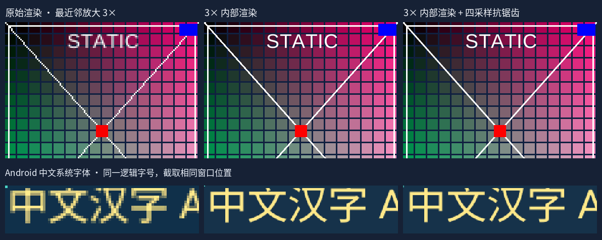

# 画面放大与超分辨率（upscaling）

游戏仍按设定的逻辑尺寸布局、接收触点和读写像素。桌面 SDL2、无头端和现代 Android 可以在光栅化阶段提高分辨率，也可以在呈现阶段选择独立滤镜。

## 内部渲染倍率、抗锯齿和 M3G FSR2

以 240×320 游戏为例，`--render-scale 2` 会按 480×640 绘制。再加 `--ssaa 2` 会在 960×1280 上采样，把每个 2×2 区域平均为一个输出像素，最终仍输出 480×640。两项均默认 1。建议先试 2×，再根据机型帧率决定是否加四采样。

```sh
# SDL2 或桌面启动器，画面按 2× 输出，四采样抗锯齿
build/nj2me --port sdl2 --render-scale 2 --ssaa 2 game.jar
# 在启用 Vulkan FSR2 的构建上，为合适的 M3G 绘制启用时域重建
build-fsr2/nj2me --port sdl2 --render-scale 2 --fsr2 game.jar
```

| 画面内容 | 渲染行为 |
| --- | --- |
| LCDUI 图元 | 在内部采样网格重画线、矩形、圆角、弧线和三角形。线宽与裁剪按游戏坐标解释。 |
| 文字与位图 | TTF 轮廓和现代 Android 系统、中文及自选字体按物理字号重绘，沿用逻辑基线和字距。位图字体、精灵与 `drawRGB` 使用原始纹素。 |
| M3G 与 Mascot | 投影几何在物理缓冲区光栅化。M3G 保持独立高清深度，可加 `--subdivide` 将适用的不透明面片分成四个共面子三角形，保留透视纹理插值。Mascot 按原绘制顺序处理点、线、面片和精灵。 |
| 时域重建 | `--fsr2` 为兼容的 M3G 绑定启用 AMD FSR2 2.2.1，输出至少 2×。渲染器提供抖动颜色、深度和当前像素到上一帧的运动向量，在 `releaseTarget` 时写回高清图像，后画的 LCDUI/HUD 继续合成。 |

`--render-scale` 支持 1–4，`--ssaa` 支持 1 或 2。每轴倍率加倍，颜色和深度采样数约增至四倍。当开启 `--fsr2` 时，软件桥接还要生成时域输入并与 GPU 交换帧数据，耗时取决于游戏和设备。标准透视、完整清除颜色和深度且可见片元不透明的绑定可使用 FSR2。部分清除、精灵、透明混合或设备能力不足时使用高清空间渲染。变更目标或场景时会重置时域历史。

Android 在游戏内画面面板调整「高清渲染倍率」「超采样抗锯齿」「3D 面片细分」和「FSR2 时域放大」，下次启动游戏生效。默认构建支持空间高清和 SSAA。FSR2 构建需要 Vulkan 1.2 设备和可选 SDK。[Linux 与 Android 构建步骤](../src/port/fsr2/README.md)

验证中，StaticDemo 的 128×144 画布以 3× 输出为 384×432，四采样使 2,044 个输出像素发生变化。《毁灭战士 3》195 个主机帧中记录到 99 次 240×320 → 480×640 的 AMD dispatch，31 次沿用历史、68 次重置历史，另有 118 次 M3G 目标释放走高清空间路径。计数按目标释放，一个主机帧可包含多次释放。无头 `--dump-frames` 可以导出实际输出尺寸供对比。

下图上排取自桌面 StaticDemo，下排取自 API 36 Android 模拟器运行同一个中文 MIDlet。三列分别使用原始分辨率、3× 内部渲染、3× 内部渲染加四采样。在同一窗口位置截取像素，中文测试中的 5×5 逻辑定位块在三档画质下覆盖同样的 625 个屏幕像素。



### 选择软件、OpenGL ES 或 Vulkan

`--graphics software` 使用 CPU 绘制，可单独使用高清倍率和四采样。`--graphics gles2` 使用 SDL2 的 OpenGL ES 后端。`--graphics vulkan` 将可加速的 M3G 三角形交给 Vulkan，支持 SDL2 和无头运行。使用对应构建后，可以用同一个 JAR 比较三条路径。

```sh
cmake -S . -B build-gpu -DNJ_ENABLE_GFX_ACCEL=1 -DNJ_BUILD_GLES2_ACCEL=ON -DNJ_ENABLE_VULKAN=ON
cmake --build build-gpu --target nj2me-cli
build-gpu/nj2me --port sdl2 --graphics gles2 --render-scale 2 game.jar
build-gpu/nj2me --port sdl2 --graphics vulkan --render-scale 2 game.jar
build-gpu/nj2me --port sdl2 --graphics software --render-scale 2 game.jar
```

在高清 M3G 模式下，GPU 接收物理分辨率的顶点、颜色与深度缓冲区，只交换绘制涉及的矩形。Java 的逻辑像素和深度仍由软件生成，供游戏同步读取。驱动拒绝某批面片时，软件按原顺序重绘该批。FSR2 是独立可选项，按上节的条件收集时域输入。GLES2 窗口在小端上可直接上传紧密排列的 ARGB8888 高清帧，像素预算为 4096²，具体尺寸还受设备纹理与视口上限约束。

Android 的常规包提供软件和 GLES2。arm64 增强包在画面面板增加「Vulkan 3D 面片渲染」，下次启动游戏时尝试启用。如果设备初始化失败，游戏沿用已选的绘制方式。API 36 模拟器已验证回退，Vulkan 面片提交已在桌面 NVIDIA 和 Intel 设备上验证。

## 1. libretro / RetroArch：用前端 shader（现在就能用，无需改内核）

内核输出 240×320 的 RGB565 画面，RetroArch 的 slang shader 负责放大：

* 打开 `Settings > Video > Scaling`，把 `Integer Scale` 关掉（或按需开），
  `Aspect Ratio` 选 Core Provided。
* 打开 `Settings > Video > Shader`，载入 shader 预设。FSR 1.0（EASU + RCAS）
  在官方 shader 包里：`shaders_slang/fsr/fsr.slangp`（需要从
  `libretro/slang-shaders` 安装/更新 shader 包）。像素风游戏更推荐整数倍
  nearest 或 `sharp-bilinear`；3D 类（M3G）游戏用 FSR 观感更平滑。

### 推荐预设（按游戏类型选一个，不需要改内核）

| 游戏类型 | 推荐预设（`shaders_slang/` 下） | 说明 |
| --- | --- | --- |
| 2D 像素风 | `sharp-bilinear-simple.slangp` | 轻度平滑但保留像素块，性能开销最小 |
| 2D 像素风 + 整数倍 | `nearest/nearest.slangp`（开 Integer Scale） | 完全无插值，适合 240×320 的整数倍放大 |
| 2D + CRT 观感 | `crt/crt-geom.slangp` 或 `crt/shaders/crt-royale.slangp` | 扫描线/荫罩；royale 性能要求高 |
| LCD 掌机观感 | `handheld/lcd-grid-v2.slangp` | 模拟 LCD 网格 |
| M3G 3D / 全 3D 标题 | `fsr/fsr.slangp`（EASU+RCAS） | 3D 边缘平滑、字体不糊；性能可接受 |
| 混合 2D/3D | `fsr/fsr.slangp` 或 `sharpen/sharpen-bilinear.slangp` | 兼顾文字与 3D 边缘 |

使用要点：

* FSR / sharp-bilinear 建议关闭 Integer Scale 并让窗口/全屏自由缩放；
  nearest 建议开启 Integer Scale，避免非整数倍采样的不均匀像素。
* `Aspect Ratio` 用 **Core Provided**（内核按游戏原生的 240×320 等比例输出，
  不做拉伸）；窗口比例不合适时由 shader 的缩放阶段处理。
* 画质与性能只取决于前端 shader；内核的存档、截图、帧转储仍然是原始
  分辨率，不受影响。没有 shader 支持的前端（或用命令行 CLI 时）不启用
  这些预设，行为与现在完全一致。
* RetroArch 中可用 `Settings > Video > Shader > Apply Shader Preset` 保存为
  每个内核/游戏的自定义预设；切换游戏时自动生效。

这条路不需要内核改动，也不影响任何兼容性/存档行为。

## 2. 独立 SDL2 版：软件呈现滤镜（已实现）

默认仍是 `nearest`，不改变现有观感。启动器「设置 → 缩放滤镜」一行现在有
五个模式，按小车/回车循环：

| 模式 | 效果 |
| --- | --- |
| 最近邻 | 保持像素（默认） |
| 线性 | 双线性平滑 |
| 扫描线 | 每两行设备像素压暗一行，模拟 CRT 扫描线 |
| LCD 网格 | 扫描线 + 每 3 像素的纵向 RGB 条纹间隔 |
| CRT | 更重的扫描线 + 罩栅阴影 |

实现要点：

* 窗口滤镜作用于呈现阶段。无头 `--dump-frames` 记录滤镜之前的画面，大小由内部渲染倍率决定。
* 扫描线/网格按窗口设备像素绘制，文字、按键等 UI 覆盖物保持清晰。
* 配置文件键 `filter_mode`（0=最近邻 1=线性 2=扫描线 3=LCD 4=CRT），旧键
  `filter_linear`（0/1）继续兼容读取；直接构造 SDL2 端口时也可用
  `NJ_SDL2_FILTER=nearest|linear|scanline|lcd|crt`（桌面客户端会用自己的
  设置覆盖该环境变量）。
* 验证证据：LoopDemo 与《浴火银河 2》窗口回读截图（960×1039）对比默认帧：
  扫描线模式 345,600/997,440 px 不同（34.7%），CRT 模式 537,600 px（53.9%），
  均为预期的隔行压暗，非渲染差异。

## 2b. GLES2 / FSR 后处理（已实现，SDL2 桌面版）

SDL2 桌面版现在有一条真正的 GL 呈现路径：原生帧上传为纹理，经可插拔
着色器画到窗口（`--upscale` / `NJ_GL_PRESENT`）。模式 5 为 **FSR1**
（EASU 边缘自适应放大 + RCAS 对比度自适应锐化，两遍渲染；EASU 的
textureGather 在 GLSL ES 1.0 下用 4 次 texture2D 手工重建）。其余模式为
nearest / sharp-bilinear / 扫描线 / LCD / CRT / bicubic。默认使用软件呈现，
显式传 `--upscale` 时启用 GL 滤镜。`--upscale fsr` 可以处理整张最终画面，
`--fsr2` 使用 M3G 渲染过程中的深度与运动数据。桌面 SDL2 将离屏结果交给窗口，
Android 可直接绘制到 EGL 窗口。

### Android 版：软件呈现滤镜（已实现，0.5.43+）

设置 →「画面滤镜」提供：关闭（默认）/ 扫描线 / LCD 网格 / CRT。滤镜在原生
`android_display_present()` 锁定窗口缓冲后应用，只改变窗口显示；模拟器帧缓冲、
存档、截图、帧转储与 libretro 核心均不受影响。选择保存在应用私有
SharedPreferences（`present_filter`），通过 `nativeSetPresentFilter(mode)` 传给原生层，
下一帧生效。「GL 呈现」可单独选择 FSR1 和 bicubic，各渲染倍率开关见上面的内部渲染设置。

**模拟器验证（2026-11-25，API 36 AVD，x86_64 APK）**：LoopDemo 游戏画面在
关闭滤镜时为基准；切换「扫描线」后画面区域 614,784 / 2,592,000 像素变化
（23.7%，隔行压暗）；「CRT」后 819,712 像素变化（31.6%，扫描线+栅格）；
按键/状态栏 UI 不在滤镜区域。`am force-stop` 后重新启动并进入游戏，设置面板仍显示
「画面滤镜：CRT」，SharedPreferences 持久化验证通过。

## 真实游戏验证（2026-11-25，SDL2/GLES2 桌面）

窗口截图取自 SDL2 GLES2 路径（`--graphics gles2 --upscale ... --upscale-scale 2`，
Galaxy on Fire 2 启动画面，960x1039 窗口，含按键层）：

| 对照 | 差异（>6/255 像素） | 说明 |
|---|---|---|
| nearest 2x vs FSR 2x | 631,524 / 997,440（**63.31%**） | 文字与 UI 边缘经 EASU 重建 + RCAS 锐化，块状锯齿明显减少 |
| nearest 1x vs 软件呈现 | 0 / 997,440 | 呈现层替换本身无几何/采样偏差（A2 证据） |

截图：[`docs/images/upscale-nearest-galaxy.png`](images/upscale-nearest-galaxy.png)、
[`docs/images/upscale-fsr-galaxy.png`](images/upscale-fsr-galaxy.png)。

CPU 记录（同机 RTX 5080，Linux）：

| 场景 | 软件呈现 | GL 呈现 + FSR 2x | 差值 |
|---|---|---|---|
| Galaxy on Fire 2，560 帧 @30 fps（3D GL） | user 4.663 s / sys 0.313 s | user 5.872 s / sys 0.268 s | +1.21 s user（≈+26%） |
| LoopDemo，3000 帧 fps 0（纯 2D，演示后处理本身开销） | user 5.884 s / sys 0.390 s | user 8.116 s / sys 0.416 s | +2.23 s（≈0.74 ms/帧） |

结论：FSR 2x 的后处理成本约 0.7–2 ms/帧（取决于分辨率与场景），换来明显更好的
放大质量；默认仍为软件渲染，`--upscale` 为显式选项。

## 独立 Android 版：GL 呈现（实验）

Android 游戏内设置 →「GL 呈现（实验）」可选择 **最近邻 / 扫描线 / LCD 网格 / CRT**：
画面由私有 GLES2 上下文的着色器呈现（与 SDL2 的 `--upscale` 同一套 shader），
默认仍是软件呈现；GL 不可用或任何一步失败会自动回退，不影响模拟器帧、存档与截图。
包含 **FSR1（EASU+RCAS）**：EASU 离屏放大到视口尺寸，RCAS 再直接呈现，无回读。
