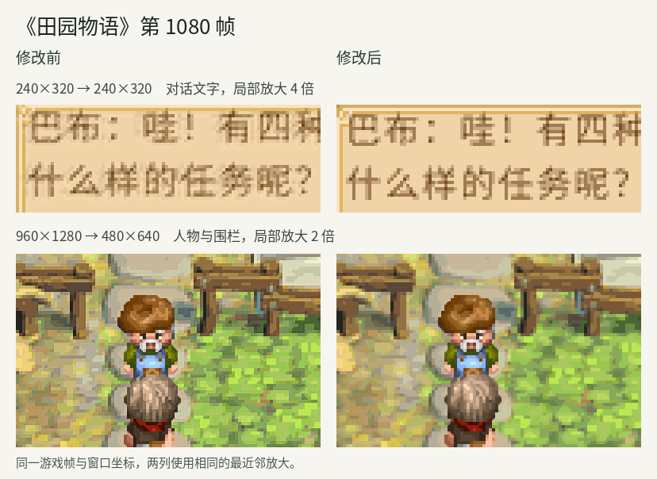

# FSR 在不同分辨率下的画质与呈现耗时

对照版本为 `5e080ff`。FSR1 处理合成后的游戏画面。SDL2 默认以游戏视口为目标，Android 直接绘制到实际 EGL 窗口。1∶1 时逐像素传递，放大时按源纹素中心重建并锐化，缩小时按覆盖面积求平均。高于 2× 的空间放大在最多 2× 的网格上执行 EASU。Vulkan FSR2 使用 M3G 场景提供的深度、运动向量和历史帧，实际采样倍率高于每轴 3× 时交付原生高清几何。

## 同一游戏帧

《3D 版田园物语》的逻辑画面为 240×320，JAR SHA-256 为 `8ad0920c1ebf685a1272bfa5f7fc1e0c4415189bcb82d0e28bd82917fca54e63`。使用相同的按键、虚拟时钟和第 1080 帧，分别采集 1×、4×、8× 的绘制结果，再用新旧版本的 SDL2 窗口呈现同一份输入。截图取自窗口合成之后。



在 240×320 的窗口中，以原始帧作为参考。对话左上方 96×34 像素的裁剪中，旧版有 2,226 个像素不同，新版为 0。全帧排除宿主速度标签的 38×19 区域后，旧版有 66,920 / 76,078 个像素不同，新版为 0。

从 480×640 的 FSR 窗口缩回 240×320 后，另测了只刷新 10×10 黑色方块的游戏。首次转回原尺寸时，SDL 先从游戏帧同步整张逻辑纹理，后续可继续局部更新。修正前小块外的白底显示为黑色，修正后小块的 100 个像素全部为黑色，抽查的 160×60 背景全部为白色。

### 桌面窗口耗时

RTX 5080，SDL offscreen 窗口和 GLES2 滤镜。每种组合预热 8 帧，测量固定游戏帧的 `display_hd` 调用，每轮 36 帧，共 3 轮，交替运行新旧版本。下表为窗口提交耗时，单位 ms/帧。包括 SDL 纹理传输和窗口合成，游戏逻辑与几何绘制已在回放前完成。

| 输入 → 游戏视口 | 窗口尺寸 | 中位数，旧 → 新 | P95，旧 → 新 |
|---|---|---:|---:|
| 240×320 → 240×320 | 240×320 | 0.517 → 0.143 | 1.168 → 1.025 |
| 240×320 → 480×640 | 489×701 | 0.914 → 0.786 | 1.182 → 0.996 |
| 240×320 → 720×960 | 788×1051 | 1.698 → 2.003 | 2.766 → 2.530 |
| 960×1280 → 480×640 | 551×751 | 7.590 → 1.465 | 9.110 → 1.959 |
| 960×1280 → 960×1280 | 960×1280 | 9.528 → 2.271 | 11.205 → 3.226 |
| 1920×2560 → 480×640 | 551×751 | 3.775 → 3.827 | 4.839 → 4.787 |

旧版的默认中间纹理按输入尺寸再乘二。最后一行会申请 3840×5120，超出像素上限后回退到 SDL 呈现。新版在该行使用面积过滤。第三行新版直接生成 720×960 的输出，中位数增加 0.305 ms，P95 减少 0.236 ms。

## 空间滤镜的采样精度

在 Intel ARL、Mesa 26.3.1 上，使用包含文字笔画、斜线和彩色条纹的固定图案。表中为 RGB 通道平均绝对误差，每通道范围 0–255。1∶1 参考源像素，放大参考像素中心对齐的双线性采样，缩小参考精确的面积积分。放大指标用于检查边缘位置，EASU 和 RCAS 也会主动改变局部对比度。

| 输入 → 目标 | 旧 | 新 |
|---|---:|---:|
| 240×320 → 240×320 | 17.710 | 0.000 |
| 240×320 → 241×323 | 24.759 | 7.910 |
| 240×320 → 371×495 | 24.400 | 6.038 |
| 240×320 → 781×1045 | 24.142 | 4.338 |
| 240×320 → 143×191 | 23.802 | 0.024 |
| 1920×2560 → 443×591 | 15.808 | 0.005 |
| 1920×2560 → 240×320 | 1.042 | 0.001 |

781×1045 的 GPU 绘制时间从 0.659 降至 0.328 ms/帧，包含上传与同步的耗时从 0.921 降至 0.626 ms/帧。每轮 64 帧，GPU 时间来自 `GL_TIME_ELAPSED_EXT`。

## FSR2 与 Android

- 《Doom3D》以相同按键和虚拟时钟回放 150 帧。240×320 的游戏在 4× 下得到 960×1280 的原生面片。旧版第一次时域写回改动了其中 91,855 个像素，新版 21 个采样帧全部与同倍率、关闭 FSR2 的原生对照逐字节相同。Vulkan 绘制路径也收到了 2 批共 836 个三角形。
- 同一游戏在 2× 下实际执行了 1,719 次 AMD FSR2，一次窗口呈现可包含多次 M3G 提交。新旧版本 21 个采样帧有 20 个相同，另一帧的 RGB 平均绝对差为 0.283/255。硬件测试另覆盖 3× 上限、运动与静止帧、尺寸变化后的历史重置，以及 2× 加四采样得到 4× 实际网格时的原生回退。
- 在 Android API 36 AVD 和 SwiftShader 上，同一局运行中将屏幕从 320×640 改到 371×680、240×580，再回到初始尺寸。文本标尺的位置跟随视口，恢复后整张截图逐像素一致。另测了横屏和起点为 (−56, −21) 的放大视口。
- 最终 arm64 测试包在软件 3D 设置下通过游戏菜单切换软件、FSR1 和双三次。完整计数轮 4 次选择 GL 均收到首帧。Home 返回和改变屏幕尺寸后保持同一局，可用方向键推进画面。之前重复出现的窗口占用错误 `EGL_BAD_ALLOC` 计数为 0。切回软件的两次操作各在被替换的窗口上出现一次 `EGL_BAD_SURFACE`，随后新窗口正常显示。
- AVD 按键检查使用 KeysDemo 二维画布。每次关闭触屏菜单后，用 adb 发送的首个方向键只收到抬起事件，第二个方向键收到完整按下与抬起并推进画面。软件、FSR1、双三次均观察到该现象。Android 测量覆盖窗口生命周期与画面，性能数据来自上面的桌面 GPU。

## 复核

默认构建通过 222 项测试，启用 GLES2、Vulkan 与 FSR2 SDK 的构建通过 236 项。`test_gfx_gles2` 覆盖原尺寸、面积缩采样、强放大、裁剪和读回色序。`test_sdl2_dpi` 从高清纹理切回局部更新的普通纹理，检查更新区域外的颜色。`test_fsr2` 与 `test_m3g_temporal` 覆盖支持的倍率与原生几何回退。在已构建的增强版目录中可用以下命令复核。

```sh
EGL_PLATFORM=surfaceless ctest --test-dir build-fsr2 \
  -R '^(test_gfx_gles2|test_sdl2_dpi|test_fsr2|test_m3g_temporal)$' --output-on-failure
```

> 0.5.51 之后 FSR1 的放大路径已替换为立方核重建 + RCAS，见 [2026-11-27 笔记](2026-11-27-fsr-cubic-reconstruction.md)；本文的 FSR1 指标对应 0.5.51 的 EASU 实现。
