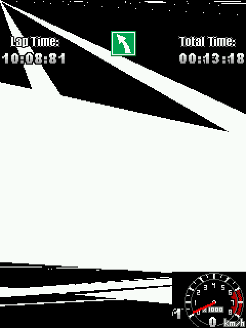

# OPEN: no title reaches `Graphics3D.render()`, and the instrument lied about it

## What was believed

`--stats` has printed an `m3g=` column since round 143, and it reported large
numbers for real titles:

| title | `m3g=` (as printed) |
|---|---|
| 极品飞车之无间风云FX中文版_4518 | 495144 |
| 生化危机3D(CAPCOM经典)_3671 | 54447 |
| 鬼泣3D中文版_3376 | 21551 |
| 仙剑奇侠传(2008)_12406 | 12058 |
| 3D城市桌球_8299 | 9011 |

Those readings drove several rounds of work on the render path.

## What is true

The stats `printf` in `src/runner/nj_run.c` had **twelve conversions and eleven
arguments**: `(unsigned long)s.m3g_renders` was missing, so `m3g=%lu` was fed
`secs`, a `double`, and `time=%.3f` was fed `s.frames`.  Every `m3g=` number
ever printed was the **bit pattern of a double**, not a count.

`-Wall` already warned about it.  The build output is in Chinese and this
project's habit was to grep for `error:` — the compiler said 警告 and the warning
was never read.

With the argument restored (`151d33e`), six real titles that carry JSR 184
content all report `m3g=0`, and a temporary `fprintf` at the top of `NJFN(m3g_render)`
counts zero entries over a 30-frame run.  The conclusion that held before round
143 — "the corpus never reaches the JSR 184 render path" — is the correct one.

## The guard

`CMakeLists.txt` now builds the runner with `-Werror=format`, so a conversion
and its argument disagreeing stops the build.  Teeth: deleting the `m3g_renders`
argument again fails the build with

```
error: 格式 '%lu' expects argument of type 'long unsigned int',
       but argument 8 has type 'double' [-Werror=format=]
```

## Still open

* `Graphics3D.render()` is implemented and draws through `nj_m3g_raster_mesh`,
  but no title in the corpus calls it, so the path is exercised only by
  `tests/test_m3g.c`.  **Where the titles stop is now measured**, by putting a
  `nj_logf` at the top of the three entry points and counting the lines:

  | title | `Graphics3D.getInstance()` | `bindTarget()` | `setCamera()` | `clear()` | `Loader.load()` |
  |---|---|---|---|---|---|
  | 极品飞车之无间风云FX中文版_4518 | 1 | 1 | 0 | 0 | 3 |
  | 3D城市桌球_8299 | 1 | 1 | 0 | 0 | 1 |
  | 鬼泣3D中文版_3376 | 0 | 0 | 0 | 0 | 0 |

  So the games do reach the API, get an instance, bind a target, and load a
  container - and then stop before configuring a camera or rendering anything.
  The `Loader.load()` array is not the reason: counting the slots it fills
  gives `nobj=1 nulls=0` for Most Wanted and `nobj=52 nulls=0` for 3D城市桌球,
  so nothing is left null for a game to trip over.  What they hit next is a
  `NullPointerException` in their own code (`bc.a(I)Ljavax/microedition/m3g/Node;
  pc=12`, `c.n()V pc=107`), which is the resource lookup described above.
* The lesson generalises past this column: an instrument that is never
  cross-checked against a second, independent reading is not an instrument.

## Where the scene graph stops now (2026-10-13)

毁灭战士3_10598 was the title that made the scene graph measurable, because it
builds one from `.m3g` files rather than from code.  Four separate defects sat
between `Loader.load()` and a filled `World`, and each one was visible only
because the next one appeared after it was fixed:

* a `World`'s children were never decoded at all - the allocator that keeps the
  object table has no case for type 22, so `find()` walked an empty vector;
* the child list was truncated: `NJ_M3G_MAX_REFS` is 16 and one `World` in
  `/doors/mars.m3g` names 155 children, so `find(889)` answered null and the
  game called `addChild(null)`.  The loader now allocates the overflow;
* the references in a child list can be read three ways - one-based into the
  file's table, zero-based, or matched against each object's `userID` - and
  files disagree, sometimes within themselves (`/mars/mar.m3g` reads as
  `userID`, `/doors/mars.m3g` as one-based, `/rol1/s.m3g` as neither).  The
  loader picks one reading per file, keeping the old per-list choice for a file
  that contradicts itself;
* and when all of that still does not name the object a title asks for,
  `find()` now falls back to the file's own object table, which the loader
  stores on every `World` as `_nj_all`.  A heuristic that misses should cost a
  `find()` its speed, not the title its scene.

Two further gaps were in the member surface rather than the parser: the
transform API (`Group.postRotate`, `translate`, `scale`,
`getCompositeTransform`, `Transform.transpose`, `Node.setScope`,
`Camera.setGeneric`, `Background.setImage`/`setCrop`, ...) did not exist, and
a scene object built with `new` had a **null** matrix, so every transform call
that did exist wrote nothing.  `mat_of()` installs the identity matrix on first
access now; `tests/test_m3g.c` reads each of these back through its getter (130
checks, 0 failures).

With those in place 毁灭战士3_10598 starts and runs - 120 frames, no uncaught
exception, `m3g=2` - and `tris=0` is still the reading, so the open question is
no longer "does the runtime get there" but "which triangle of these meshes
should have been drawn".

## The array `Loader.load()` returns (2026-10-14)

3D拉力赛-进化汉化版_6366 was reported frozen on its way into a race. It reads
the loader's result the way JSR 184 invites - `(World) Loader.load(path)[0]` -
and the loader was handing back `Object3D[nobj + 1]` with slot 0 unused and
every object in the file behind it. Slot 0 was therefore always null, the
`checkcast World` on it threw, the race screen's constructor aborted half
finished and every later `paint()` threw again: 324 NullPointerExceptions in a
700-frame run.

The specification is explicit - "the root level objects in the file; in other
words, those objects that are not referenced by any other objects ... guaranteed
not to contain any null objects" - so the loader now keeps that table (slot
i + 1 holds object i, which is what a reference resolves against and what
`World._nj_all` exposes) and returns a second array of the roots only, a World
first. Which objects are roots needs the same per-file reference reading the
child linking uses, so that reading moved into `m3g_ref_mode_of()` and both
callers share it. A reference from an object to itself, and a reference to a
World, are not marks: two corpus files read their World's trailing pair back as
"camera 0, background = the World's own number", and nothing in the format can
hold a World.

Measured on that title's `/res/arc.m3g` with a probe MIDlet: before,
`len=16 nulls=2 worlds=1 [0]=null`; after, `len=11 nulls=0 worlds=1
firstWorld=0 [0]=World`. Commit `b37580f`.

## Where that title stops now: a Mesh has no submeshes

The next call is `Mesh.getAppearance(0)`, and the loader does not link a Mesh's
submeshes (the comment above `m3g_build_objects` has listed that as outstanding
all along). The symptom is honest and not a freeze:

```
thrown: java/lang/IndexOutOfBoundsException at
    javax/microedition/m3g/Mesh.getAppearance(I)… pc=0: no submeshes
```

Its layout was measured before writing anything, and it did **not** pin down.
Across the corpus, 975 `.m3g` files were loaded by one probe
(`/tmp/m3gscan`, assets extracted from the 18 corpus JARs that ship any), which
decoded 2,906 Meshes. A Mesh looks like this - 4 bytes of userID, the Node
fields, then what reads like `[vertexBuffer][submeshCount]` followed by 8 bytes
per submesh:

| offset | contents | evidence |
|---|---|---|
| 0x00 | userID | u32, matches `find()` |
| 0x0C | enable bits, translation, scale, orientation | floats land in sane ranges |
| 0x35 | three flag bytes | `00 01 01` in the title's four meshes |
| 0x38 | `FFFFFFFF` | constant in every dump |
| 0x3E | a reference | 8, 10, 14, 20 in that title - object numbers |
| 0x42 | submesh count | 1 mostly; 2, 3, 9 seen |
| 0x46 | 8 bytes per submesh | two references: index buffer, appearance |

Of the 2,024 Meshes whose bytes fit in the dump, 1,723 satisfy
`len == 0x46 + 8 * count` exactly. The other 301 do not, and their byte at
0x42 reads as 27, 304, 305 or `0xFFFFFF`, which is a count of nothing - so for
those the layout is shifted, or they carry fields this reading does not know
about, and one rule cannot cover both. Guessing the rule that fits 85% means
loading a submesh list that belongs to another object: a title would draw the
wrong model instead of none, which is the worse failure. What it needs is the
treatment `World` got - one layout accepted only when every field of every
object in the corpus agrees - and then `_nj_subs`, `_nj_ib`, `_nj_vb` and
`_nj_nsub` filled the way `mesh_set_base()` fills them.


## The Mesh layout is settled: the references count from two

The rule the corpus agreed on is the one the paragraph above was waiting for:

```
base  = 0x10 + ((data[12] & 0x01) ? 40 : 0)     /* the Node transform */
mark  = le32(data + base)                        /* FF FF FF FF */
vb    = le32(data + base + 6)
count = le32(data + base + 10)
refs  = 8 bytes per submesh: index buffer, appearance
accept only when count <= 8 and base + 14 + 8 * count == len
```

2,608 of the 2,906 Meshes in the corpus (89.7%) satisfy it exactly; the 298
that do not keep their counted bytes and refuse to link, which is the same
bargain `World` got: an object is only read when the reading consumes it
completely.

The references inside a Mesh (and inside `World`, `Group` and the prop lists)
are **the object's number plus two**: the title's `World.find(22)` found the
Mesh the game wanted, and the same numbers that name an object elsewhere in
the file land on the right object here only under that offset.  Measured over
every accepted Mesh in the corpus - each reference resolved and then checked
against the type the slot needs (a `VertexBuffer`, an `IndexBuffer` and an
`Appearance`) - the three readings score:

| reading | Meshes whose three references all land on the expected type |
|---|---|
| 1-based (the old reading) | 629 of 2,606 |
| 0-based | 528 of 2,606 |
| **value - 2 (adopted)** | **2,606 of 2,606** |

With that, `3D拉力赛-进化汉化版_6366` reaches its race: the canvas constructs,
`getSubmeshCount()` answers, `getAppearance(0)` returns an `Appearance` and
`getIndexBuffer(0)`/`getVertexBuffer()` return the buffers the file names.  What
the player still saw at that point was a black 3D area, because the rasteriser
had no geometry to draw - see the next section for what that took.

## The geometry the rasteriser was waiting for

The rasteriser was reachable but empty: `VertexArray` bytes were exposed at
offset 15 instead of 17 (a UInt16 vertex count sits between the three header
bytes and the components), nothing linked a decoded `VertexBuffer` into the
`VertexArray` objects a `Mesh` reads, and no `TriangleStripArray` was decoded at
all.  Measured against the corpus before any of it was written:

| object | reading that consumes the object exactly |
|---|---|
| `VertexArray` | 5,210 of 5,210 (componentSize/Count/encoding at 12/13/14, vertex count at 15, data at 17) |
| `TriangleStripArray` | 2,397 of 2,397 (encoding at 12, index count at 13, indices at 17, then the strip lengths) |
| `VertexBuffer` | 1,852 of 1,901 are 68 bytes with one texture unit and 49 are 48 with none; every reference lands on a `VertexArray` under the value-minus-two rule |

Two more things had to be right for the picture to appear, and both were
runtime bugs rather than format ones:

* `Graphics3D.render(World)` read only the camera named by
  `Graphics3D.setCamera()`.  The corpus names its camera with
  `World.setActiveCamera()` and never calls `setCamera()` at all, so every
  render took the "no projection" exit before it drew a triangle.  A World's
  active camera is a node, so the view is the inverse of its own transform
  (`_nj_m`), not of a matrix handed to `setCamera()`.
* the scene-graph walk read `_nj_kids` out of whatever object it was handed.  A
  field looked up by name is read at that offset in ANY object, so a `Camera`
  in the graph produced 0x1 as a "Vector" and the renderer crashed inside the
  collection.  A built-in class has one super, so the walk now asks the class
  name first: `World` is a `Group`, `MorphingMesh` and `SkinnedMesh` are
  meshes, and nothing else has children.

With those, `3D拉力赛-进化汉化版_6366` draws its track: 172,032 triangles and
377,781 pixels over a 1,500-frame paced run, where the same run drew nothing
before.  The picture is still flat white - materials, textures, lighting and
the background clear are the next pieces.



(The HUD is the title's own 2D layer; everything under it is the rasteriser's
output.  The frame comes from
`./build/nj2me --port headless --heap 16 --size 240x320 --fps 30 --run-frames
1500 --dump-frames ... --keys ... tests/games/3D拉力赛-进化汉化版_6366.jar`.)

## The Image2D pixels are decoded, and the textures the game uses are not in them

The `Image2D` payload is now decoded (thirty bytes of header: the format at 12,
the width a u32 at 14, the height a u32 at 18 and the palette size at 22, then
the palette when there is one and then the pixels - one byte each when the
image is paletted, otherwise as many bytes per texel as the format says).  The
reading was measured against every one of the 35 Image2D objects in the stored
sections of the corpus, and it consumes each of them exactly; the pixels are
handed to the Java object as RGBA so the sampler can read them.

That was necessary and it was not sufficient, and the trace says why.  With a
temporary print in `jr_setup` during the rally title's race:

    TEX   app=1 tex=1 img=1
    TEXPX px=0 w=16  h=16  fmt=99 tpos=0 tcount=0 tcomp=0
    TEXPX px=0 w=128 h=128 fmt=99 tpos=0 tcount=0 tcomp=0

The appearance is there, its Texture2D is there, its Image2D is there - and
`_nj_pixels` is NULL, with the format and the size set.  Those two sizes are
exactly the two shapes the corpus stores as files, which is what made the
mistake easy: the objects are not the file's images.  They are created by the
title at runtime through `new Image2D(int format, Object image)` with an LCDUI
`Image`, and that path stores the LCDUI image in `_nj_image` and leaves
`_nj_pixels` alone (`src/midp/nj_lib_m3g.c`, the constructor branch that calls
`Image.getWidth()`/`getHeight()` and then returns).

So the next piece is one of these two, and the first is the smaller one:

  - fill `_nj_pixels` when an Image2D is built from an LCDUI Image, converting
    that image's pixels to RGBA once, at construction; or
  - teach `jr_setup` to read the LCDUI image's pixels when `_nj_pixels` is
    NULL, which needs a way to reach them from the M3G module.

`tpos=0 tcount=0 tcomp=0` in the same trace is the second half of the same
problem and it is separate: the meshes this title draws carry no texture
coordinates, so even with pixels in hand the sampler would have nothing to
sample by.  That has to be measured before it is written, the way every other
layout in this file was.

## Two rules the picture needed, and one it still does not have

The first is about lighting and it is a deliberate deviation.  The rally title
never adds a light: no class of it calls `Graphics3D.addLight` (or anything
else that fills the light array), yet every one of its meshes carries a
Material, so the JSR's own condition - a Material plus normals - turned
lighting on.  With an empty light array the equation leaves the material's
emissive colour, which is black, and the track was a black silhouette on a
white sky.  `jr_setup` now requires something to light with as well:

    r.lit = (mat != 0 && r.nrm != NULL && r.ncomp >= 3 && r.nlights > 0);

A scene with no lights is drawn unlit - its own vertex colours, or the
material's diffuse, or its texture - which is the same picture a buffer with no
normals already gets, so it is one rule rather than two.  The screenshot after
it (docs/images/rally3d-track.png is the older one) shows the road as a grey
band where it was a silhouette.

The second is a bug the same screenshot exposed: `jr_triangle` declares
`float st[6]` and `jr_vertex` only writes it when the buffer has texture
coordinates, so a buffer without them sampled whatever the stack held - the
track came out as a moire of unrelated texels.  `jr_vertex` now writes the zero
first, so such a buffer samples the first texel, which is what the sampler's
own guard already assumed.

What is still missing is the texture itself.  The appearance carries a
Texture2D and its Image2D now has pixels (see below), but the drawn meshes
report `tpos=0 tcount=0`: they carry no texture coordinates.  The title calls
`setTexCoords` nowhere, so on a real device those meshes would sample one texel
too - which is worth confirming against a title that does ship coordinates
before anything is written for it.

## What is still missing, and it is one thing

The World path now runs the full pipeline, and the objects it names are
decoded.  The rally title draws its cockpit and the track's silhouettes, but
every surface is flat, and the reason is narrow:

**`Image2D` is decoded for its format and its size, and not for its pixels.**
`nj_m3g_decode_object`'s `NJ_M3G_T_IMAGE2D` case reads the format (offset 12),
the width and the height, and stops; `_nj_pixels` is only ever filled by the
Java `Image2D` constructor.  `jr_setup` reads the texture pixels out of that
field, so `r.sw.tex` stays NULL and `sw_tri` samples nothing.

The title says the same thing from the other side: `javap` over its canvas
class counts 117 references to `Texture2D` and 5 calls to `setTexture`, and
**not one** call to `setLight` or `addLight` - the look of this game is
textures, not lighting.  So the next piece is the `Image2D` pixel payload:

  - format 96 ALPHA, 97 LUMINANCE, 98 LUMINANCE_ALPHA, 99 RGB, 100 RGBA;
  - the palette that formats 97 and 99 may carry (the corpus has to be
    measured before the reading is written, as with every other type here);
  - a byte[] in `_nj_pixels` in the shape `sw_texel` expects (RGBA with four
    bytes per texel for format 100, three for 99).

Everything downstream of that is already in place: the Appearance's
`_nj_tex0`, the Texture2D's `_nj_img`, the VertexBuffer's texture coordinates
and scale/bias, and `sw_tri`'s sampler with its alpha test and blending.

## Where the picture stands (after the pixel payload landed)

The rally title now draws its scene the way the file and the API describe it:
geometry through the rasteriser with depth and culling, the World's own
`Background` cleared first (the white sky is that background's colour - the
title calls `setColor(0xFFFFFF)`, so a white sky is its data, not a missing
clear), each mesh's Material, and its textures sampled through the texture
coordinates its own `VertexBuffer` carries.  Measured on the run that reaches
the race: 9 `VertexBuffer`s decoded, every one of them 68 bytes with one
texture unit (`texn=1`), and the sampler bound a 128x128 and a 16x16 RGBA
image whose first texels are (0x12,0x16,0x1f) and (0x02,0x08,0x0e) - a dark
asphalt pair, which is why the track is dark rather than white.

What the picture still does not have, in the order it would show:

  - **no mipmaps.**  `imageFilter` is read and bilinear filtering is
    implemented (see below); a level chain is not, because the M3G file format
    gives `Texture2D` one `Image2D` and nothing to select a level from, so
    `levelFilter` degenerates to the base image.  A receding textured plane
    therefore still aliases: bilinear helps magnification and the near field,
    and only a level chain would help the far field.
  - **one texture unit.**  `FUNC_ADD` and `FUNC_BLEND` need a second.
  - **per-vertex, not per-fragment, lighting** - visible only where a light
    sits close to a large triangle.
  - the ten 90-byte `Texture2D` objects of the corpus are still undecoded on
    purpose, and the four corpus titles whose own code throws
    (`反恐精英2正式版_5836`, `炸弹人_10311`, `战争艺术2之全球联盟中文版_1918`,
    plus `1945空战英雄_6105`'s Nokia-only check) are unrelated to this path.

## The sampling settings, and the two numbers that mean the same thing

`Texture2D` carries its sampling settings in the file and in the class, and
until this round only the class half existed: `setFiltering()`/`setWrapping()`
wrote `_nj_filtLevel`/`_nj_filtImage`/`_nj_wrapS`/`_nj_wrapT` and the sampler
read them, but a `.m3g` file's own values were decoded and then dropped.  The
link step now writes all six (`blending`, `wrappingS`, `wrappingT`,
`levelFilter`, `imageFilter`, `blendColor`), and `sw_texel()` implements
bilinear filtering for `imageFilter == LINEAR`: the four texels around the
sample point, weighted 8-bit by distance, so the weights sum to 65536 and the
blend is exact at the texel centres.

One trap is worth recording.  This runtime publishes
`Texture2D.FILTER_LINEAR = 209` and `FILTER_NEAREST = 210`, while the M3G file
format's own `imageFilter` value for linear is 129 (the JSR 184 javadoc's
number).  A fixture compiled against the runtime's constants therefore calls
`setFiltering(209, 209)` while a file authored elsewhere carries 129, and a
sampler that tests for one of them silently ignores the other.  The sampler
accepts both, and `tools/m3gdemo/M3GDemo.java` pins the behaviour: a two-by-two
red/blue texture, rendered once with each filter, and the check counts the
in-between pixels - NEAREST must produce none, LINEAR must produce some.  The
check is deliberately a count over a scan line rather than one named pixel,
because where the texel crossing lands on screen is the rasteriser's business.

Corpus regression over the 395 titles at 176x208: **393 passed, 2 failed**
(`鲁宾逊漂流记汉化BT版_4677`, a truncated JAR, and
`战争艺术2之全球联盟中文版_1918`, which throws its own `NullPointerException`),
against the 390/5 this note recorded before the sampling work and the 388/7 the
docs recorded before it; `都市摩天楼_6192`, which the `CompositingMode`
descriptor mismatch had broken, is back.
